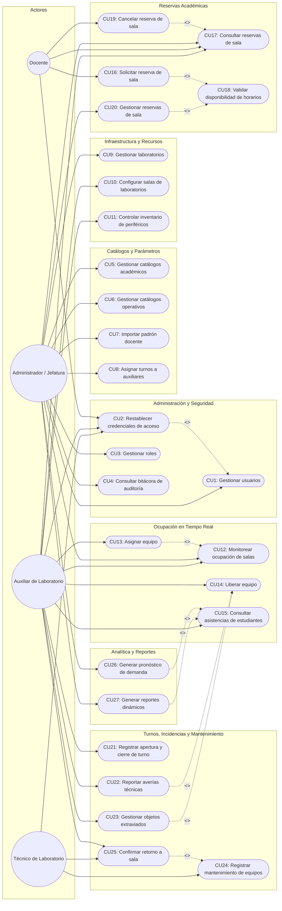
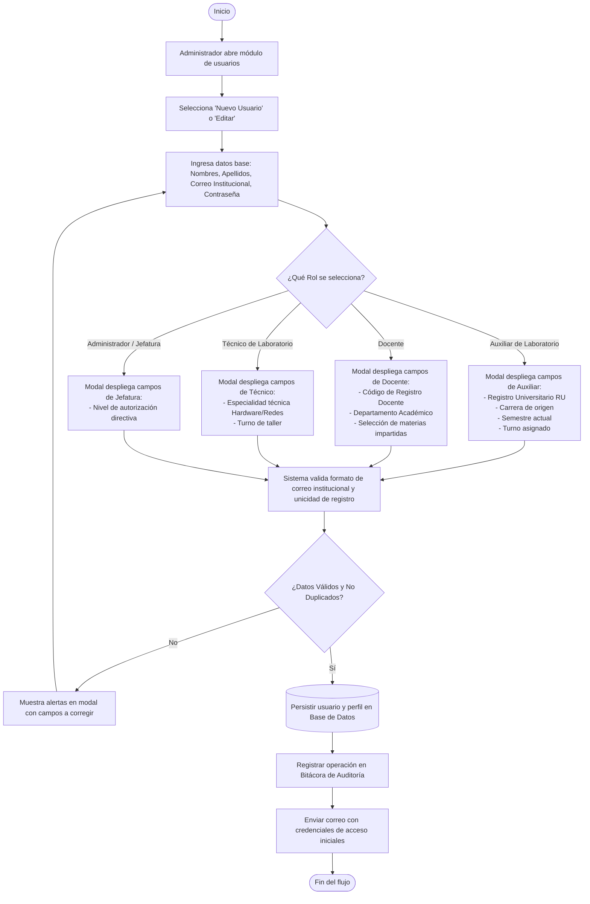

# Especificación Formal de Casos de Uso del Sistema - CITEF

## Sistema Web de Gestión y Monitoreo Inteligente para Laboratorios de Computación de la FCEE - UAGRM

---

### 1. Introducción y Metodología

En estricto cumplimiento del **Proceso Unificado de Desarrollo de Software (RUP)**, el estándar **UML 2.5** y las directrices metodológicas de Taller de Grado de la Facultad de Ciencias Económicas y Empresariales (**FCEE**), se presenta el catálogo formal y detallado de Casos de Uso para el Centro de Innovación Tecnológica Facultativa (**CITEF**).

Siguiendo las pautas metodológicas acordadas:
1. **Actores Exclusivamente Humanos:** De acuerdo a UML 2.5, el "Sistema" **NO es un actor**. Los únicos actores externos son:
   * **Administrador / Jefatura de Laboratorios (CITEF)**
   * **Docente**
   * **Auxiliar de Laboratorio**
   * **Técnico de Laboratorio**
2. **Nombres Directos y Concisión de Verbos (Estándar Formal):**
   * Cada Caso de Uso representa **un único objetivo elemental de un actor** (fórmula: *Verbo en Infinitivo + Objeto Directo*).
   * Se elimina la conjunción "y" entre verbos, evitando duplicidades conceptuales.
   * **`Gestionar`**: Empleado para administración global y ciclo de vida completo (CRUD) por parte del Administrador.
   * **`Asignar` / `Liberar` / `Solicitar` / `Consultar` / `Reportar` / `Registrar` / `Confirmar`**: Utilizados para acciones operativas delimitadas ejecutadas por Auxiliares, Docentes o Técnicos.
3. **Estructura Rigurosa de Relaciones `<<include>>` y `<<extend>>`:**
   * **Relaciones `<<include>>` (Inclusiones Obligatorias):** Modelan comportamientos comunes o consultas indispensables que forman parte ineludible del caso de uso base:
     * `CU13 (Asignar equipo)` $\xrightarrow{\ll include\gg}$ `CU12 (Monitorear ocupación de salas)`: Para asignar una máquina, el auxiliar interactúa y consulta el mapa interactivo de disponibilidad en tiempo real.
     * `CU16 (Solicitar reserva de sala)` $\xrightarrow{\ll include\gg}$ `CU18 (Validar disponibilidad de horarios)`: Validación algorítmica preventiva de solapamiento horario.
     * `CU20 (Gestionar reservas de sala)` $\xrightarrow{\ll include\gg}$ `CU18 (Validar disponibilidad de horarios)`: Revalidación algorítmica obligatoria al momento de la aprobación oficial.
     * `CU26 (Generar pronóstico de demanda)` $\xrightarrow{\ll include\gg}$ `CU15 (Consultar asistencias de estudiantes)`: El modelo predictivo de Machine Learning consume el dataset histórico de asistencias.
     * `CU27 (Generar reportes dinámicos)` $\xrightarrow{\ll include\gg}$ `CU15 (Consultar asistencias de estudiantes)`: Las estadísticas oficiales para Acreditación procesan el histórico de concurrencia estudiantil.
   * **Relaciones `<<extend>>` (Extensiones Condicionales con Puntos de Extensión):** Modelan flujos opcionales que se disparan ante eventos específicos del negocio:
     * `CU2 (Restablecer credenciales de acceso)` $\xrightarrow{\ll extend\gg}$ `CU1 (Gestionar usuarios)`: Punto de extensión *Olvido o reseteo de contraseña institucional*.
     * `CU19 (Cancelar reserva de sala)` $\xrightarrow{\ll extend\gg}$ `CU17 (Consultar reservas de sala)`: Punto de extensión *Desistimiento voluntario de horario por el docente*.
     * `CU22 (Reportar averías técnicas)` $\xrightarrow{\ll extend\gg}$ `CU14 (Liberar equipo)`: Punto de extensión *Avería detectada al desocupar la estación*.
     * `CU23 (Gestionar objetos extraviados)` $\xrightarrow{\ll extend\gg}$ `CU14 (Liberar equipo)`: Punto de extensión *Objeto olvidado en puesto al retirarse*.
     * `CU25 (Confirmar retorno a sala)` $\xrightarrow{\ll extend\gg}$ `CU24 (Registrar mantenimiento de equipos)`: Punto de extensión *Puesta en marcha física y reinstalación en laboratorio*.
4. **Tratamiento de la Auditoría:** El registro automático en bitácora de auditoría se formaliza de manera pulcra en las **Postcondiciones** de cada caso de uso transaccional, disponiendo la Jefatura del caso de uso independiente `CU4. Consultar bitácora de auditoría`.

---

### 2. Matriz General de los 27 Casos de Uso

| ID | Nombre del Caso de Uso | Paquete Arquitectural | Actor Principal | Relaciones UML Clave |
| :--- | :--- | :--- | :--- | :--- |
| **CU1** | Gestionar usuarios | Administración y Seguridad | Administrador | Punto de extensión para CU2 |
| **CU2** | Restablecer credenciales de acceso | Administración y Seguridad | Docente / Auxiliar / Técnico | `<<extend>>` hacia CU1 |
| **CU3** | Gestionar roles | Administración y Seguridad | Administrador | - |
| **CU4** | Consultar bitácora de auditoría | Administración y Seguridad | Administrador | - |
| **CU5** | Gestionar catálogos académicos | Catálogos y Parámetros | Administrador | - |
| **CU6** | Gestionar catálogos operativos | Catálogos y Parámetros | Administrador | - |
| **CU7** | Importar padrón docente | Catálogos y Parámetros | Administrador | - |
| **CU8** | Asignar turnos a auxiliares | Catálogos y Parámetros | Administrador | - |
| **CU9** | Gestionar laboratorios | Infraestructura y Recursos | Administrador | - |
| **CU10** | Configurar salas de laboratorios | Infraestructura y Recursos | Auxiliar / Administrador | - |
| **CU11** | Controlar inventario de periféricos | Infraestructura y Recursos | Auxiliar / Administrador | - |
| **CU12** | Monitorear ocupación de salas | Ocupación en Tiempo Real | Auxiliar / Administrador | *(Destino de `<<include>>` desde CU13)* |
| **CU13** | Asignar equipo | Ocupación en Tiempo Real | Auxiliar de Laboratorio | `<<include>>` hacia CU12 |
| **CU14** | Liberar equipo | Ocupación en Tiempo Real | Auxiliar de Laboratorio | Puntos de extensión para CU22 y CU23 |
| **CU15** | Consultar asistencias de estudiantes | Ocupación en Tiempo Real | Auxiliar / Administrador | *(Destino de `<<include>>` desde CU26 y CU27)* |
| **CU16** | Solicitar reserva de sala | Reservas Académicas | Docente | `<<include>>` hacia CU18 |
| **CU17** | Consultar reservas de sala | Reservas Académicas | Docente / Auxiliar / Admin | Punto de extensión para CU19 |
| **CU18** | Validar disponibilidad de horarios | Reservas Académicas | Docente / Administrador | *(Destino de `<<include>>` desde CU16 y CU20)* |
| **CU19** | Cancelar reserva de sala | Reservas Académicas | Docente / Administrador | `<<extend>>` hacia CU17 |
| **CU20** | Gestionar reservas de sala | Reservas Académicas | Administrador (Jefatura) | `<<include>>` hacia CU18 |
| **CU21** | Registrar apertura, cierre y relevo de turno | Turnos e Incidencias | Auxiliar de Laboratorio | - |
| **CU22** | Reportar averías técnicas | Turnos e Incidencias | Auxiliar de Laboratorio | `<<extend>>` hacia CU14 |
| **CU23** | Gestionar objetos extraviados | Turnos e Incidencias | Auxiliar de Laboratorio | `<<extend>>` hacia CU14 |
| **CU24** | Registrar mantenimiento de equipos | Soporte y Mantenimiento | Técnico de Laboratorio | Punto de extensión para CU25 |
| **CU25** | Confirmar retorno a sala | Soporte y Mantenimiento | Técnico / Auxiliar | `<<extend>>` hacia CU24 |
| **CU26** | Generar pronóstico de demanda y análisis de colas | Analítica Predictiva (ML) | Administrador (Jefatura) | `<<include>>` hacia CU15 |
| **CU27** | Generar reportes dinámicos y consultas analíticas | Reportes e Indicadores | Administrador (Jefatura) | `<<include>>` hacia CU15 |

---

### 3. Diagrama General de Relaciones de Casos de Uso (UML)

---

### 4. Diagrama de Actividad UML: CU1. Gestionar Usuarios (Modales Dinámicos por Rol)

---

### 5. Especificación Detallada de los 27 Casos de Uso (Formato RUP)

#### Paquete 1: Administración y Seguridad

##### CU1. Gestionar usuarios
* **Caso de Uso:** CU1. Gestionar usuarios
* **Propósito:** Administrar centralizadamente las cuentas de acceso y perfiles del personal institucional del CITEF.
* **Descripción:** El Administrador registra, edita, consulta y desactiva cuentas. La interfaz provee modales interactivos condicionales: al seleccionar el rol "Auxiliar" solicita matrícula y turno; al seleccionar "Docente" solicita departamento y asignaturas; al seleccionar "Técnico" especialidad de taller.
* **Actores:** Administrador / Jefatura CITEF
* **Actor Iniciador:** Administrador / Jefatura CITEF
* **Precondición:** Administrador autenticado con rol directivo.
* **Punto de Extensión:** *Olvido o reseteo de contraseña institucional:* extendido por **CU2. Restablecer credenciales de acceso**.
* **Proceso Principal:**
  1. El Administrador accede al módulo de usuarios y selecciona "Nuevo Usuario" o "Editar".
  2. Ingresa nombres, apellidos, correo institucional `@uagrm.edu.bo` y selecciona el rol institucional.
  3. El modal interactivo despliega los campos específicos del perfil correspondiente.
  4. El sistema valida unicidad de correo y de registro institucional.
  5. El Administrador confirma; el sistema almacena el registro y envía las credenciales iniciales al correo.
* **Postcondición:** Usuario registrado, perfil actualizado o cuenta desactivada. La operación queda registrada en la bitácora de auditoría.
* **Excepciones:** Correo institucional duplicado o formato inválido.

##### CU2. Restablecer credenciales de acceso
* **Caso de Uso:** CU2. Restablecer credenciales de acceso
* **Propósito:** Permitir a los usuarios registrados recuperar el acceso al sistema mediante autoservicio seguro por correo institucional.
* **Descripción:** Caso de uso que extiende a la gestión de usuarios cuando un actor no puede iniciar sesión. Solicita el correo institucional, valida su existencia, remite un token criptográfico temporal y permite ingresar una nueva clave cumpliendo políticas de seguridad.
* **Actores:** Docente, Auxiliar de Laboratorio, Técnico de Laboratorio, Administrador / Jefatura CITEF
* **Actor Iniciador:** Usuario solicitante
* **Precondición:** Correo institucional previamente dado de alta y activo.
* **Relaciones UML:** `<<extend>>` hacia **CU1. Gestionar usuarios** (Punto de extensión: *Olvido o reseteo de contraseña institucional*).
* **Proceso Principal:**
  1. En la pantalla de inicio de sesión, el usuario selecciona "¿Olvidó su contraseña?".
  2. Ingresa su correo `@uagrm.edu.bo`.
  3. El sistema valida la cuenta, emite un token con 15 minutos de vigencia y remite un enlace seguro.
  4. El usuario abre el enlace, ingresa y confirma su nueva contraseña.
  5. El sistema valida la complejidad, actualiza el hash de la clave e invalida el token.
* **Postcondición:** Contraseña actualizada y cuenta habilitada para inicio de sesión. La operación queda registrada en la bitácora de auditoría.
* **Excepciones:** Correo institucional no registrado o token expirado.

##### CU3. Gestionar roles
* **Caso de Uso:** CU3. Gestionar roles
* **Propósito:** Configurar la matriz de permisos por roles para controlar el acceso a los módulos del CITEF.
* **Descripción:** El Administrador consulta y ajusta los privilegios granulares asignados a cada rol del sistema (Jefatura, Auxiliar, Docente, Técnico) sobre los diferentes módulos del sistema.
* **Actores:** Administrador / Jefatura CITEF
* **Actor Iniciador:** Administrador / Jefatura CITEF
* **Precondición:** Administrador autenticado con privilegios de Super-Administrador.
* **Proceso Principal:**
  1. El Administrador accede a "Roles y Permisos".
  2. El sistema despliega la matriz de funciones por rol.
  3. El Administrador modifica los permisos asignados a un rol institucional.
  4. El sistema valida que los permisos mínimos del Administrador se conserven.
  5. Confirma los cambios y se aplican en las sesiones activas.
* **Postcondición:** Matriz de permisos actualizada. La operación queda registrada en la bitácora de auditoría.
* **Excepciones:** Intento de deshabilitar permisos administrativos esenciales.

##### CU4. Consultar bitácora de auditoría
* **Caso de Uso:** CU4. Consultar bitácora de auditoría
* **Propósito:** Proveer a la Jefatura un historial inalterable de las acciones operativas y de seguridad efectuadas en el sistema.
* **Descripción:** El Administrador consulta y filtra la bitácora de auditoría cronológica del CITEF (creaciones de cuentas, aprobaciones de reservas, asignaciones y liberaciones de equipos, reportes técnicos y cierres de turno) con fines de control interno y acreditación.
* **Actores:** Administrador / Jefatura CITEF
* **Actor Iniciador:** Administrador / Jefatura CITEF
* **Precondición:** Existencia de trazas de auditoría generadas automáticamente por el sistema.
* **Proceso Principal:**
  1. El Administrador accede al módulo de auditoría.
  2. Aplica filtros por fechas, usuario responsable, módulo o acción.
  3. El sistema despliega los eventos cronológicos con fecha, hora, usuario, IP y entidad afectada.
  4. El Administrador puede exportar los resultados a formato tabular.
* **Postcondición:** Trazas de auditoría consultadas.
* **Excepciones:** Sin registros para los filtros seleccionados.

---

#### Paquete 2: Catálogos y Parámetros Académicos

##### CU5. Gestionar catálogos académicos
* **Caso de Uso:** CU5. Gestionar catálogos académicos
* **Propósito:** Administrar las carreras de la FCEE, semestres lectivos y asignaturas para su disponibilidad en reservas y ocupación.
* **Descripción:** El Administrador crea, edita, consulta y desactiva carreras, códigos curriculares, semestres y materias impartidas en la facultad.
* **Actores:** Administrador / Jefatura CITEF
* **Actor Iniciador:** Administrador / Jefatura CITEF
* **Precondición:** Administrador autenticado.
* **Proceso Principal:**
  1. El Administrador accede a "Catálogos Académicos".
  2. Selecciona Carreras o Materias.
  3. Registra o edita código de materia, nombre, carrera y semestre.
  4. El sistema valida unicidad de código y guarda los datos.
* **Postcondición:** Catálogo académico actualizado. La operación queda registrada en la bitácora de auditoría.
* **Excepciones:** Código curricular duplicado.

##### CU6. Gestionar catálogos operativos
* **Caso de Uso:** CU6. Gestionar catálogos operativos
* **Propósito:** Parametrizar las franjas horarias de los turnos de atención y motivos de uso estudiantil en los laboratorios.
* **Descripción:** El Administrador configura las horas de inicio y fin de los turnos oficiales (Mañana, Tarde, Noche) y normaliza los motivos de uso permitidos (Prácticas, Exámenes, Libre navegación académica).
* **Actores:** Administrador / Jefatura CITEF
* **Actor Iniciador:** Administrador / Jefatura CITEF
* **Precondición:** Administrador autenticado.
* **Proceso Principal:**
  1. El Administrador accede a "Parámetros Operativos".
  2. Define o actualiza las horas de los turnos de atención y la lista de motivos de ocupación.
  3. El sistema valida coherencia en las franjas horarias.
  4. Confirma los cambios para los selectores de atención.
* **Postcondición:** Parámetros operativos actualizados. La operación queda registrada en la bitácora de auditoría.
* **Excepciones:** Solapamiento temporal erróneo entre turnos definidos.

##### CU7. Importar padrón docente
* **Caso de Uso:** CU7. Importar padrón docente
* **Propósito:** Automatizar la incorporación y actualización masiva de más de 300 docentes de la FCEE a partir de un archivo estructurado CSV o Excel.
* **Descripción:** El Administrador descarga la plantilla oficial, carga el archivo con el padrón docente y el sistema valida por lotes el formato, correos institucionales, registros docentes y vinculación con materias, generando un reporte de inconsistencias e importando masivamente los registros válidos.
* **Actores:** Administrador / Jefatura CITEF
* **Actor Iniciador:** Administrador / Jefatura CITEF
* **Precondición:** Administrador autenticado y archivo CSV/Excel preparado.
* **Proceso Principal:**
  1. El Administrador accede a "Importación de Padrón Docente".
  2. Carga el archivo estructurado.
  3. El sistema valida unicidad de registros docentes, formato de correos y existencia de materias.
  4. Muestra un resumen previo: cantidad de docentes a crear, actualizar y errores detectados.
  5. Confirma la importación; el sistema crea las cuentas de acceso iniciales y guarda el padrón docente.
* **Postcondición:** Padrón docente actualizado y habilitado. La operación queda registrada en la bitácora de auditoría.
* **Excepciones:** Formato de archivo incompatible o registros duplicados (se reportan filas omitidas).

##### CU8. Asignar turnos a auxiliares
* **Caso de Uso:** CU8. Asignar turnos a auxiliares
* **Propósito:** Programar y gestionar los turnos semanales de atención de los estudiantes becarios en los laboratorios del CITEF.
* **Descripción:** El Administrador asocia cada auxiliar de laboratorio con sus días y franjas horarias de servicio (Mañana, Tarde, Noche) para habilitar el control de apertura y cierre de turno.
* **Actores:** Administrador / Jefatura CITEF
* **Actor Iniciador:** Administrador / Jefatura CITEF
* **Precondición:** Cuentas de usuario de auxiliares dadas de alta previamente.
* **Proceso Principal:**
  1. El Administrador accede a "Turnos de Auxiliares".
  2. Selecciona al auxiliar y asigna los días de la semana y turnos de su beca.
  3. El sistema valida que no existan inconsistencias de horarios.
  4. Guarda la asignación semanal.
* **Postcondición:** Rol de turno del auxiliar programado y activo. La operación queda registrada en la bitácora de auditoría.
* **Excepciones:** Auxiliar con turno superpuesto en el mismo laboratorio.

---

#### Paquete 3: Infraestructura y Recursos

##### CU9. Gestionar laboratorios
* **Caso de Uso:** CU9. Gestionar laboratorios
* **Propósito:** Administrar las salas y laboratorios de cómputo del CITEF con su capacidad física y equipamiento audiovisual.
* **Descripción:** El Administrador da de alta, edita y consulta las salas de laboratorio, especificando código de sala, nombre, ubicación, cantidad de computadoras para estudiantes, existencia de máquina docente, proyector, aire acondicionado y estado operativo general.
* **Actores:** Administrador / Jefatura CITEF
* **Actor Iniciador:** Administrador / Jefatura CITEF
* **Precondición:** Administrador autenticado.
* **Proceso Principal:**
  1. El Administrador accede a "Infraestructura de Laboratorios".
  2. Selecciona "Nuevo Laboratorio" o selecciona una sala existente.
  3. Ingresa datos: código, capacidad de computadoras de alumnos, presencia de máquina docente y recursos audiovisuales.
  4. El sistema calcula la capacidad total de puestos.
  5. Guarda los datos en el sistema.
* **Postcondición:** Laboratorio registrado con su capacidad operativa delimitada. La operación queda registrada en la bitácora de auditoría.
* **Excepciones:** Código de sala duplicado.

##### CU10. Configurar salas de laboratorios
* **Caso de Uso:** CU10. Configurar salas de laboratorios
* **Propósito:** Diseñar la distribución física y cuadrícula topológica de las computadoras en cada sala de cómputo.
* **Descripción:** El Auxiliar o el Administrador diseñan o actualizan la disposición espacial de la sala mediante una cuadrícula visual de filas y columnas, ubicando cada computadora con su identificador (ej. PC-01, PC-Docente), tipo de máquina y parámetros de red.
* **Actores:** Auxiliar de Laboratorio, Administrador / Jefatura CITEF
* **Actor Iniciador:** Auxiliar de Laboratorio / Administrador
* **Precondición:** Sala de laboratorio registrada previamente.
* **Proceso Principal:**
  1. El usuario accede al editor topológico de la sala.
  2. Posiciona los equipos en la cuadrícula visual especificando identificador del puesto y tipo (Estudiante / Docente).
  3. Asigna opcionalmente IP/MAC referencial para soporte técnico.
  4. Guarda la configuración; el sistema actualiza el mapa interactivo en tiempo real.
* **Postcondición:** Distribución física de la sala actualizada y sincronizada en el monitoreo visual.
* **Excepciones:** Colisión espacial de dos equipos en la misma coordenada.

##### CU11. Controlar inventario de periféricos
* **Caso de Uso:** CU11. Controlar inventario de periféricos
* **Propósito:** Mantener el inventario operativo de los componentes de hardware asignados a cada computadora en sala.
* **Descripción:** El Auxiliar o la Jefatura registran y actualizan el estado físico (Bueno, Regular, Dañado, Faltante) y números de serie de los periféricos de cada equipo (monitor, CPU, teclado, mouse, estabilizador) para auditoría interna del laboratorio.
* **Actores:** Auxiliar de Laboratorio, Administrador / Jefatura CITEF
* **Actor Iniciador:** Auxiliar de Laboratorio / Administrador
* **Precondición:** Computadora registrada en la cuadrícula de la sala.
* **Proceso Principal:**
  1. El usuario selecciona un equipo en el mapa de la sala.
  2. Abre la pestaña "Componentes y Periféricos".
  3. Revisa y actualiza el estado físico de teclado, mouse, monitor y CPU.
  4. Si detecta un periférico dañado o faltante, actualiza su condición para justificar mantenimiento.
  5. Guarda los cambios.
* **Postcondición:** Inventario de periféricos del puesto actualizado.
* **Excepciones:** Componente vinculado simultáneamente a dos máquinas sin traslado.

---

#### Paquete 4: Ocupación en Tiempo Real

##### CU12. Monitorear ocupación de salas
* **Caso de Uso:** CU12. Monitorear ocupación de salas
* **Propósito:** Visualizar de forma gráfica e interactiva la disponibilidad y estado de las computadoras en tiempo real mediante WebSockets.
* **Descripción:** El Auxiliar y el Administrador observan un mapa dinámico de la sala con código de colores según el estado vigente de cada equipo: Verde (Disponible), Rojo (Ocupado), Amarillo (Reservado), Gris (En Mantenimiento) y Azul (Puesto docente activo), recibiendo actualizaciones instantáneas ante cualquier cambio.
* **Actores:** Auxiliar de Laboratorio, Administrador / Jefatura CITEF
* **Actor Iniciador:** Auxiliar de Laboratorio / Administrador
* **Precondición:** Sesión autenticada en el sistema.
* **Proceso Principal:**
  1. El usuario selecciona la sala a monitorear.
  2. El sistema se suscribe al canal de WebSockets de la sala y renderiza el mapa con los estados actuales.
  3. Al producirse asignaciones, liberaciones o averías, la interfaz se refresca automáticamente sin recargar la página.
* **Postcondición:** Mapa visual de ocupación desplegado y sincronizado síncronamente.
* **Excepciones:** Pérdida de conexión de red (el sistema muestra indicador de reconexión).

##### CU13. Asignar equipo
* **Caso de Uso:** CU13. Asignar equipo
* **Propósito:** Registrar el ingreso y asignación rápida u optimizada de una computadora por un estudiante en el laboratorio.
* **Descripción:** El Auxiliar interactúa con el mapa interactivo de sala (incluyendo de forma obligatoria la consulta y visualización de ocupación en tiempo real), seleccionando una computadora disponible o accionando la **sugerencia algorítmica de asignación** (que prioriza equipos con menor carga de horas de uso acumuladas para balancear el desgaste físico). Ingresa el registro universitario del alumno (autocompletando carrera), selecciona el motivo de uso y confirma la ocupación. Si la sala se encuentra colmada, el sistema calcula y despliega el **tiempo de espera estimado ($W_q$)** según el modelo de Teoría de Colas ($M/M/c$).
* **Actores:** Auxiliar de Laboratorio
* **Actor Iniciador:** Auxiliar de Laboratorio
* **Precondición:** Computadora seleccionada en estado "Disponible" (verde) o registro en cola de espera.
* **Relaciones UML:** `<<include>>` hacia **CU12. Monitorear ocupación de salas**.
* **Proceso Principal:**
  1. El Auxiliar consulta el mapa de la sala interactiva ejecutando `<<include>>` **CU12. Monitorear ocupación de salas**.
  2. Selecciona un equipo disponible (verde) o presiona "Asignación Sugerida" para que el algoritmo seleccione el puesto con menor desgaste acumulado.
  3. Ingresa el registro universitario del estudiante; el sistema autocompleta la carrera y valida que el alumno no tenga otra máquina activa en el CITEF.
  4. Selecciona el motivo de ocupación (práctica, navegación, etc.).
  5. Confirma la asignación; el sistema pasa el equipo a "Ocupado" (rojo), inicia el cronómetro y difunde el evento por WebSockets.
* **Flujo Alternativo (Alta Saturación / Cola de Espera):**
  * Si la sala no tiene cupos libres, el sistema evalúa la tasa de finalización ($\mu$) de las sesiones en curso y despliega el tiempo estimado de espera ($W_q$) para el siguiente cupo disponible.
* **Postcondición:** Asignación registrada, computadora ocupada en tiempo real y métricas de colas actualizadas. La operación queda registrada en la bitácora de auditoría.
* **Excepciones:** Estudiante con asignación activa concurrente en otro laboratorio.

##### CU14. Liberar equipo
* **Caso de Uso:** CU14. Liberar equipo
* **Propósito:** Registrar la desocupación de una computadora cuando el estudiante concluye su permanencia.
* **Descripción:** El Auxiliar selecciona una computadora ocupada, confirma la salida del estudiante, el sistema calcula los minutos efectivos de uso, archiva la sesión y restituye el equipo a estado "Disponible" en el mapa interactivo. En caso de detectar desperfectos u objetos olvidados al momento de desocupar, el caso de uso es extendido condicionalmente por el reporte de avería o la custodia de bienes.
* **Actores:** Auxiliar de Laboratorio
* **Actor Iniciador:** Auxiliar de Laboratorio
* **Precondición:** Computadora en estado "Ocupado" (rojo).
* **Puntos de Extensión:**
  * *Avería detectada al desocupar:* extendido por **CU22. Reportar averías técnicas**.
  * *Objeto olvidado en puesto:* extendido por **CU23. Gestionar objetos extraviados**.
* **Proceso Principal:**
  1. El Auxiliar hace clic en una computadora ocupada en el mapa interactivo.
  2. Verifica los datos de permanencia y confirma "Liberar Equipo".
  3. El sistema calcula la duración de permanencia en minutos y cierra la sesión histórica.
  4. Cambia el estado del equipo a "Disponible" (verde) y emite la actualización por WebSockets.
* **Postcondición:** Computadora desocupada y disponible; sesión historificada. La operación queda registrada en la bitácora de auditoría.
* **Excepciones:** Equipo liberado concurrentemente desde otra terminal.

##### CU15. Consultar asistencias de estudiantes
* **Caso de Uso:** CU15. Consultar asistencias de estudiantes
* **Propósito:** Consultar el historial de asistencias, permanencia y comportamiento de los estudiantes en los laboratorios.
* **Descripción:** Permite buscar a un estudiante por su registro universitario para revisar su fecha y hora de ingresos pasados, salas y computadoras ocupadas, tiempo acumulado de permanencia y antecedentes de incidencias. Es invocado como inclusión obligatoria por los módulos de analítica y reportes institucionales.
* **Actores:** Auxiliar de Laboratorio, Administrador / Jefatura CITEF
* **Actor Iniciador:** Auxiliar de Laboratorio / Administrador
* **Precondición:** Registro universitario ingresado o consulta general filtrada.
* **Proceso Principal:**
  1. El usuario introduce el número de registro en el buscador o aplica filtros por periodo.
  2. El sistema recupera la ficha del estudiante: asistencias pasadas, duración promedio e historial disciplinario.
  3. Despliega la información en pantalla para validación y control.
* **Postcondición:** Información histórica de asistencias consultada.
* **Excepciones:** Estudiante sin historial previo registrado en la plataforma.

---

#### Paquete 5: Reservas Académicas

##### CU16. Solicitar reserva de sala
* **Caso de Uso:** CU16. Solicitar reserva de sala
* **Propósito:** Registrar una solicitud formal de reserva de laboratorio por parte de un docente para clases prácticas o exámenes.
* **Descripción:** El Docente selecciona fecha, horario, laboratorio, materia, grupo y cantidad esperada de alumnos. El sistema incluye obligatoriamente la validación algorítmica de solapamiento de horarios y almacena la solicitud en estado "Pendiente".
* **Actores:** Docente
* **Actor Iniciador:** Docente
* **Precondición:** Docente activo y autenticado en la plataforma.
* **Relaciones UML:** `<<include>>` hacia **CU18. Validar disponibilidad de horarios**.
* **Proceso Principal:**
  1. El Docente accede al módulo de reservas y selecciona "Nueva Solicitud".
  2. Especifica la sala requerida, fecha, horario de inicio y fin, materia, grupo y cantidad de alumnos.
  3. El sistema ejecuta `<<include>>` **CU18. Validar disponibilidad de horarios** para verificar que no existan colisiones con reservas aprobadas.
  4. El sistema registra la solicitud en estado "Pendiente" y la envía a la bandeja de evaluación de la Jefatura.
* **Postcondición:** Solicitud de reserva registrada en estado pendiente. La operación queda registrada en la bitácora de auditoría.
* **Excepciones:** Detección de colisión horaria (bloqueo de solicitud); capacidad de la sala inferior al número de estudiantes.

##### CU17. Consultar reservas de sala
* **Caso de Uso:** CU17. Consultar reservas de sala
* **Propósito:** Visualizar el calendario y estado de las reservas programadas y solicitadas en los laboratorios del CITEF.
* **Descripción:** Los Docentes, Auxiliares y la Jefatura consultan la grilla semanal y mensual de reservas por sala, verificando qué franjas están ocupadas y cuáles disponibles. Para los docentes o jefatura, provee el punto de extensión para cancelar reservas vigentes.
* **Actores:** Docente, Auxiliar de Laboratorio, Administrador / Jefatura CITEF
* **Actor Iniciador:** Docente / Auxiliar / Administrador
* **Precondición:** Reservas registradas en la base de datos.
* **Punto de Extensión:** *Desistimiento voluntario de horario por el docente:* extendido por **CU19. Cancelar reserva de sala**.
* **Proceso Principal:**
  1. El usuario accede al calendario interactivo de reservas.
  2. Selecciona la sala y la semana académica a consultar.
  3. El sistema despliega los bloques ocupados indicando materia, docente y horario.
* **Postcondición:** Calendario de reservas visualizado en pantalla.
* **Excepciones:** Sin reservas programadas para la semana seleccionada.

##### CU18. Validar disponibilidad de horarios
* **Caso de Uso:** CU18. Validar disponibilidad de horarios
* **Propósito:** Verificar algorítmicamente que no existan colisiones ni solapamientos temporales para una sala y franja horaria determinadas.
* **Descripción:** Caso de uso incluido que ejecuta el control de intersección sobre los intervalos de tiempo `[inicio, fin]` de las reservas aprobadas en la sala solicitada, impidiendo estrictamente solapamientos.
* **Actores:** Docente, Administrador / Jefatura CITEF
* **Actor Iniciador:** Invocado por inclusión desde CU16 (Solicitar reserva) o CU20 (Gestionar reservas).
* **Precondición:** Sala, fecha y horario especificados.
* **Proceso Principal:**
  1. El backend recibe la sala, fecha y rango horario propuesto.
  2. Consulta si existe alguna reserva aprobada que intersecte el intervalo temporal.
  3. Si no existe conflicto, retorna validación exitosa.
  4. Si existe conflicto, retorna alerta de colisión con los horarios ocupados.
* **Postcondición:** Resultado de la validación temporal retornado a la operación invocadora.
* **Excepciones:** Conflicto de horario detectado.

##### CU19. Cancelar reserva de sala
* **Caso de Uso:** CU19. Cancelar reserva de sala
* **Propósito:** Permitir al docente o al Administrador desistir o anular una reserva de laboratorio previamente programada, liberando inmediatamente la franja horaria.
* **Descripción:** Caso de uso que extiende a la consulta de reservas. Cuando un docente verifica que no podrá impartir su clase práctica en la sala reservada, selecciona su reserva y confirma la cancelación justificando el motivo, restituyendo la disponibilidad del aula en el calendario institucional.
* **Actores:** Docente, Administrador / Jefatura CITEF
* **Actor Iniciador:** Docente (para sus reservas) / Administrador (para cualquier reserva)
* **Precondición:** Reserva en estado pendiente o aprobada perteneciente al docente solicitante.
* **Relaciones UML:** `<<extend>>` hacia **CU17. Consultar reservas de sala** (Punto de extensión: *Desistimiento voluntario de horario por el docente*).
* **Proceso Principal:**
  1. El docente visualiza sus reservas en el calendario mediante CU17.
  2. Selecciona la reserva programada y hace clic en "Cancelar Reserva".
  3. Ingresa la justificación de la cancelación.
  4. El sistema actualiza el estado a "Cancelada", libera el bloque horario en el calendario institucional y notifica a los auxiliares de turno.
* **Postcondición:** Reserva cancelada y horario liberado para otros docentes. La operación queda registrada en la bitácora de auditoría.
* **Excepciones:** Intento de cancelación de una reserva ajena sin privilegios administrativos.

##### CU20. Gestionar reservas de sala
* **Caso de Uso:** CU20. Gestionar reservas de sala
* **Propósito:** Evaluar, aprobar, rechazar o reprogramar las solicitudes de reservas de laboratorios formuladas por los docentes.
* **Descripción:** La Jefatura revisa las solicitudes pendientes en su bandeja de gestión. Incluye obligatoriamente la validación de disponibilidad de horarios para confirmar la aprobación formal de la reserva (bloqueando el espacio en el calendario oficial) o registra el rechazo motivado.
* **Actores:** Administrador / Jefatura CITEF
* **Actor Iniciador:** Administrador / Jefatura CITEF
* **Precondición:** Solicitudes de reserva en estado "Pendiente".
* **Relaciones UML:** `<<include>>` hacia **CU18. Validar disponibilidad de horarios**.
* **Proceso Principal:**
  1. La Jefatura accede a la bandeja de gestión de reservas.
  2. Selecciona una solicitud pendiente y revisa los datos de materia, docente y capacidad requerida.
  3. El sistema ejecuta `<<include>>` **CU18. Validar disponibilidad de horarios** para revalidar que la franja horaria continúe libre.
  4. La Jefatura selecciona "Aprobar" o "Rechazar" (ingresando justificación obligatoria).
  5. El sistema actualiza el estado a "Aprobada" o "Rechazada" y refleja el cambio en el calendario oficial de laboratorios.
* **Postcondición:** Reserva evaluada y estado reflejado en el calendario oficial. La operación queda registrada en la bitácora de auditoría.
* **Excepciones:** Colisión horaria sobrevenida.

---

#### Paquete 6: Turnos e Incidencias

##### CU21. Registrar apertura, cierre y relevo de turno
* **Caso de Uso:** CU21. Registrar apertura, cierre y relevo de turno
* **Propósito:** Controlar formalmente la apertura del laboratorio mediante checklist, generar el acta consolidada de cierre y efectuar el traspaso formal de guardia (Handover) entre auxiliares.
* **Descripción:** Al iniciar su jornada, el Auxiliar completa un checklist digital rápido de verificación de sala y revisa novedades pendientes del turno previo. Al concluir su horario, el sistema consolida automáticamente las asignaciones atendidas, horas de uso y novedades; el auxiliar registra observaciones de sala y emite el acta de traspaso formal (Handover), que el siguiente auxiliar debe aceptar digitalmente al asumir la guardia, eliminando la evasión de responsabilidades.
* **Actores:** Auxiliar de Laboratorio
* **Actor Iniciador:** Auxiliar de Laboratorio
* **Precondición:** Auxiliar autenticado con turno asignado en el cronograma semanal del CITEF.
* **Proceso Principal:**
  1. **Apertura de turno:** Al iniciar la jornada, el Auxiliar completa el checklist de verificación de sala (orden físico, red, periféricos básicos) y confirma la apertura de turno.
  2. Si el turno saliente dejó incidencias abiertas, el sistema despliega el acta de Handover para su aceptación digital.
  3. **Cierre de turno:** Al terminar su horario, hace clic en "Cerrar Turno".
  4. El sistema compila el resumen de la jornada: cantidad de estudiantes atendidos, equipos con fallas activas y objetos bajo custodia.
  5. El Auxiliar ingresa observaciones y confirma la emisión del acta de relevo.
  6. El sistema archiva el acta de turno en el histórico operativo con sello de auditoría.
* **Postcondición:** Turno cerrado y acta de relevo auditada archivada. La operación queda registrada en la bitácora de auditoría.
* **Excepciones:** Equipos marcados aún como ocupados al intentar cerrar el turno (requiere justificación o cierre forzado por fin de turno).

##### CU22. Reportar averías técnicas
* **Caso de Uso:** CU22. Reportar averías técnicas
* **Propósito:** Registrar un desperfecto físico o lógico en una computadora vinculando contextualmente al último responsable del aula o equipo.
* **Descripción:** El Auxiliar reporta una falla técnica en una computadora o periférico. El sistema asocia automáticamente al último estudiante que utilizó el equipo (si fue uso libre) o a la materia y docente titular (si ocurrió tras una clase curricular). Pone la máquina en estado "En Mantenimiento" y genera la orden para el taller de soporte técnico. Extiende condicionalmente al caso de uso de liberación de equipos si el desperfecto se identifica al desocupar la máquina.
* **Actores:** Auxiliar de Laboratorio
* **Actor Iniciador:** Auxiliar de Laboratorio
* **Relaciones UML:** `<<extend>>` hacia **CU14. Liberar equipo** (Punto de extensión: *Avería detectada al desocupar*).
* **Proceso Principal:**
  1. El Auxiliar selecciona la computadora dañada (desde el mapa o al finalizar una liberación mediante CU14).
  2. Especifica el tipo de avería (hardware, periférico, software, conectividad) y redacta la descripción.
  3. El sistema identifica contextualmente al responsable: vincula los datos del último estudiante asignado o la clase docente reciente.
  4. Cambia el estado de la máquina a "En Mantenimiento" (gris) y genera la orden en la cola técnica del taller.
  5. Sincroniza el cambio en el mapa mediante WebSockets.
* **Postcondición:** Máquina inhabilitada con orden técnica generada y responsable vinculado. La operación queda registrada en la bitácora de auditoría.
* **Excepciones:** Computadora con orden de avería técnica ya registrada y pendiente.

##### CU23. Gestionar objetos extraviados
* **Caso de Uso:** CU23. Gestionar objetos extraviados
* **Propósito:** Registrar pertenencias olvidadas en salas bajo estado de custodia y controlar su posterior restitución al estudiante acreditado.
* **Descripción:** El Auxiliar registra el hallazgo de un objeto en el aula (descripción, categoría, sala, fecha), manteniéndolo "Bajo Custodia". Cuando el estudiante se presenta a reclamarlo, el auxiliar verifica su identidad mediante registro universitario o carnet y registra la devolución pasando el estado a "Devuelto". Extiende condicionalmente al caso de uso de liberación de equipos si el objeto es hallado al retirar al estudiante.
* **Actores:** Auxiliar de Laboratorio
* **Actor Iniciador:** Auxiliar de Laboratorio
* **Relaciones UML:** `<<extend>>` hacia **CU14. Liberar equipo** (Punto de extensión: *Objeto olvidado en puesto*).
* **Proceso Principal:**
  1. **Registro de hallazgo:** El Auxiliar ingresa descripción y categoría del objeto encontrado; el sistema lo registra como "Bajo Custodia".
  2. **Entrega del objeto:** Al presentarse el estudiante, el Auxiliar busca la ficha del objeto.
  3. Ingresa el registro universitario o cédula del alumno receptor.
  4. Confirma la devolución; el sistema actualiza el estado a "Devuelto" archivando fecha, hora y auxiliar que realizó la entrega.
* **Postcondición:** Objeto registrado bajo custodia o devuelto con constancia de entrega. La operación queda registrada en la bitácora de auditoría.
* **Excepciones:** Entrega sin identificación del estudiante receptor.

---

#### Paquete 7: Soporte y Mantenimiento Técnico

##### CU24. Registrar mantenimiento de equipos
* **Caso de Uso:** CU24. Registrar mantenimiento de equipos
* **Propósito:** Controlar los diagnósticos e intervenciones técnicas de hardware y software efectuadas en las computadoras averiadas del CITEF, computando los tiempos de parada técnica.
* **Descripción:** El Técnico de Laboratorio consulta su bandeja de equipos con orden de soporte técnico, toma una máquina, registra el diagnóstico, las piezas o componentes sustituidos y las acciones ejecutadas (formateo, cambio de cables, reemplazo de periféricos), actualizando el estado de la orden técnica a "En Reparación" y "Reparado en Taller". El sistema registra los tiempos de inicio y fin para alimentar las métricas de confiabilidad **MTTR** (*Mean Time To Repair*).
* **Actores:** Técnico de Laboratorio
* **Actor Iniciador:** Técnico de Laboratorio
* **Precondición:** Órdenes técnicas de avería en estado pendiente.
* **Punto de Extensión:** *Puesta en marcha física y reinstalación en laboratorio:* extendido por **CU25. Confirmar retorno a sala**.
* **Proceso Principal:**
  1. El Técnico accede a su bandeja de soporte técnico y selecciona una orden pendiente.
  2. Inicia los trabajos marcando la orden como "En Reparación" e ingresando el diagnóstico inicial.
  3. Ejecuta las reparaciones correspondientes y registra el detalle técnico de repuestos o piezas cambiadas.
  4. Al finalizar la intervención técnica, marca la orden como "Reparado en Taller" registrando la hora de conclusión de taller.
  5. Guarda los registros técnicos en el sistema.
* **Postcondición:** Diagnóstico y acciones de mantenimiento registradas en el histórico de la máquina; tiempo de intervención computado para MTTR. La operación queda registrada en la bitácora de auditoría.
* **Excepciones:** Equipo declarado como baja técnica irreparable (se da de baja del inventario operativo).

##### CU25. Confirmar retorno a sala
* **Caso de Uso:** CU25. Confirmar retorno a sala
* **Propósito:** Validar la reinstalación física y operativa de una computadora en el laboratorio, restituyendo su disponibilidad y actualizando los factores de confiabilidad y disponibilidad operativa ($A$).
* **Descripción:** Caso de uso que extiende al mantenimiento de equipos. Una vez que el equipo técnico ha sido reparado en taller y devuelto a su ubicación física en la sala de cómputo, el técnico o auxiliar confirma la puesta en marcha, lo que cierra formalmente la orden técnica, cambia el estado del equipo a "Disponible" (verde), emite la actualización en tiempo real por WebSockets y recalcula el indicador de **Disponibilidad Operativa ($A = \frac{MTBF}{MTBF + MTTR}$)** del parque informático.
* **Actores:** Técnico de Laboratorio, Auxiliar de Laboratorio
* **Actor Iniciador:** Técnico de Laboratorio / Auxiliar
* **Precondición:** Computadora con orden técnica en estado "Reparado en Taller".
* **Relaciones UML:** `<<extend>>` hacia **CU24. Registrar mantenimiento de equipos** (Punto de extensión: *Puesta en marcha física y reinstalación en laboratorio*).
* **Proceso Principal:**
  1. El usuario reinstala y conecta físicamente el equipo en su posición de la sala.
  2. En el módulo de soporte o mapa de sala, selecciona la opción "Confirmar Retorno a Sala".
  3. Verifica el correcto encendido y funcionamiento de periféricos y red.
  4. Confirma la puesta en marcha; el sistema cierra la orden técnica, devuelve el equipo a estado "Disponible" (verde), recalcula la disponibilidad del laboratorio y emite el evento en tiempo real por WebSockets.
* **Postcondición:** Equipo operativo en sala, visible como disponible para asignación y métricas de confiabilidad consolidadas. La operación queda registrada en la bitácora de auditoría.
* **Excepciones:** Equipo devuelto con persistencia de fallas técnicas (se reabre la orden de mantenimiento).

---

#### Paquete 8: Analítica Predictiva con Machine Learning y Teoría de Colas

##### CU26. Generar pronóstico de demanda y análisis de colas
* **Caso de Uso:** CU26. Generar pronóstico de demanda y análisis de colas
* **Propósito:** Proyectar la afluencia de estudiantes, evaluar el factor de saturación ($\rho$) y estimar tiempos de espera mediante Machine Learning (`RandomForestRegressor`) y **Teoría de Colas ($M/M/c$)**.
* **Descripción:** La Jefatura consulta predicciones de ocupación por sala, turno y fecha académica futura. El sistema incluye obligatoriamente la consulta de asistencias históricas como insumo de inferencia, invoca al microservicio FastAPI (Scikit-learn) y despliega curvas de demanda proyectada, tasas de arribo ($\lambda$), tasa de servicio ($\mu$), factor de utilización ($\rho$) y alertas preventivas de saturación crítica ($\rho > 0.85$).
* **Actores:** Administrador / Jefatura CITEF
* **Actor Iniciador:** Administrador / Jefatura CITEF
* **Precondición:** Modelo predictivo entrenado disponible en el microservicio FastAPI.
* **Relaciones UML:** `<<include>>` hacia **CU15. Consultar asistencias de estudiantes**.
* **Proceso Principal:**
  1. La Jefatura accede al panel de analítica predictiva.
  2. Selecciona el laboratorio y la semana lectiva o periodo a evaluar.
  3. El sistema ejecuta `<<include>>` **CU15. Consultar asistencias de estudiantes** para recopilar las variables históricas de concurrencia.
  4. Invoca al microservicio FastAPI enviando las variables de inferencia.
  5. El microservicio procesa el modelo `RandomForestRegressor`, resuelve las ecuaciones de colas $M/M/c$ y retorna proyecciones y métricas de saturación.
  6. La interfaz despliega las curvas de demanda, el factor de utilización ($\rho$) y el tiempo medio de espera proyectado ($W_q$).
* **Postcondición:** Pronóstico de saturación y modelado de colas generado y visualizado en el tablero de decisiones.
* **Excepciones:** Microservicio predictivo temporalmente fuera de línea (se despliegan promedios ponderados recientes como contingencia).

---

#### Paquete 9: Reportes e Indicadores para Acreditación Académica y Asistente Analítico

##### CU27. Generar reportes dinámicos y consultas analíticas
* **Caso de Uso:** CU27. Generar reportes dinámicos y consultas analíticas
* **Propósito:** Producir estadísticas y reportes consolidados oficiales para Acreditación y permitir consultas analíticas en lenguaje natural mediante un Asistente Text-to-SQL seguro.
* **Descripción:** La Jefatura genera reportes a la medida filtrando por fechas, laboratorios, carreras, turnos y docentes, o interactúa con el **Asistente Analítico Inteligente** ingresando preguntas en lenguaje natural que el sistema resuelve sobre una réplica de solo lectura mediante Tool Calling tipado. Incluye obligatoriamente la consulta de asistencias históricas para consolidar métricas, presentando cuadros tabulares con gráficos y permitiendo la exportación a formatos oficiales PDF y Excel.
* **Actores:** Administrador / Jefatura CITEF
* **Actor Iniciador:** Administrador / Jefatura CITEF
* **Precondición:** Registros operacionales acumulados en el sistema.
* **Relaciones UML:** `<<include>>` hacia **CU15. Consultar asistencias de estudiantes**.
* **Proceso Principal:**
  1. La Jefatura ingresa al módulo de "Reportes y Acreditación".
  2. Puede optar por los filtros dinámicos (periodo, sala, carrera) o redactar una pregunta analítica en el Asistente en Lenguaje Natural.
  3. El sistema ejecuta `<<include>>` **CU15. Consultar asistencias de estudiantes** para procesar y totalizar las métricas correspondientes.
  4. Despliega la vista interactiva con gráficos, indicadores de uso y disponibilidad ($A$, MTBF, MTTR).
  5. La Jefatura selecciona exportar a PDF o Excel; el sistema compila y descarga el documento oficial estructurado.
* **Postcondición:** Reporte oficial generado y exportado. La operación queda registrada en la bitácora de auditoría.
* **Excepciones:** No existen registros coincidentes con los filtros seleccionados o consulta en lenguaje natural ambigua.
* **Excepciones:** Ausencia de registros para los filtros seleccionados.
