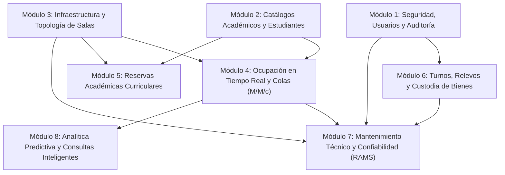

# Diseño Lógico de la Base de Datos Relacional (PostgreSQL) - CITEF
**Proyecto:** Sistema Web de Gestión y Monitoreo Inteligente para Laboratorios de Computación del CITEF  
**Institución:** Facultad de Ciencias Económicas y Empresariales (FCEE) – UAGRM  
**Materia:** Taller de Grado I / Modalidad de Graduación  
**Autores:** Nataly Vanessa Martinez Martinez & Jael Mamani Sandoval  
**SGBD Destino:** PostgreSQL 15+ / Enterprise Architect (Diseño Lógico y Conceptual de Datos)

---

## 1. Guía de Interpretación para Modelado en Enterprise Architect

Este documento contiene la especificación completa del **Diseño Lógico de Datos** organizado en **8 Módulos Funcionales**, adaptado con nombres directos, abreviaciones normalizadas (`descrip`, `cant`, `obs`) y claves naturales de negocio (`registro` en Estudiante y `codigo` en Docente):
1. **Nombre de la Clase/Tabla:** Nomenclatura normalizada en snake_case (y CamelCase para clases UML).
2. **Propósito Funcional:** Rol dentro de las reglas de negocio del CITEF y los 27 Casos de Uso PUDS.
3. **Diccionario de Atributos:** Nombre del atributo abreviado, tipo de dato nativo de PostgreSQL, restricción de nulidad (`NOT NULL` / `NULL`), llaves (`PK`, `FK`, `UK`) y descripción semántica.
4. **Relaciones Lógicas y Cardinalidades:** Nombre del vínculo (verbo en presente/infinitivo), clase origen, clase destino, cardinalidad mínima/máxima en ambos extremos (`1..1`, `0..1`, `1..*`, `0..*`) y regla de integridad referencial.

---

## 2. Mapa Arquitectónico de Módulos de Datos

---

## 2.1. Principio de Centralidad del Administrador y Trazabilidad Transaccional Total (Requisito Crítico de Defensa II)

De acuerdo con las observaciones metodológicas de evaluación docente (véase patrón arquitectónico de referencia en `image copy 4.png`), **el Administrador / Usuario institucional se sitúa en el centro neurálgico del modelo relacional**:
1. **Omnipresencia de Autoridad y Gestión:** En el CITEF no existe ninguna entidad operativa o registro maestro que escape al alcance del `ADMINISTRADOR`. El administrador crea, configura, autoriza, audita y supervisa todas las dimensiones del ecosistema.
2. **Trazabilidad Forense por Llaves Foráneas de Auditoría:** Para que todo evento en el sistema evidencie autoría explícita (`created_by`, `modified_by`, `approved_by`), las tablas de infraestructura, catálogos, sesiones, reservas, soporte y reportes contienen llaves foráneas directas hacia `usuario(id_usuario)`.

```mermaid
classDiagram
    direction TB
    class Usuario {
        <<PK>> id_usuario: BIGINT
        correo_institucional: VARCHAR(120)
        password_hash: VARCHAR(255)
        nombres: VARCHAR(80)
        apellidos: VARCHAR(80)
        activo: BOOLEAN
        creado_en: TIMESTAMP
        actualizado_en: TIMESTAMP
    }
    
    class BitacoraAuditoria {
        <<PK>> id_auditoria: BIGINT
        <<FK>> id_usuario: BIGINT
        accion: VARCHAR(50)
        tabla_afectada: VARCHAR(60)
        valores_anteriores: JSONB
        valores_nuevos: JSONB
    }
    
    class LaboratorioSala {
        <<PK>> id_sala: INT
        <<FK>> id_usuario_administrador: BIGINT
        codigo_sala: VARCHAR(20)
        cant_estudiantes: SMALLINT
    }
    
    class Computadora {
        <<PK>> id_computadora: BIGINT
        <<FK>> id_usuario_administrador: BIGINT
        codigo_equipo: VARCHAR(30)
        estado_actual: VARCHAR(25)
    }
    
    class ReservaSala {
        <<PK>> id_reserva: INT
        <<FK>> id_usuario_administrador: BIGINT
        <<FK>> codigo_docente: VARCHAR(30)
        tipo_reserva: VARCHAR(20)
        estado: VARCHAR(20)
    }
    
    class AsignacionSesion {
        <<PK>> id_sesion: BIGINT
        <<FK>> id_usuario_auxiliar: BIGINT
        <<FK>> registro_estudiante: VARCHAR(20)
        hora_inicio: TIMESTAMP
    }
    
    class AsignarTurno {
        <<PK>> id_asignacion_turno: INT
        <<FK>> id_usuario_administrador: BIGINT
        <<FK>> id_usuario_auxiliar: BIGINT
    }
    
    class OrdenAveria {
        <<PK>> id_averia: INT
        <<FK>> id_usuario_reportante: BIGINT
        descrip_falla: TEXT
    }
    
    class MantenimientoTaller {
        <<PK>> id_mantenimiento: INT
        <<FK>> id_usuario_tecnico: BIGINT
        <<FK>> id_usuario_autorizador: BIGINT
    }
    
    class DocumentoReporteExportado {
        <<PK>> id_reporte: BIGINT
        <<FK>> id_usuario: BIGINT
        tipo_reporte: VARCHAR(60)
        formato: VARCHAR(10)
        fecha_generacion: TIMESTAMP
    }
    
    class EjecucionModeloML {
        <<PK>> id_ejecucion_ml: BIGINT
        <<FK>> id_usuario: BIGINT
        algoritmo: VARCHAR(80)
        fecha_ejecucion: TIMESTAMP
    }

    Usuario "1" --> "0..*" BitacoraAuditoria : registra_auditoria
    Usuario "1" --> "0..*" LaboratorioSala : configura_sala
    Usuario "1" --> "0..*" Computadora : inventaria_equipo
    Usuario "1" --> "0..*" ReservaSala : autoriza_dictamina
    Usuario "1" --> "0..*" AsignacionSesion : asigna_sesion
    Usuario "1" --> "0..*" AsignarTurno : programa_guardia
    Usuario "1" --> "0..*" OrdenAveria : reporta_incidencia
    Usuario "1" --> "0..*" MantenimientoTaller : repara_autoriza
    Usuario "1" --> "0..*" DocumentoReporteExportado : genera_exporta
    Usuario "1" --> "0..*" EjecucionModeloML : entrena_ejecuta
```

---

## 3. Especificación Detallada por Módulos

### MÓDULO 1: Seguridad, Usuarios y Auditoría

Gestiona las identidades institucionales, autenticación mediante tokens criptográficos, Control de Acceso Basado en Roles (RBAC) y la trazabilidad inalterable de auditoría para Decanatura.

---

#### 1.1. Tabla / Clase: `usuario` (`Usuario`)
* **Propósito:** Almacena las cuentas de acceso de todos los operadores del sistema (Jefatura, Auxiliares de Laboratorio, Docentes y Técnicos de Soporte).
* **Diccionario de Atributos:**

| Atributo | Tipo de Dato (PostgreSQL) | Nulidad | Llave | Descripción |
| :--- | :--- | :--- | :--- | :--- |
| `id_usuario` | `BIGSERIAL` | NOT NULL | **PK** | Identificador unívoco autoincremental de la cuenta de usuario. |
| `correo_institucional` | `VARCHAR(120)` | NOT NULL | **UK** | Correo electrónico oficial `@uagrm.edu.bo` para inicio de sesión. |
| `password_hash` | `VARCHAR(255)` | NOT NULL | - | Hash criptográfico de la contraseña (bcrypt / Argon2). |
| `nombres` | `VARCHAR(80)` | NOT NULL | - | Nombres de pila del titular de la cuenta. |
| `apellidos` | `VARCHAR(80)` | NOT NULL | - | Apellidos paterno y materno del titular. |
| `telefono` | `VARCHAR(20)` | NULL | - | Teléfono celular institucional o personal para notificaciones. |
| `activo` | `BOOLEAN` | NOT NULL | - | Bandera de estado lógico de la cuenta (`TRUE` = Activo, `FALSE` = Inactivo). Default `TRUE`. |
| `creado_en` | `TIMESTAMP WITH TIME ZONE` | NOT NULL | - | Marca temporal de alta del usuario en el sistema. Default `NOW()`. |
| `actualizado_en` | `TIMESTAMP WITH TIME ZONE` | NOT NULL | - | Marca temporal de la última actualización de perfil. Default `NOW()`. |

---

#### 1.2. Tabla / Clase: `rol` (`Rol`)
* **Propósito:** Catálogo formal de roles institucionales admitidos en el CITEF (`ADMINISTRADOR`, `DOCENTE`, `AUXILIAR`, `TECNICO`).
* **Diccionario de Atributos:**

| Atributo | Tipo de Dato (PostgreSQL) | Nulidad | Llave | Descripción |
| :--- | :--- | :--- | :--- | :--- |
| `id_rol` | `SERIAL` | NOT NULL | **PK** | Identificador unívoco del rol institucional. |
| `nombre` | `VARCHAR(40)` | NOT NULL | **UK** | Nombre único del rol (ej. `ADMINISTRADOR`, `AUXILIAR`). |
| `descrip` | `VARCHAR(255)` | NOT NULL | - | Explicación funcional de los privilegios del rol. |
| `activo` | `BOOLEAN` | NOT NULL | - | Vigencia operativa del rol. Default `TRUE`. |

---

#### 1.3. Tabla / Clase: `permiso` (`Permiso`)
* **Propósito:** Privilegios atómicos y específicos sobre módulos y operaciones del sistema (ej. `ASIGNAR_EQUIPO`, `APROBAR_RESERVA`).
* **Diccionario de Atributos:**

| Atributo | Tipo de Dato (PostgreSQL) | Nulidad | Llave | Descripción |
| :--- | :--- | :--- | :--- | :--- |
| `id_permiso` | `SERIAL` | NOT NULL | **PK** | Identificador primario del permiso elemental. |
| `codigo` | `VARCHAR(50)` | NOT NULL | **UK** | Clave nemotécnica en mayúsculas (ej. `SALAS_CREAR`). |
| `modulo` | `VARCHAR(50)` | NOT NULL | - | Nombre del subsistema al que pertenece el permiso. |
| `descrip` | `VARCHAR(255)` | NOT NULL | - | Descripción detallada de la acción permitida. |

---

#### 1.4. Tabla / Clase: `usuario_rol` (`UsuarioRol`)
* **Propósito:** Tabla asociativa para resolver la relación de muchos a muchos entre usuarios y sus roles asignados.
* **Diccionario de Atributos:**

| Atributo | Tipo de Dato (PostgreSQL) | Nulidad | Llave | Descripción |
| :--- | :--- | :--- | :--- | :--- |
| `id_usuario_rol` | `BIGSERIAL` | NOT NULL | **PK** | Identificador primario de la asociación. |
| `id_usuario` | `BIGINT` | NOT NULL | **FK** | Referencia a la tabla `usuario(id_usuario)`. |
| `id_rol` | `INTEGER` | NOT NULL | **FK** | Referencia a la tabla `rol(id_rol)`. |
| `asignado_en` | `TIMESTAMP WITH TIME ZONE` | NOT NULL | - | Fecha y hora en que se confirió el rol. Default `NOW()`. |

---

#### 1.5. Tabla / Clase: `rol_permiso` (`RolPermiso`)
* **Propósito:** Tabla asociativa que mapea los permisos autorizados para cada rol del sistema.
* **Diccionario de Atributos:**

| Atributo | Tipo de Dato (PostgreSQL) | Nulidad | Llave | Descripción |
| :--- | :--- | :--- | :--- | :--- |
| `id_rol_permiso` | `SERIAL` | NOT NULL | **PK** | Identificador primario de la asignación del permiso. |
| `id_rol` | `INTEGER` | NOT NULL | **FK** | Referencia a la tabla `rol(id_rol)`. |
| `id_permiso` | `INTEGER` | NOT NULL | **FK** | Referencia a la tabla `permiso(id_permiso)`. |

---

#### 1.6. Tabla / Clase: `token_recuperacion` (`TokenRecuperacion`)
* **Propósito:** Gestión de tokens criptográficos con tiempo de expiración (15 minutos) para el autoservicio de reseteo de claves (`RF1`, `CU2`).
* **Diccionario de Atributos:**

| Atributo | Tipo de Dato (PostgreSQL) | Nulidad | Llave | Descripción |
| :--- | :--- | :--- | :--- | :--- |
| `id_token` | `BIGSERIAL` | NOT NULL | **PK** | Identificador del token de restablecimiento. |
| `id_usuario` | `BIGINT` | NOT NULL | **FK** | Referencia a la tabla `usuario(id_usuario)`. |
| `token_hash` | `VARCHAR(255)` | NOT NULL | **UK** | Hash del token seguro enviado al correo institucional. |
| `expira_en` | `TIMESTAMP WITH TIME ZONE` | NOT NULL | - | Fecha y hora límite de validez del enlace. |
| `utilizado` | `BOOLEAN` | NOT NULL | - | Indica si el token ya fue canjeado. Default `FALSE`. |
| `creado_en` | `TIMESTAMP WITH TIME ZONE` | NOT NULL | - | Marca temporal de expedición del token. Default `NOW()`. |

---

#### 1.7. Tabla / Clase: `bitacora_auditoria` (`BitacoraAuditoria`)
* **Propósito:** Registro inalterable de eventos transaccionales críticos (quién, cuándo, qué operación, estado previo y posterior en JSONB).
* **Diccionario de Atributos:**

| Atributo | Tipo de Dato (PostgreSQL) | Nulidad | Llave | Descripción |
| :--- | :--- | :--- | :--- | :--- |
| `id_auditoria` | `BIGSERIAL` | NOT NULL | **PK** | Identificador único del evento auditado. |
| `id_usuario` | `BIGINT` | NULL | **FK** | Usuario que ejecutó la acción (NULL en eventos de sistema). |
| `accion` | `VARCHAR(50)` | NOT NULL | - | Operación ejecutada (`INSERT`, `UPDATE`, `DELETE`, `LOGIN`). |
| `tabla_afectada` | `VARCHAR(60)` | NOT NULL | - | Nombre de la entidad modificada (ej. `reserva_sala`). |
| `id_registro_afectado`| `VARCHAR(60)` | NOT NULL | - | Identificador del registro alterado. |
| `valores_anteriores` | `JSONB` | NULL | - | Instantánea del registro antes del cambio. |
| `valores_nuevos` | `JSONB` | NULL | - | Instantánea del registro posterior al cambio. |
| `ip_cliente` | `VARCHAR(45)` | NULL | - | Dirección IPv4 o IPv6 del cliente. |
| `fecha_hora` | `TIMESTAMP WITH TIME ZONE` | NOT NULL | - | Marca de tiempo estricta del evento. Default `NOW()`. |

---

### MÓDULO 2: Catálogos Académicos, Carreras y Estudiantes

Administra la estructura académica de la FCEE, los padrones docentes importados por lote (`CSV/Excel`) con clave `codigo`, y los estudiantes con clave natural `registro`.

---

#### 2.1. Tabla / Clase: `carrera` (`Carrera`)
* **Propósito:** Catálogo de programas académicos de la Facultad de Ciencias Económicas y Empresariales (FCEE).
* **Diccionario de Atributos:**

| Atributo | Tipo de Dato (PostgreSQL) | Nulidad | Llave | Descripción |
| :--- | :--- | :--- | :--- | :--- |
| `id_carrera` | `SERIAL` | NOT NULL | **PK** | Identificador unívoco de la carrera. |
| `codigo` | `VARCHAR(20)` | NOT NULL | **UK** | Código formal facultativo (ej. `ECO`, `ADM`, `ING-COM`). |
| `nombre` | `VARCHAR(100)` | NOT NULL | - | Nombre completo de la carrera universitaria. |
| `activo` | `BOOLEAN` | NOT NULL | - | Estado de vigencia académica. Default `TRUE`. |

---

#### 2.2. Tablas: `materia` (`Materia`) y `carrera_materia` (`CarreraMateria`)
* **Propósito:** Desacopla el catálogo único de materias de la facultad de su asignación curricular en cada carrera (relación muchos a muchos N:M), permitiendo materias de tronco común compartidas entre distintas carreras con diferente nivel semestral.

##### 2.2.1. Tabla: `materia`
* **Diccionario de Atributos:**

| Atributo | Tipo de Dato (PostgreSQL) | Nulidad | Llave | Descripción |
| :--- | :--- | :--- | :--- | :--- |
| `id_materia` | `SERIAL` | NOT NULL | **PK** | Identificador unívoco de la materia. |
| `sigla` | `VARCHAR(20)` | NOT NULL | **UK** | Sigla académica institucional (ej. `MAT101`, `FIN200`). |
| `nombre` | `VARCHAR(150)` | NOT NULL | - | Denominación formal de la materia. |
| `activo` | `BOOLEAN` | NOT NULL | - | Vigencia institucional. Default `TRUE`. |

##### 2.2.2. Tabla Asociativa: `carrera_materia`
* **Diccionario de Atributos:**

| Atributo | Tipo de Dato (PostgreSQL) | Nulidad | Llave | Descripción |
| :--- | :--- | :--- | :--- | :--- |
| `id_carrera_materia` | `SERIAL` | NOT NULL | **PK** | Identificador primario de la asociación en la malla. |
| `id_carrera` | `INTEGER` | NOT NULL | **FK** | Referencia a `carrera(id_carrera)`. |
| `id_materia` | `INTEGER` | NOT NULL | **FK** | Referencia a `materia(id_materia)`. |
| `semestre_nivel` | `INTEGER` | NOT NULL | - | Semestre de ubicación en esa carrera (1 al 10). |
| `activo` | `BOOLEAN` | NOT NULL | - | Estado de vigencia en el plan de estudios. Default `TRUE`. |

> Restricción de unicidad: `UNIQUE(id_carrera, id_materia)`.

---

#### 2.3. Tabla / Clase: `docente` (`Docente`)
* **Propósito:** Registro del plantel docente (+300 profesores importados masivamente), donde su **`codigo`** institucional es la **Llave Primaria natural única**, vinculado en relación `1 a 1` estricta con su cuenta de `usuario`. Al crearse o importarse un docente, el sistema genera automáticamente su cuenta de usuario con rol `DOCENTE` y contraseña inicial predeterminada (`Docente.CITEF2026*`).
* **Diccionario de Atributos:**

| Atributo | Tipo de Dato (PostgreSQL) | Nulidad | Llave | Descripción |
| :--- | :--- | :--- | :--- | :--- |
| `codigo` | `VARCHAR(30)` | NOT NULL | **PK** | Código institucional / número de planilla del docente (Llave Primaria natural). |
| `id_usuario` | `BIGINT` | NOT NULL | **FK, UK**| Referencia obligatoria a `usuario(id_usuario)`. |
| `departamento_academico` | `VARCHAR(100)`| NOT NULL | - | Departamento facultativo al que está adscrito (ej. "Economía", "Finanzas"). |
| `condicion_contrato` | `VARCHAR(30)` | NOT NULL | - | Condición contractual (`TITULAR`, `INVITADO`). |
| `activo` | `BOOLEAN` | NOT NULL | - | Vigencia operativa del docente. Default `TRUE`. |

---

#### 2.4. Tabla / Clase: `estudiante` (`Estudiante`)
* **Propósito:** Padrón de estudiantes concurrentes a las salas de cómputo, donde el **`registro`** universitario oficial es la **Llave Primaria natural unívoca**.
* **Diccionario de Atributos:**

| Atributo | Tipo de Dato (PostgreSQL) | Nulidad | Llave | Descripción |
| :--- | :--- | :--- | :--- | :--- |
| `registro` | `VARCHAR(20)` | NOT NULL | **PK** | Matrícula universitaria oficial (RU) del alumno (Llave Primaria). |
| `id_carrera` | `INTEGER` | NOT NULL | **FK** | Referencia a `carrera(id_carrera)`. |
| `ci` | `VARCHAR(20)` | NOT NULL | - | Cédula de identidad para verificación física. |
| `nombres` | `VARCHAR(80)` | NOT NULL | - | Nombres del estudiante. |
| `apellidos` | `VARCHAR(80)` | NOT NULL | - | Apellidos del estudiante. |
| `correo` | `VARCHAR(120)` | NULL | - | Correo personal o institucional de contacto. |
| `sancionado` | `BOOLEAN` | NOT NULL | - | Indicador de suspensión por mal uso o extravío. Default `FALSE`. |

---

### MÓDULO 3: Infraestructura Física y Topología de Salas

Modela las salas de laboratorio (con atributos booleanos directos `maquina_docente`, `proyector`, `aire_acondicionado`), computadoras físicas e inventario interno de periféricos.

---

#### 3.1. Tabla / Clase: `laboratorio_sala` (`LaboratorioSala`)
* **Propósito:** Entidad que representa cada sala de cómputo del CITEF (ej. Lab 1, Lab 2).
* **Diccionario de Atributos:**

| Atributo | Tipo de Dato (PostgreSQL) | Nulidad | Llave | Descripción |
| :--- | :--- | :--- | :--- | :--- |
| `id_sala` | `SERIAL` | NOT NULL | **PK** | Identificador de la sala de cómputo. |
| `id_usuario_administrador` | `BIGINT` | NULL | **FK** | Referencia a `usuario(id_usuario)` (Administrador que configuró la sala). |
| `codigo_sala` | `VARCHAR(20)` | NOT NULL | **UK** | Código visible institucional (ej. `LAB-01`, `LAB-02`). |
| `nombre` | `VARCHAR(80)` | NOT NULL | - | Nombre descriptivo (ej. "Laboratorio de Finanzas"). |
| `piso` | `SMALLINT` | NOT NULL | - | Nivel de piso dentro del edificio. |
| `cant_estudiantes` | `SMALLINT` | NOT NULL | - | Cantidad neta de computadoras destinadas a alumnos. |
| `maquina_docente` | `BOOLEAN` | NOT NULL | - | Presencia de estación de trabajo para el profesor. Default `TRUE`. |
| `proyector` | `BOOLEAN` | NOT NULL | - | Disponibilidad de retroproyector audiovisual. Default `TRUE`. |
| `aire_acondicionado` | `BOOLEAN` | NOT NULL | - | Climatización operativa en la sala. Default `TRUE`. |
| `filas_cuadricula` | `SMALLINT` | NOT NULL | - | Filas de la matriz visual para el mapa SPA (ej. 6). |
| `columnas_cuadricula` | `SMALLINT` | NOT NULL | - | Columnas de la matriz visual para el mapa SPA (ej. 8). |
| `estado_operativo` | `VARCHAR(25)` | NOT NULL | - | Estado de la sala (`OPERATIVA`, `EN_MANTENIMIENTO`, `CERRADA`). |

---

#### 3.2. Tabla / Clase: `computadora` (`Computadora`)
* **Propósito:** Estación de trabajo física. Almacena las **horas acumuladas de uso** para el algoritmo de balanceo de desgaste y el estado síncrono para WebSockets.
* **Diccionario de Atributos:**

| Atributo | Tipo de Dato (PostgreSQL) | Nulidad | Llave | Descripción |
| :--- | :--- | :--- | :--- | :--- |
| `id_computadora` | `BIGSERIAL` | NOT NULL | **PK** | Identificador primario del equipo. |
| `id_usuario_administrador` | `BIGINT` | NULL | **FK** | Referencia a `usuario(id_usuario)` (Administrador que inventarió la terminal). |
| `id_sala` | `INTEGER` | NOT NULL | **FK** | Referencia a `laboratorio_sala(id_sala)`. |
| `codigo_equipo` | `VARCHAR(30)` | NOT NULL | **UK** | Identificador de placa/etiqueta (ej. `L1-PC01`, `L1-DOCENTE`). |
| `maquina_docente` | `BOOLEAN` | NOT NULL | - | Distingue estación docente de terminales de alumnos. Default `FALSE`. |
| `posicion_fila` | `SMALLINT` | NOT NULL | - | Coordenada Y en la cuadrícula de la sala. |
| `posicion_columna` | `SMALLINT` | NOT NULL | - | Coordenada X en la cuadrícula de la sala. |
| `estado_actual` | `VARCHAR(25)` | NOT NULL | - | Estado en tiempo real: `DISPONIBLE`, `OCUPADA`, `RESERVADA`, `EN_MANTENIMIENTO`. |
| `ip_red` | `VARCHAR(45)` | NULL | - | Dirección IP local asignada (opcional). |
| `mac_address` | `VARCHAR(20)` | NULL | - | Dirección física de tarjeta de red (opcional). |
| `horas_uso_acumuladas` | `NUMERIC(8,2)` | NOT NULL | - | **Horas efectivas de uso acumuladas en el mes** (base del balanceo de desgaste). Default `0.00`. |
| `activo` | `BOOLEAN` | NOT NULL | - | Disponibilidad de inventario físico. Default `TRUE`. |

---

#### 3.3. Tabla / Clase: `tipo_periferico` (`TipoPeriferico`)
* **Propósito:** Catálogo de componentes de hardware complementarios (`MONITOR`, `TECLADO`, `MOUSE`, `ESTABILIZADOR`, `HEADSET`).
* **Diccionario de Atributos:**

| Atributo | Tipo de Dato (PostgreSQL) | Nulidad | Llave | Descripción |
| :--- | :--- | :--- | :--- | :--- |
| `id_tipo_periferico` | `SERIAL` | NOT NULL | **PK** | Identificador del tipo de componente. |
| `nombre` | `VARCHAR(50)` | NOT NULL | **UK** | Nombre formal del periférico (ej. `TECLADO`). |

---

#### 3.4. Tabla / Clase: `periferico_inventario` (`PerifericoInventario`)
* **Propósito:** Inventario operativo interno de periféricos asignados a cada puesto para control de auxiliares (`RF10`, `CU11`).
* **Diccionario de Atributos:**

| Atributo | Tipo de Dato (PostgreSQL) | Nulidad | Llave | Descripción |
| :--- | :--- | :--- | :--- | :--- |
| `id_periferico` | `BIGSERIAL` | NOT NULL | **PK** | Identificador primario del componente. |
| `id_usuario_administrador` | `BIGINT` | NULL | **FK** | Referencia a `usuario(id_usuario)` (Administrador o personal que registró el periférico). |
| `id_computadora` | `BIGINT` | NOT NULL | **FK** | Referencia a `computadora(id_computadora)`. |
| `id_tipo_periferico` | `INTEGER` | NOT NULL | **FK** | Referencia a `tipo_periferico(id_tipo_periferico)`. |
| `marca_modelo` | `VARCHAR(80)` | NOT NULL | - | Marca y modelo comercial (ej. `Logitech K120`). |
| `numero_activo` | `VARCHAR(60)` | NOT NULL | **UK** | Número de activo patrimonial oficial del componente. |
| `condicion_fisica` | `VARCHAR(20)` | NOT NULL | - | Condición operativa: `BUENO`, `REGULAR`, `DANADO`, `FALTANTE`. |
| `actualizado_en` | `TIMESTAMP WITH TIME ZONE` | NOT NULL | - | Fecha de última inspección física. Default `NOW()`. |

---

### MÓDULO 4: Ocupación en Tiempo Real y Modelado de Colas ($M/M/c$)

Soporta las sesiones de estudio de alumnos libres, el cronometraje en minutos, el cálculo de tiempo de espera dinámico ($W_q$) y el almacenamiento de parámetros estocásticos ($\lambda, \mu, \rho$).

---

#### 4.1. Tabla / Clase: `motivo_uso` (`MotivoUso`)
* **Propósito:** Catálogo de propósitos de asistencia para estadísticas de acreditación (ej. `INVESTIGACION`, `PRACTICA_MATERIA`, `EXAMEN_VIRTUAL`).
* **Diccionario de Atributos:**

| Atributo | Tipo de Dato (PostgreSQL) | Nulidad | Llave | Descripción |
| :--- | :--- | :--- | :--- | :--- |
| `id_motivo` | `SERIAL` | NOT NULL | **PK** | Identificador del motivo. |
| `descrip` | `VARCHAR(60)` | NOT NULL | **UK** | Descripción del motivo de uso. |

---

#### 4.2. Tabla / Clase: `asignacion_sesion` (`AsignacionSesion`)
* **Propósito:** Registro transaccional de la ocupación de una computadora por un estudiante libre. Base para el cálculo de permanencia y colas.
* **Diccionario de Atributos:**

| Atributo | Tipo de Dato (PostgreSQL) | Nulidad | Llave | Descripción |
| :--- | :--- | :--- | :--- | :--- |
| `id_asignacion` | `BIGSERIAL` | NOT NULL | **PK** | Identificador único de la sesión de uso. |
| `id_computadora` | `BIGINT` | NOT NULL | **FK** | Referencia a `computadora(id_computadora)`. |
| `registro_estudiante`| `VARCHAR(20)`| NOT NULL | **FK** | Referencia a `estudiante(registro)`. |
| `id_motivo` | `INTEGER` | NOT NULL | **FK** | Referencia a `motivo_uso(id_motivo)`. |
| `id_usuario_auxiliar`| `BIGINT` | NOT NULL | **FK** | Referencia a `usuario(id_usuario)` (auxiliar que asignó). |
| `fecha_hora_inicio` | `TIMESTAMP WITH TIME ZONE` | NOT NULL | - | Marca de tiempo exacta del inicio de sesión. |
| `fecha_hora_fin` | `TIMESTAMP WITH TIME ZONE` | NULL | - | Marca de tiempo de liberación del puesto (NULL si está activa). |
| `minutos_permanencia` | `INTEGER` | NULL | - | Duración calculada en minutos al desocupar. |
| `asignacion_automatica`| `BOOLEAN`| NOT NULL | - | Indica si fue asignada por el algoritmo de balanceo. Default `FALSE`. |
| `estado` | `VARCHAR(20)` | NOT NULL | - | Estado de la sesión: `EN_CURSO`, `CONCLUIDA`, `CANCELADA`. |

---

#### 4.3. Tabla / Clase: `cola_espera_sala` (`ColaEsperaSala`)
* **Propósito:** Registro estocástico de estudiantes en espera cuando el laboratorio presenta saturación ($\ge 90\%$), sustentando la **Teoría de Colas ($M/M/c$)**.
* **Diccionario de Atributos:**

| Atributo | Tipo de Dato (PostgreSQL) | Nulidad | Llave | Descripción |
| :--- | :--- | :--- | :--- | :--- |
| `id_cola` | `BIGSERIAL` | NOT NULL | **PK** | Identificador del registro en cola. |
| `id_sala` | `INTEGER` | NOT NULL | **FK** | Referencia a `laboratorio_sala(id_sala)`. |
| `registro_estudiante`| `VARCHAR(20)`| NOT NULL | **FK** | Referencia a `estudiante(registro)`. |
| `fecha_hora_llegada` | `TIMESTAMP WITH TIME ZONE` | NOT NULL | - | Momento exacto de llegada (insumo para la tasa de arribo $\lambda$). |
| `tiempo_espera_estimado_min`| `NUMERIC(5,2)` | NOT NULL | - | **Tiempo estimado de espera ($W_q$)** calculado por el sistema al arribar. |
| `fecha_hora_atencion` | `TIMESTAMP WITH TIME ZONE` | NULL | - | Momento en que se le asignó máquina disponible. |
| `tiempo_espera_real_min` | `NUMERIC(5,2)` | NULL | - | Tiempo real esperado (diferencia entre atención y llegada). |
| `estado_cola` | `VARCHAR(20)` | NOT NULL | - | Estado: `EN_ESPERA`, `ATENDIDO`, `DESISTIO`. |

---

#### 4.4. Tabla / Clase: `metrica_cola_historica` (`MetricaColaHistorica`)
* **Propósito:** Almacena los parámetros consolidados de Teoría de Colas por sala y turno para calibrar los pronósticos analíticos.
* **Diccionario de Atributos:**

| Atributo | Tipo de Dato (PostgreSQL) | Nulidad | Llave | Descripción |
| :--- | :--- | :--- | :--- | :--- |
| `id_metrica_cola` | `BIGSERIAL` | NOT NULL | **PK** | Identificador de la métrica consolidada. |
| `id_sala` | `INTEGER` | NOT NULL | **FK** | Referencia a `laboratorio_sala(id_sala)`. |
| `fecha` | `DATE` | NOT NULL | - | Día calendario evaluado. |
| `turno` | `VARCHAR(15)` | NOT NULL | - | Franja horaria (`MANANA`, `TARDE`, `NOCHE`). |
| `lambda_llegadas_hora` | `NUMERIC(6,2)` | NOT NULL | - | Tasa media observada de arribos por hora ($\lambda$). |
| `mu_servicio_hora` | `NUMERIC(6,2)` | NOT NULL | - | Tasa media de terminación de sesiones por hora ($\mu$). |
| `servidores_c` | `SMALLINT` | NOT NULL | - | Cantidad de puestos operativos disponibles ($c$). |
| `factor_utilizacion_rho`| `NUMERIC(5,4)` | NOT NULL | - | Factor de ocupación estocástica ($\rho = \frac{\lambda}{c \cdot \mu}$). |
| `tiempo_medio_espera_wq`| `NUMERIC(6,2)` | NOT NULL | - | Tiempo promedio efectivo en cola ($W_q$). |

---

### MÓDULO 5: Reservas Académicas Curriculares

Gestiona las solicitudes docentes de salas completas para prácticas curriculares o exámenes, asegurando la no colisión de horarios mediante validación algorítmica.

---

#### 5.1. Tabla / Clase: `reserva_sala` (`ReservaSala`)
* **Propósito:** Registra las solicitudes y aprobaciones de aulas de cómputo para docentes (`RF15`, `RF17`, `CU16`, `CU20`), vinculadas por el `codigo_docente`.
* **Diccionario de Atributos:**

| Atributo | Tipo de Dato (PostgreSQL) | Nulidad | Llave | Descripción |
| :--- | :--- | :--- | :--- | :--- |
| `id_reserva` | `BIGSERIAL` | NOT NULL | **PK** | Identificador primario de la reserva. |
| `id_sala` | `INTEGER` | NOT NULL | **FK** | Referencia a `laboratorio_sala(id_sala)`. |
| `codigo_docente` | `VARCHAR(30)` | NOT NULL | **FK** | Referencia a `docente(codigo)`. |
| `id_asignatura` | `INTEGER` | NOT NULL | **FK** | Referencia a `asignatura(id_asignatura)`. |
| `id_usuario_administrador`| `BIGINT` | NULL | **FK** | Jefatura que aprobó o rechazó la solicitud. |
| `fecha_reserva` | `DATE` | NOT NULL | - | Fecha en que se utilizará el laboratorio. |
| `hora_inicio` | `TIME` | NOT NULL | - | Hora de inicio programada. |
| `hora_fin` | `TIME` | NOT NULL | - | Hora de culminación programada. |
| `tema_practica` | `VARCHAR(150)` | NOT NULL | - | Tema curricular o justificación de la clase práctica. |
| `cant_estimada_alumnos`| `SMALLINT` | NOT NULL | - | Proyección de asistencia asignada a la sala física individual. |
| `cant_total_alumnos` | `SMALLINT` | NULL | - | Asistencia total del curso en solicitudes multi-sala combinadas. |
| `id_grupo_multisala` | `VARCHAR(50)` | NULL | - | Identificador de vinculación coordinada para reservas multi-sala (`GRP_...`). |
| `salas_grupo` | `JSONB` | NULL | - | Desglose y aforos de los laboratorios coordinados en la solicitud. |
| `tipo_reserva` | `VARCHAR(20)` | NOT NULL | - | `CLASE` (cátedra curricular) o `EXAMEN` (evaluación con prioridad de asignación). |
| `estado` | `VARCHAR(20)` | NOT NULL | - | `PENDIENTE`, `APROBADA`, `EN_CURSO`, `RECHAZADA`, `CANCELADA`, `FINALIZADA`. |
| `editada` | `BOOLEAN` | NOT NULL | - | `true` si la reserva fue modificada y requiere dictamen o acuse de recibo. |
| `notificacion_docente` | `TEXT` | NULL | - | Aviso formal al docente por ajuste administrativo o desplazamiento por examen. |
| `id_lote_recurrente` | `VARCHAR(50)` | NULL | - | Identificador de lote para programación semestral recurrente (`SEM_...`). |
| `obs_resolucion` | `TEXT` | NULL | - | Motivo de rechazo o instrucciones técnicas de jefatura. |
| `creado_en` | `TIMESTAMP WITH TIME ZONE` | NOT NULL | - | Marca temporal de la petición. Default `NOW()`. |
| `actualizado_en` | `TIMESTAMP WITH TIME ZONE` | NOT NULL | - | Marca temporal de última modificación. Default `NOW()`. |

---

### MÓDULO 6: Turnos de Auxiliares, Actas de Relevo y Custodia de Bienes

Gestiona la asignación semestral de turnos (fija por 6 meses), el checklist de jornada, el acta formal de relevo (`ActaRelevo`) y la custodia de objetos extraviados.

---

#### 6.1. Tabla / Clase: `horario_turno_catalogo` (`HorarioTurnoCatalogo`)
* **Propósito:** Catálogo de franjas horarias de atención del CITEF (`MAÑANA: 07:00-12:00`, `TARDE: 12:00-17:00`, `NOCHE: 17:00-21:30`).
* **Diccionario de Atributos:**

| Atributo | Tipo de Dato (PostgreSQL) | Nulidad | Llave | Descripción |
| :--- | :--- | :--- | :--- | :--- |
| `id_horario_catalogo` | `SERIAL` | NOT NULL | **PK** | Identificador de la franja. |
| `nombre_turno` | `VARCHAR(25)` | NOT NULL | - | Nombre (`MANANA`, `TARDE`, `NOCHE`). |
| `hora_apertura` | `TIME` | NOT NULL | - | Hora de inicio del servicio. |
| `hora_cierre` | `TIME` | NOT NULL | - | Hora de finalización del servicio. |

---

#### 6.2. Tabla / Clase: `asignar_turno` (`AsignarTurno`)
* **Propósito:** Asignación fija del turno al auxiliar becario válida para todo el semestre lectivo (6 meses de duración).
* **Diccionario de Atributos:**

| Atributo | Tipo de Dato (PostgreSQL) | Nulidad | Llave | Descripción |
| :--- | :--- | :--- | :--- | :--- |
| `id_asignar_turno` | `BIGSERIAL` | NOT NULL | **PK** | Identificador de la asignación de turno. |
| `id_usuario_administrador`| `BIGINT` | NULL | **FK** | Referencia a `usuario(id_usuario)` (Jefatura/Administrador que programó la guardia). |
| `id_usuario_auxiliar`| `BIGINT` | NOT NULL | **FK** | Referencia a `usuario(id_usuario)`. |
| `id_horario_catalogo`| `INTEGER` | NOT NULL | **FK** | Referencia a `horario_turno_catalogo(id_horario_catalogo)`. |
| `id_sala` | `INTEGER` | NOT NULL | **FK** | Referencia a `laboratorio_sala(id_sala)`. |
| `gestion_semestre` | `VARCHAR(15)` | NOT NULL | - | Semestre lectivo de vigencia de 6 meses (ej. `2-2026`). |
| `activo` | `BOOLEAN` | NOT NULL | - | Asignación activa en el semestre. Default `TRUE`. |

---

#### 6.3. Tabla / Clase: `jornada_turno_auxiliar` (`JornadaTurnoAuxiliar`)
* **Propósito:** Registro diario de apertura, ejecución y acta de cierre de un auxiliar en sala (`RF19`, `CU21`).
* **Diccionario de Atributos:**

| Atributo | Tipo de Dato (PostgreSQL) | Nulidad | Llave | Descripción |
| :--- | :--- | :--- | :--- | :--- |
| `id_jornada` | `BIGSERIAL` | NOT NULL | **PK** | Identificador de la jornada diaria. |
| `id_asignar_turno` | `BIGINT` | NOT NULL | **FK** | Referencia a `asignar_turno(id_asignar_turno)`. |
| `fecha_jornada` | `DATE` | NOT NULL | - | Fecha de realización de la jornada. |
| `hora_apertura_real`| `TIMESTAMP WITH TIME ZONE` | NOT NULL | - | Hora exacta de registro de apertura en sala. |
| `hora_cierre_real` | `TIMESTAMP WITH TIME ZONE` | NULL | - | Hora exacta de confirmación de cierre. |
| `checklist_apertura` | `JSONB` | NOT NULL | - | **Checklist estructurado inicial** (orden, aire, red, periféricos básicos). |
| `cant_estudiantes_atendidos`| `INTEGER`| NOT NULL | - | Total consolidado automáticamente al cerrar. Default `0`. |
| `obs_cierre` | `TEXT` | NULL | - | Notas de novedades asentadas por el auxiliar saliente. |
| `estado` | `VARCHAR(20)` | NOT NULL | - | `EN_CURSO`, `CERRADO_NORMAL`, `CERRADO_CON_NOVEDADES`. |

---

#### 6.4. Tabla / Clase: `acta_relevo` (`ActaRelevo`)
* **Propósito:** Formaliza el **Traspaso de Turno** entre el auxiliar saliente y el entrante para garantizar la trazabilidad de máquinas dañadas y objetos bajo custodia.
* **Diccionario de Atributos:**

| Atributo | Tipo de Dato (PostgreSQL) | Nulidad | Llave | Descripción |
| :--- | :--- | :--- | :--- | :--- |
| `id_acta_relevo` | `BIGSERIAL` | NOT NULL | **PK** | Identificador del acta de relevo formal. |
| `id_jornada_saliente`| `BIGINT` | NOT NULL | **FK** | Referencia a `jornada_turno_auxiliar(id_jornada)` saliente. |
| `id_jornada_entrante`| `BIGINT` | NOT NULL | **FK** | Referencia a `jornada_turno_auxiliar(id_jornada)` entrante. |
| `fecha_hora_relevo` | `TIMESTAMP WITH TIME ZONE` | NOT NULL | - | Momento de suscripción del relevo. |
| `cant_averias_pend` | `SMALLINT` | NOT NULL | - | Averías técnicas sin resolver en sala al momento del relevo. |
| `cant_objetos_custodia`| `SMALLINT` | NOT NULL | - | Bienes olvidados en custodia al momento del relevo. |
| `aceptado_por_entrante`| `BOOLEAN` | NOT NULL | - | **Confirmación digital explícita del auxiliar entrante**. Default `FALSE`. |
| `obs_discrepancia` | `TEXT` | NULL | - | Anotación en caso de que el auxiliar entrante detecte novedades no declaradas. |

---

#### 6.5. Tabla / Clase: `objeto_extraviado` (`ObjetoExtraviado`)
* **Propósito:** Registro y custodia de pertenencias olvidadas en salas hasta su restitución (`RF21`, `CU23`).
* **Diccionario de Atributos:**

| Atributo | Tipo de Dato (PostgreSQL) | Nulidad | Llave | Descripción |
| :--- | :--- | :--- | :--- | :--- |
| `id_objeto` | `BIGSERIAL` | NOT NULL | **PK** | Identificador del objeto extraviado. |
| `id_sala` | `INTEGER` | NOT NULL | **FK** | Referencia a `laboratorio_sala(id_sala)` donde se halló. |
| `id_jornada_hallazgo`| `BIGINT` | NOT NULL | **FK** | Referencia a `jornada_turno_auxiliar(id_jornada)` del hallazgo. |
| `registro_estudiante_receptor`| `VARCHAR(20)`| NULL | **FK**| Referencia a `estudiante(registro)` que reclama el bien. |
| `id_usuario_entrega` | `BIGINT` | NULL | **FK** | Referencia a `usuario(id_usuario)` (auxiliar que entregó). |
| `categoria` | `VARCHAR(40)` | NOT NULL | - | Categoría (`ELECTRONICA`, `DOCUMENTO`, `PRENDA`, `MATERIAL_ESTUDIO`). |
| `descrip_detallada` | `VARCHAR(255)`| NOT NULL | - | Color, marca, contenido o señas particulares. |
| `fecha_hora_hallazgo`| `TIMESTAMP WITH TIME ZONE` | NOT NULL | - | Momento en que se registró el hallazgo. |
| `fecha_hora_devolucion`| `TIMESTAMP WITH TIME ZONE`| NULL | - | Momento de la entrega efectiva al titular. |
| `estado` | `VARCHAR(20)` | NOT NULL | - | `BAJO_CUSTODIA`, `DEVUELTO`, `DONADO_ARCHIVO`. |

---

### MÓDULO 7: Soporte Técnico, Mantenimiento y Métricas de Confiabilidad (RAMS)

Gestiona la orden de avería con vinculación contextual, el ciclo en taller, confirmación de retorno a sala y el cómputo matemático de **MTBF, MTTR y Disponibilidad ($A$)**.

---

#### 7.1. Tabla / Clase: `orden_averia` (`OrdenAveria`)
* **Propósito:** Registro formal de un fallo técnico en computadora o periférico, asociando contextualmente al responsable (`RF20`, `CU22`).
* **Diccionario de Atributos:**

| Atributo | Tipo de Dato (PostgreSQL) | Nulidad | Llave | Descripción |
| :--- | :--- | :--- | :--- | :--- |
| `id_orden_averia` | `BIGSERIAL` | NOT NULL | **PK** | Identificador de la orden técnica. |
| `id_computadora` | `BIGINT` | NOT NULL | **FK** | Referencia a `computadora(id_computadora)`. |
| `id_usuario_reporta` | `BIGINT` | NOT NULL | **FK** | Referencia a `usuario(id_usuario)` (auxiliar que detectó). |
| `id_asignacion_contextual`| `BIGINT` | NULL | **FK** | Referencia a `asignacion_sesion(id_asignacion)` si falló en uso libre. |
| `id_reserva_contextual`| `BIGINT` | NULL | **FK** | Referencia a `reserva_sala(id_reserva)` si falló en clase curricular. |
| `tipo_falla` | `VARCHAR(30)` | NOT NULL | - | Categoría: `PANTALLA_VIDEO`, `PERIFERICO_ROTO`, `SISTEMA_OPERATIVO`, `RED`. |
| `descrip_desperfecto`| `TEXT` | NOT NULL | - | Detalle descriptivo reportado por el auxiliar. |
| `fecha_hora_reporte` | `TIMESTAMP WITH TIME ZONE` | NOT NULL | - | Momento de detección de la avería. |
| `estado_orden` | `VARCHAR(25)` | NOT NULL | - | `PENDIENTE_TALLER`, `EN_REPARACION`, `REPARADO_EN_TALLER`, `PUESTO_EN_MARCHA`. |

---

#### 7.2. Tabla / Clase: `mantenimiento_taller` (`MantenimientoTaller`)
* **Propósito:** Registra los trabajos técnicos, diagnóstico y sustitución de piezas ejecutadas en el taller de soporte técnico (`RF22`, `CU24`).
* **Diccionario de Atributos:**

| Atributo | Tipo de Dato (PostgreSQL) | Nulidad | Llave | Descripción |
| :--- | :--- | :--- | :--- | :--- |
| `id_mantenimiento` | `BIGSERIAL` | NOT NULL | **PK** | Identificador primario del mantenimiento. |
| `id_orden_averia` | `BIGINT` | NOT NULL | **FK, UK**| Referencia única a `orden_averia(id_orden_averia)`. |
| `id_usuario_tecnico` | `BIGINT` | NOT NULL | **FK** | Referencia a `usuario(id_usuario)` (técnico que repara). |
| `fecha_hora_inicio_taller`| `TIMESTAMP WITH TIME ZONE`| NOT NULL | - | Momento en que el técnico ingresa el equipo a banco de trabajo. |
| `fecha_hora_fin_taller` | `TIMESTAMP WITH TIME ZONE` | NULL | - | Momento de finalización de trabajos técnicos en taller. |
| `diagnostico_tecnico` | `TEXT` | NOT NULL | - | Causa raíz identificada del problema físico o lógico. |
| `solucion_aplicada` | `TEXT` | NOT NULL | - | Tareas ejecutadas (ej. "Reemplazo de fuente de poder y limpieza"). |
| `repuestos_utilizados` | `VARCHAR(255)`| NULL | - | Componentes o cables sustituidos del inventario. |
| `duracion_taller_horas` | `NUMERIC(6,2)` | NULL | - | Tiempo neto insumido en taller (**insumo para MTTR**). |

---

#### 7.3. Tabla / Clase: `confirmacion_retorno_sala` (`ConfirmacionRetornoSala`)
* **Propósito:** Acta técnica de reinstalación física de la máquina en el laboratorio, habilitándola nuevamente para uso (`CU25`).
* **Diccionario de Atributos:**

| Atributo | Tipo de Dato (PostgreSQL) | Nulidad | Llave | Descripción |
| :--- | :--- | :--- | :--- | :--- |
| `id_retorno` | `BIGSERIAL` | NOT NULL | **PK** | Identificador de la confirmación de retorno. |
| `id_mantenimiento` | `BIGINT` | NOT NULL | **FK, UK**| Referencia a `mantenimiento_taller(id_mantenimiento)`. |
| `id_usuario_confirma`| `BIGINT` | NOT NULL | **FK** | Referencia a `usuario(id_usuario)` (técnico o auxiliar en sala). |
| `fecha_hora_retorno` | `TIMESTAMP WITH TIME ZONE` | NOT NULL | - | Momento en que se conecta físicamente en sala y pasa a "Disponible". |
| `pruebas_satisfactorias`| `BOOLEAN` | NOT NULL | - | Confirmación de encendido y enlace de red óptimo. Default `TRUE`. |
| `obs_instalacion` | `VARCHAR(255)`| NULL | - | Observaciones operativas tras la reconexión. |

---

#### 7.4. Tabla / Clase: `indicador_confiabilidad_rams` (`IndicadorConfiabilidadRAMS`)
* **Propósito:** Tabla analítica que consolida los indicadores oficiales de **Confiabilidad y Disponibilidad (RAMS)** por computadora y laboratorio para auditoría institucional.
* **Diccionario de Atributos:**

| Atributo | Tipo de Dato (PostgreSQL) | Nulidad | Llave | Descripción |
| :--- | :--- | :--- | :--- | :--- |
| `id_indicador` | `BIGSERIAL` | NOT NULL | **PK** | Identificador del registro analítico. |
| `id_computadora` | `BIGINT` | NOT NULL | **FK** | Referencia a `computadora(id_computadora)`. |
| `periodo_mes` | `SMALLINT` | NOT NULL | - | Mes del cálculo (1 a 12). |
| `periodo_anio` | `SMALLINT` | NOT NULL | - | Año calendario del cálculo. |
| `cant_fallas_registradas`| `SMALLINT`| NOT NULL | - | Número de incidentes reportados en el periodo ($N$). |
| `mtbf_horas` | `NUMERIC(8,2)` | NOT NULL | - | **Tiempo Medio Entre Fallas:** $\text{MTBF} = \frac{\text{Horas Operativas Totales}}{N}$. |
| `mttr_horas` | `NUMERIC(8,2)` | NOT NULL | - | **Tiempo Medio de Reparación:** $\text{MTTR} = \frac{\text{Horas Totales Parada}}{N}$. |
| `disponibilidad_operativa_a`| `NUMERIC(6,4)` | NOT NULL | - | **Factor de Disponibilidad:** $A = \frac{\text{MTBF}}{\text{MTBF} + \text{MTTR}}$. |

---

### MÓDULO 8: Analítica Predictiva, Pronósticos y Asistente Text-to-SQL

Soporta las proyecciones de demanda del modelo `RandomForestRegressor`, la integración con el modelo estocástico de colas y el registro de consultas analíticas en lenguaje natural.

---

#### 8.1. Tabla / Clase: `ejecucion_modelo_ml` (`EjecucionModeloML`)
* **Propósito:** Historial de entrenamientos y métricas de exactitud ($R^2$, RMSE, MAE) del microservicio FastAPI (`RF23`, `CU26`).
* **Diccionario de Atributos:**

| Atributo | Tipo de Dato (PostgreSQL) | Nulidad | Llave | Descripción |
| :--- | :--- | :--- | :--- | :--- |
| `id_ejecucion_ml` | `BIGSERIAL` | NOT NULL | **PK** | Identificador de la corrida de entrenamiento. |
| `algoritmo` | `VARCHAR(50)` | NOT NULL | - | Nombre del modelo (`RandomForestRegressor`). |
| `version_modelo` | `VARCHAR(20)` | NOT NULL | - | Etiqueta semántica de versión (ej. `v1.2.0`). |
| `cant_registros_entrenamiento`| `INTEGER`| NOT NULL | - | Volumen de asistencias históricas procesadas. |
| `metrica_r2` | `NUMERIC(5,4)` | NOT NULL | - | Coeficiente de determinación ($R^2$). |
| `metrica_rmse` | `NUMERIC(6,3)` | NOT NULL | - | Raíz del error cuadrático medio. |
| `metrica_mae` | `NUMERIC(6,3)` | NOT NULL | - | Error absoluto medio. |
| `ruta_artefacto_binario`| `VARCHAR(255)`| NOT NULL | - | Ruta del archivo binario serializado (`.joblib` / `.pkl`). |
| `fecha_entrenamiento` | `TIMESTAMP WITH TIME ZONE`| NOT NULL| - | Momento de entrenamiento. Default `NOW()`. |

---

#### 8.2. Tabla / Clase: `pronostico_saturacion` (`PronosticoSaturacion`)
* **Propósito:** Almacena las proyecciones calculadas de demanda estudiantil y riesgo de saturación por sala y franja horaria (`RF24`, `CU26`).
* **Diccionario de Atributos:**

| Atributo | Tipo de Dato (PostgreSQL) | Nulidad | Llave | Descripción |
| :--- | :--- | :--- | :--- | :--- |
| `id_pronostico` | `BIGSERIAL` | NOT NULL | **PK** | Identificador de la predicción. |
| `id_ejecucion_ml` | `BIGINT` | NOT NULL | **FK** | Referencia a `ejecucion_modelo_ml(id_ejecucion_ml)`. |
| `id_sala` | `INTEGER` | NOT NULL | **FK** | Referencia a `laboratorio_sala(id_sala)`. |
| `fecha_proyectada` | `DATE` | NOT NULL | - | Día futuro pronosticado. |
| `turno` | `VARCHAR(15)` | NOT NULL | - | Turno proyectado (`MANANA`, `TARDE`, `NOCHE`). |
| `demanda_estudiantes_estimada`| `NUMERIC(6,2)`| NOT NULL | - | Concurrencia proyectada de estudiantes por hora. |
| `porcentaje_ocupacion_proyectado`| `NUMERIC(5,2)`| NOT NULL | - | Tasa de saturación estimada respecto a la capacidad. |
| `riesgo_saturacion` | `BOOLEAN` | NOT NULL | - | Bandera de advertencia si la ocupación proyectada es $> 85\%$. |
| `puestos_optimos_recomendados`| `SMALLINT`| NOT NULL | - | Cantidad recomendada de máquinas a tener operativas ($c$). |
| `generado_en` | `TIMESTAMP WITH TIME ZONE`| NOT NULL | - | Momento de cálculo de la inferencia. |

---

#### 8.3. Tabla / Clase: `bitacora_consulta_asistente` (`BitacoraConsultaAsistente`)
* **Propósito:** Auditoría y trazabilidad del **Asistente Analítico en Lenguaje Natural (Text-to-SQL Seguro)** utilizado por la Jefatura (`RF25`, `CU27`).
* **Diccionario de Atributos:**

| Atributo | Tipo de Dato (PostgreSQL) | Nulidad | Llave | Descripción |
| :--- | :--- | :--- | :--- | :--- |
| `id_consulta_asistente`| `BIGSERIAL` | NOT NULL | **PK** | Identificador de la consulta en lenguaje natural. |
| `id_usuario` | `BIGINT` | NOT NULL | **FK** | Referencia a `usuario(id_usuario)` (Jefatura solicitante). |
| `pregunta_usuario` | `TEXT` | NOT NULL | - | Texto original de la consulta (ej. *"¿Qué sala tuvo mayor saturación en septiembre?"*). |
| `sql_generado_lectura` | `TEXT` | NOT NULL | - | Sentencia `SELECT` parametrizada generada sobre réplica de solo lectura. |
| `tiempo_ejecucion_ms` | `INTEGER` | NOT NULL | - | Latencia de procesamiento del modelo y consulta SQL. |
| `exitosa` | `BOOLEAN` | NOT NULL | - | Indica si la consulta se ejecutó y graficó correctamente. Default `TRUE`. |
| `fecha_hora` | `TIMESTAMP WITH TIME ZONE`| NOT NULL | - | Marca de tiempo de la interacción. Default `NOW()`. |

---

#### 8.4. Tabla / Clase: `documento_reporte_exportado` (`DocumentoReporteExportado`)
* **Propósito:** Registro y archivo digital de todos los informes ejecutivos y acreditativos generados por la Jefatura (`CU27`), descargables en formatos PDF institucional (con membrete oficial y sellos de agua) y libros de cálculo Excel (`.xlsx`). Vinculado directamente al `id_usuario` que solicitó la emisión (Requisito de Defensa II).
* **Diccionario de Atributos:**

| Atributo | Tipo de Dato (PostgreSQL) | Nulidad | Llave | Descripción |
| :--- | :--- | :--- | :--- | :--- |
| `id_reporte` | `BIGSERIAL` | NOT NULL | **PK** | Identificador unívoco del reporte emitido. |
| `id_usuario` | `BIGINT` | NOT NULL | **FK** | Referencia a `usuario(id_usuario)` (Administrador o Jefatura que generó el reporte). |
| `tipo_reporte` | `VARCHAR(60)` | NOT NULL | - | Categoría (`OCUPACION_AULAS`, `ASISTENCIA_DOCENTE`, `INVENTARIO_RAMS`, `AUDITORIA_FORENSE`, `PROYECCION_SATURACION`). |
| `titulo_documento` | `VARCHAR(150)` | NOT NULL | - | Título formal del informe institucional. |
| `formato` | `VARCHAR(10)` | NOT NULL | - | Formato del archivo (`PDF`, `XLSX`). |
| `rango_fecha_inicio` | `DATE` | NOT NULL | - | Límite temporal inicial del periodo analizado. |
| `rango_fecha_fin` | `DATE` | NOT NULL | - | Límite temporal final del periodo analizado. |
| `parametros_filtro` | `JSONB` | NULL | - | Parámetros y filtros aplicados (sala, carrera, materia, docente). |
| `ruta_archivo_almacenado`| `VARCHAR(255)`| NOT NULL | - | Ruta en storage o identificador de descarga segura. |
| `tamano_bytes` | `BIGINT` | NOT NULL | - | Tamaño físico del archivo generado. |
| `hash_integridad_sha256` | `VARCHAR(64)` | NOT NULL | - | Firma criptográfica para verificación de no adulteración ante Decanatura. |
| `generado_en` | `TIMESTAMP WITH TIME ZONE`| NOT NULL | - | Marca de tiempo exacta de expedición. Default `NOW()`. |

---

## 4. Matriz de Relaciones Lógicas, Cardinalidades y Reglas de Integridad

Esta matriz formaliza el modelo lógico para que Jael trace los conectores en Enterprise Architect, distinguiendo claramente entre **Asociación Simple (`—`)**, **Agregación Compartida (`◇`)** y **Composición Fuerte (`◆`)**:

| Clase Origen (Todo / 1) | Cardinalidad | Nombre Relación (Verbo) | Cardinalidad | Clase Destino (Parte / *) | Tipo UML | Regla de Negocio / Integridad Referencial |
| :--- | :---: | :---: | :---: | :--- | :---: | :--- |
| `Usuario` | `1..1` | *asigna_rol* | `0..*` | `UsuarioRol` | Asociación | Un usuario puede tener uno o múltiples roles institucionales. |
| `Rol` | `1..1` | *otorga_a* | `0..*` | `UsuarioRol` | Asociación | Un rol puede estar otorgado a múltiples usuarios. |
| `Rol` | `1..1` | *contiene_permiso* | `1..*` | `RolPermiso` | Asociación | Un rol agrupa una lista de permisos atómicos. |
| `Permiso` | `1..1` | *pertenece_a* | `0..*` | `RolPermiso` | Asociación | Un permiso puede estar incluido en varios roles. |
| `Usuario` | `1..1` | *genera_token* | `0..*` | `TokenRecuperacion` | **Composición (◆)** | Tokens criptográficos de 15 minutos dependientes del ciclo de vida del usuario (`ON DELETE CASCADE`). |
| `Carrera` | `1..1` | *ofrece_materia* | `0..*` | `CarreraMateria` | Asociación | Una carrera ofrece materias mediante su malla curricular semestral. |
| `Materia` | `1..1` | *malla_curricular* | `0..*` | `CarreraMateria` | Asociación | Una materia única puede compartirse en múltiples planes de estudio. |
| `Carrera` | `1..1` | *matricula* | `0..*` | `Estudiante` | Asociación | Un estudiante está inscrito formalmente en una carrera. |
| `Usuario` | `1..1` | *perfila_docente* | `0..1` | `Docente` | Asociación | Cada docente es un usuario autenticado (`1 a 1` estricto). |
| `LaboratorioSala` | `1..1` | *alberga_equipo* | `1..*` | `Computadora` | **Composición (◆)** | Una sala se compone físicamente de sus puestos de cómputo en cuadrícula (`ON DELETE CASCADE`). |
| `Computadora` | `0..1` | *equipa_periferico*| `0..*` | `PerifericoInventario`| **Agregación (◇)** | Un periférico puede estar instalado o estar en bodega/almacén (`id_computadora NULL`). NO es composición. |
| `TipoPeriferico` | `1..1` | *clasifica* | `0..*` | `PerifericoInventario`| Asociación | Tipo formal de componente de hardware. |
| `Computadora` | `1..1` | *soporta_sesion* | `0..*` | `AsignacionSesion` | Asociación | Una máquina atiende sesiones de uso a lo largo del tiempo. |
| `Estudiante` | `1..1` | *realiza_sesion* | `0..*` | `AsignacionSesion` | Asociación | Un estudiante (`registro`) genera su histórico de asistencias. |
| `MotivoUso` | `1..1` | *motiva* | `0..*` | `AsignacionSesion` | Asociación | Propósito académico declarado de la sesión. |
| `LaboratorioSala` | `1..1` | *encola_espera* | `0..*` | `ColaEsperaSala` | Asociación | Sala con alumnos esperando en periodos de saturación ($\ge 90\%$). |
| `Estudiante` | `1..1` | *espera_en_cola* | `0..*` | `ColaEsperaSala` | Asociación | Registro de espera del alumno (`registro`) para estimar $W_q$. |
| `LaboratorioSala` | `1..1` | *consolida_cola* | `0..*` | `MetricaColaHistorica`| Asociación | Métricas agregadas de Teoría de Colas ($\lambda, \mu, \rho$). |
| `LaboratorioSala` | `1..1` | *es_reservada* | `0..*` | `ReservaSala` | Asociación | Una sala recibe solicitudes de reserva de docentes. |
| `Docente` | `1..1` | *solicita_reserva* | `0..*` | `ReservaSala` | Asociación | El docente (`codigo`) tramita reservas para sus clases prácticas. |
| `Asignatura` | `1..1` | *motiva_reserva* | `0..*` | `ReservaSala` | Asociación | Asignatura para la que se requiere la sala. |
| `HorarioTurnoCatalogo`| `1..1`| *define_horario* | `0..*` | `AsignarTurno` | Asociación | Franja horaria reglamentaria para el turno semestral. |
| `Usuario` | `1..1` | *asiste_turno* | `0..*` | `AsignarTurno` | Asociación | Auxiliar becario con turno fijo por 6 meses. |
| `AsignarTurno` | `1..1` | *ejecuta_jornada* | `0..*` | `JornadaTurnoAuxiliar`| Asociación | Asignación semestral administrativa vinculada a las jornadas operativas periódicas. NO es composición. |
| `JornadaTurnoAuxiliar`| `1..1`| *entrega_relevo* | `0..1` | `ActaRelevo` | **Composición (◆)** | El formulario de cierre de turno diario / acta de relevo formaliza la culminación indivisible de la jornada operativa del auxiliar saliente (`ON DELETE CASCADE`). |
| `JornadaTurnoAuxiliar`| `1..1`| *recibe_relevo* | `0..1` | `ActaRelevo` | Asociación | Jornada entrante que acepta formalmente las novedades en custodia y averías. |
| `LaboratorioSala` | `1..1` | *custodia_objeto* | `0..*` | `ObjetoExtraviado` | Asociación | Bien olvidado dentro de una sala específica. |
| `JornadaTurnoAuxiliar`| `1..1`| *halla_objeto* | `0..*` | `ObjetoExtraviado` | Asociación | Jornada de turno en que el auxiliar encontró la pertenencia. |
| `Estudiante` | `0..1` | *reclama_objeto* | `0..*` | `ObjetoExtraviado` | Asociación | Estudiante (`registro`) que acredita titularidad y retira el bien. |
| `Computadora` | `1..1` | *sufre_averia* | `0..*` | `OrdenAveria` | Asociación | Puesto que presentó avería técnica. |
| `AsignacionSesion` | `0..1` | *origina_averia_libre*| `0..1` | `OrdenAveria` | Asociación | Vínculo contextual con el **último estudiante** en uso libre. |
| `ReservaSala` | `0..1` | *origina_averia_clase*| `0..1` | `OrdenAveria` | Asociación | Vínculo contextual con la **materia/docente** si fue clase. |
| `OrdenAveria` | `1..1` | *atiende_en_taller*| `0..1` | `MantenimientoTaller` | **Composición (◆)** | La orden de mantenimiento en taller es inherente y dependiente de la orden de avería (`1 a 1`, `ON DELETE CASCADE`). |
| `MantenimientoTaller` | `1..1` | *retorna_a_sala* | `0..1` | `ConfirmacionRetornoSala`| **Composición (◆)** | El acta de retorno físico a sala compone el cierre del ciclo de mantenimiento (`1 a 1`, `ON DELETE CASCADE`). |
| `Computadora` | `1..1` | *evalua_confiabilidad*| `0..*` | `IndicadorConfiabilidadRAMS`| Asociación | Métricas consolidadas de MTBF, MTTR y Disponibilidad ($A$). |
| `EjecucionModeloML`| `1..1`| *produce* | `1..*` | `PronosticoSaturacion`| **Composición (◆)** | Las proyecciones de saturación son generadas y pertenecen a esa corrida del algoritmo (`1..*`, `ON DELETE CASCADE`). |
| `LaboratorioSala` | `1..1` | *recibe_pronostico*| `0..*` | `PronosticoSaturacion`| Asociación | Proyección de concurrencia y alerta preventiva por aula. |
| `Usuario` | `1..1` | *formula_pregunta* | `0..*` | `BitacoraConsultaAsistente`| Asociación | Consultas analíticas en lenguaje natural de la Jefatura. |

---

### 4.1. Catálogo Oficial de las 6 Relaciones de Composición (Rombo Negro `◆`)

En UML 2.5 y diseño de base de datos relacional, la **Composición** modela una relación fuerte de "Todo / Parte" con **dependencia existencial estricta**: la parte no tiene autonomía sin el todo, pertenece a un único todo a la vez, y si el todo se destruye, la parte se destruye (`ON DELETE CASCADE`).

A continuación se detalla la justificación formal de las **6 Relaciones de Composición Oficiales** del Sistema CITEF:

1. **`LaboratorioSala ◆--- Computadora` (*alberga*):**
   * *Justificación:* Los puestos de cómputo son estaciones físicas fijas con coordenadas fijas `(pos_x, pos_y)` que componen la cuadrícula y topología de una sala de cómputo específica. Si una sala física se extingue o demuele, sus puestos asignados en esa sala dejan de existir (`ON DELETE CASCADE`).
2. **`JornadaTurnoAuxiliar ◆--- ActaRelevo` (*entrega / formaliza cierre*):**
   * *Justificación:* El formulario de cierre de turno diario / acta de relevo formaliza la culminación e informe de cierre ineludible de esa jornada operativa (`id_jornada_saliente`). No tiene sentido de existir de forma aislada sin la jornada de turno que la produjo (`ON DELETE CASCADE`).
3. **`OrdenAveria ◆--- MantenimientoTaller` (*atiende*):**
   * *Justificación:* La ficha de reparación técnica en taller es la atención de mantenimiento inherente a esa orden de avería específica (`1 a 1`). No existe orden de taller sin avería originaria (`ON DELETE CASCADE`).
4. **`MantenimientoTaller ◆--- ConfirmacionRetornoSala` (*retorna*):**
   * *Justificación:* El acta de retorno y verificación técnica de sala es el cierre que compone el ciclo de mantenimiento en taller (`1 a 1`). Es la etapa final constitutiva del proceso de reparación (`ON DELETE CASCADE`).
5. **`EjecucionModeloML ◆--- PronosticoSaturacion` (*produce*):**
   * *Justificación:* Las predicciones horarias de demanda y saturación pertenecen exclusivamente a esa corrida/ejecución específica del modelo de Machine Learning (`1 a N`). Si se purga la ejecución, sus pronósticos generados desaparecen (`ON DELETE CASCADE`).
6. **`Usuario ◆--- TokenRecuperacion` (*genera*):**
   * *Justificación:* Los tokens de restablecimiento de contraseña son credenciales criptográficas efímeras (15 minutos) que componen el protocolo de seguridad del usuario institucional (`ON DELETE CASCADE`).

> [!IMPORTANT]
> **Aclaraciones Conceptuales sobre Relaciones Excluidas de Composición:**
> 1. **`Carrera --- Asignatura` (Asociación, NO Composición):** Las asignaturas curriculares (e.g. `MAT101`, `FIS100`, `ADM100`) son materias multigrupo compartidas institucionalmente entre varias carreras de la FCEE. Eliminar una carrera no debe destruir materias compartidas ni su histórico académico (`ON DELETE RESTRICT`).
> 2. **`AsignarTurno --- JornadaTurnoAuxiliar` (Asociación, NO Composición):** La asignación semestral de turno es un acto administrativo de programación horaria por 6 meses. La verdadera composición existencial diaria se da entre la jornada operativa ejecutada y su formulario de cierre/acta de relevo (`JornadaTurnoAuxiliar ◆--- ActaRelevo`).
> 3. **`Computadora --- PerifericoInventario` (Agregación Compartida `◇`, NO Composición):** Los periféricos (teclado, mouse, monitor) pueden existir físicamente en **bodega/almacén** sin estar asignados a ninguna computadora (`id_computadora IS NULL`) o rotar entre puestos según el Caso de Uso CU11. Al poder existir sin el todo (cardinalidad mínima `0`), en UML constituye agregación compartida y no composición.

---

## 5. Diagrama Relacional Mermaid Completo (Modelo Lógico para Enterprise Architect)

Este diagrama representa con exactitud la topología de tablas, claves foráneas y cardinalidades para ser modelado en Enterprise Architect:

```mermaid
erDiagram
    %% MODULO 1: SEGURIDAD Y USUARIOS
    usuario ||--o{ usuario_rol : "asigna_rol"
    rol ||--o{ usuario_rol : "otorga_a"
    rol ||--|{ rol_permiso : "contiene_permiso"
    permiso ||--o{ rol_permiso : "pertenece_a"
    usuario ||--o{ token_recuperacion : "solicita_token"
    usuario ||--o{ bitacora_auditoria : "registra_auditoria"

    %% MODULO 2: CATALOGOS ACADEMICOS
    carrera ||--o{ carrera_materia : "ofrece_materia"
    materia ||--o{ carrera_materia : "malla_curricular"
    carrera ||--o{ estudiante : "matricula"
    usuario ||--o| docente : "perfila_docente"

    %% MODULO 3: INFRAESTRUCTURA Y SALAS
    laboratorio_sala ||--|{ computadora : "alberga_equipo"
    computadora ||--o{ periferico_inventario : "equipa_periferico"
    tipo_periferico ||--o{ periferico_inventario : "clasifica"

    %% MODULO 4: OCUPACION Y COLAS M/M/c
    computadora ||--o{ asignacion_sesion : "soporta_sesion"
    estudiante ||--o{ asignacion_sesion : "realiza_sesion"
    motivo_uso ||--o{ asignacion_sesion : "motiva"
    usuario ||--o{ asignacion_sesion : "asigna_auxiliar"
    laboratorio_sala ||--o{ cola_espera_sala : "encola_espera"
    estudiante ||--o{ cola_espera_sala : "espera_en_cola"
    laboratorio_sala ||--o{ metrica_cola_historica : "consolida_cola"

    %% MODULO 5: RESERVAS ACADEMICAS
    laboratorio_sala ||--o{ reserva_sala : "es_reservada"
    docente ||--o{ reserva_sala : "solicita_reserva"
    asignatura ||--o{ reserva_sala : "motiva_reserva"
    usuario ||--o{ reserva_sala : "autoriza_reserva"

    %% MODULO 6: TURNOS, RELEVOS Y CUSTODIA
    horario_turno_catalogo ||--o{ asignar_turno : "define_horario"
    usuario ||--o{ asignar_turno : "asiste_turno"
    laboratorio_sala ||--o{ asignar_turno : "asigna_sala"
    asignar_turno ||--o{ jornada_turno_auxiliar : "ejecuta_jornada"
    jornada_turno_auxiliar ||--o| acta_relevo : "entrega_relevo"
    jornada_turno_auxiliar ||--o| acta_relevo : "recibe_relevo"
    laboratorio_sala ||--o{ objeto_extraviado : "custodia_objeto"
    jornada_turno_auxiliar ||--o{ objeto_extraviado : "halla_objeto"
    estudiante ||--o{ objeto_extraviado : "reclama_objeto"

    %% MODULO 7: SOPORTE TECNICO Y CONFIABILIDAD RAMS
    computadora ||--o{ orden_averia : "sufre_averia"
    usuario ||--o{ orden_averia : "reporta_averia"
    asignacion_sesion ||--o| orden_averia : "origina_averia_libre"
    reserva_sala ||--o| orden_averia : "origina_averia_clase"
    orden_averia ||--|| mantenimiento_taller : "atiende_en_taller"
    usuario ||--o{ mantenimiento_taller : "repara_tecnico"
    mantenimiento_taller ||--|| confirmacion_retorno_sala : "retorna_a_sala"
    computadora ||--o{ indicador_confiabilidad_rams : "evalua_confiabilidad"

    %% MODULO 8: ANALITICA PREDICTIVA Y REPORTES DE ACREDITACION
    ejecucion_modelo_ml ||--|{ pronostico_saturacion : "produce"
    laboratorio_sala ||--o{ pronostico_saturacion : "recibe_pronostico"
    usuario ||--o{ bitacora_consulta_asistente : "formula_pregunta"
    usuario ||--o{ documento_reporte_exportado : "exporta_reporte"
    usuario ||--o{ ejecucion_modelo_ml : "ejecuta_entrenamiento"
    usuario ||--o{ laboratorio_sala : "crea_configura_sala"
    usuario ||--o{ computadora : "da_de_alta_equipo"
```

---

## 6. Justificación Técnica de Normalización e Integridad

1. **Uso de Claves Primarias Naturales de Dominio:**
   * **`Estudiante`:** Utiliza la matrícula universitaria oficial **`registro`** (`VARCHAR(20)`), eliminando identificadores artificiales redundantes y garantizando unicidad institucional.
   * **`Docente`:** Utiliza su identificador de planilla docente **`codigo`** (`VARCHAR(30)`), vinculándose mediante relación 1 a 1 con la cuenta de usuario.
2. **Cumplimiento de Tercera Forma Normal (3FN):**
   * Eliminación de redundancias en atributos booleanos de infraestructura (`maquina_docente`, `proyector`, `aire_acondicionado`).
   * Eliminación del atributo `pabellon` por redundancia con la codificación de sala y piso.
3. **Turnos Semestrales Fijos:**
   * La clase `AsignarTurno` consolida la asignación semestral del becario (6 meses de vigencia) asociada a un horario y sala, sin depender del día de la semana.
4. **Trazabilidad en Actas de Relevo:**
   * La entidad `ActaRelevo` vincula formalmente las jornadas saliente y entrante con confirmación digital explícita (`aceptado_por_entrante`), `cant_averias_pend`, `cant_objetos_custodia` y `obs_discrepancia`.
5. **Soporte para Investigación Operativa y Métricas RAMS:**
   * Soporta nativamente el cálculo estocástico de Teoría de Colas ($\lambda, \mu, c, \rho, W_q$), el balanceo de desgaste mediante `horas_uso_acumuladas`, y las métricas de mantenimiento **MTBF**, **MTTR** y **Disponibilidad ($A$)**.

---

## 7. Soporte para el Motor de Reservas Académicas Avanzado (Módulo 5)

En consonancia con las actualizaciones de implementación:
1. **Entidad `reserva_sala`:** Incorpora `cant_total_alumnos` (aforo global), `id_grupo_multisala` y `salas_grupo` (metadatos JSONB) para reservas coordinadas entre múltiples salas físicas sin saturar su aforo individual ($N \le \sum C_i$).
2. **Prioridad Académica:** Atributo `tipo_reserva` (`CLASE` vs `EXAMEN`), permitiendo que las evaluaciones prioritarias desplacen a cátedras ordinarias con notificación auditada al docente titular (`notificacion_docente`) y bandera reactiva `.dot-editada`.
3. **Aprobación en Lote de Lotes Semestrales (`id_lote_recurrente`):** El administrador aprueba con un solo clic hasta 30+ clases recurrentes asociadas al mismo semestre lectivo mediante `aprobar_todas_recurrentes`.

---

## 8. Resumen de Actualizaciones y Control de Versiones del Documento

| Versión | Fecha | Secciones Afectadas | Descripción de Cambios y Mejoras Metodológicas |
| :--- | :--- | :--- | :--- |
| **v2.1** | 2026-10-23 | Sección 2.1, Módulos 1, 5, 8, Diagramas ERD | **1. Centralidad del Administrador / Usuario (Requisito de Defensa II):** Incorporación del principio arquitectónico de omnipresencia del `ADMINISTRADOR` (conforme a `image copy 4.png`), documentando llaves foráneas y auditoría hacia `Usuario` en todas las entidades maestras y transaccionales. **2. Diagrama de Centralidad de Usuario:** Diagrama Mermaid de clases mostrando a `Usuario` en el núcleo relacionándose con bitácora, salas, computadoras, reservas, sesiones, turnos, averías, taller y reportes. **3. Entidad `DocumentoReporteExportado`:** Especificación completa de la tabla para archivo y descarga de informes PDF/Excel firmados. **4. Modelo de Reservas Actualizado:** Inclusión de campos `cant_total_alumnos`, `id_grupo_multisala`, `salas_grupo`, `id_lote_recurrente`, `tipo_reserva`, `editada`, `notificacion_docente`. |
| **v2.0** | 2026-10-17 | Módulos 1 al 8, Matriz UML | Ajuste de nombres de clases directos, atributos normalizados (`cant`, `descrip`, `obs`), padrón con clave `codigo` para docentes y matrícula `registro` para estudiantes. |
| **v1.0** | 2026-10-10 | Documento Completo | Especificación inicial del diseño lógico relacional en PostgreSQL para los 8 módulos del CITEF FCEE UAGRM. |
