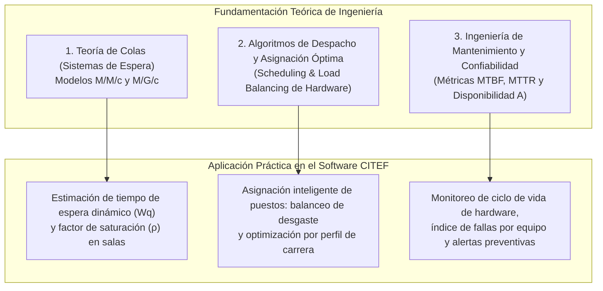

# Plan Estratégico de Upgrade: Fundamentación Teórica e Innovación para el Proyecto CITEF
**Postulantes:** Nataly Vanessa Martinez Martinez & Jael Mamani Sandoval  
**Ámbitos:** Taller de Grado I (Ing. Junior) / Proyecto de Grado / Software 2 (Ing. Martínez)  
**Entorno de Aplicación:** Centro de Innovación Tecnológica Facultativa (CITEF - FCEE - UAGRM)

---

## 2. Eje 1: Fundamentación Teórica Formal para el Proyecto

Para que el proyecto tenga el peso de una tesis de ingeniería de sistemas/informática, se integran dos cuerpos teóricos consolidados de la ingeniería:

### 2.1. Teoría de Colas (Líneas de Espera - Modelo M/M/c)
* **Definición en el Dominio:** Un laboratorio de cómputo es formalmente un **sistema de servicio estocástico multicanal**:
  - **Llegadas ($\lambda$):** Tasa media de estudiantes que arriban por hora solicitando un puesto en sala libre.
  - **Servicio ($\mu$):** Tasa media de finalización de sesiones de estudio (inverso de la permanencia promedio).
  - **Servidores ($c$):** Número de estaciones de trabajo operativas en una sala o conjunto de salas.
  - **Capacidad del sistema ($K$):** Capacidad física de recepción/espera.
* **Fórmulas de Aplicación en el Sistema:**
  - Factor de utilización del laboratorio: $\rho = \frac{\lambda}{c \cdot \mu}$
  - Probabilidad de que todas las máquinas estén ocupadas (Fórmula C de Erlang).
  - Tiempo medio de espera proyectado antes de obtener una máquina: $W_q$.
* **Valor para el Tribunal:** El sistema no se limita a un semáforo estático de "ocupado/libre". Si un estudiante llega y la sala está llena, el software calcula matemáticamente: *"Tiempo estimado de espera para la próxima máquina: 8 minutos (basado en $\mu$ de las sesiones activas)"*. A nivel directivo, permite calcular el número óptimo de máquinas ($c$) para garantizar que ningún estudiante espere más de $X$ minutos en semana de exámenes.

### 2.2. Algoritmos de Despacho y Balanceo de Desgaste de Hardware (Load Balancing Físico)
* **Definición en el Dominio:** En los laboratorios reales, las computadoras cercanas a la puerta o al pasillo sufren un 300% más de desgaste que las máquinas del fondo, lo que provoca envejecimiento prematuro y fallas concentradas.
* **Modelo Algorítmico:** Algoritmo heurístico de asignación con ponderación multicriterio:
  $$\text{Score}(M_i) = w_1 \cdot (1 - \text{HorasUsoRelativas}) + w_2 \cdot \text{EstadoOptimoPerifericos} + w_3 \cdot \text{AfinidadSoftwareCarrera}$$
* **Aplicación:** Cuando el auxiliar pulsa *"Asignación Rápida"*, el sistema sugiere la estación de trabajo óptima para nivelar las horas de uso de todo el parque informático.

### 2.3. Métricas de Mantenimiento y Confiabilidad (RAMS: Reliability, Availability, Maintainability)
* **Definición en el Dominio:** Sustento formal para el módulo técnico del CITEF:
  - **MTBF (Mean Time Between Failures):** Tiempo promedio entre fallas de un equipo.
  - **MTTR (Mean Time To Repair):** Tiempo promedio que el técnico demora en reparar y devolver el equipo a sala.
  - **Disponibilidad Operativa ($A$):** $A = \frac{\text{MTBF}}{\text{MTBF} + \text{MTTR}}$.
* **Valor para Acreditación:** El sistema genera el indicador oficial de disponibilidad del parque computacional de la FCEE exigido en los estándares del CEUB y MERCOSUR.

---

## 3. Eje 2: Innovación Funcional, Tecnológica y Metodológica

El Ing. Martínez aclaró: *"No cambien las políticas del CITEF, pero automaticen, optimicen y propongan mejoras con tecnología"*.

| Tipo de Innovación | Innovación Propuesta | ¿Cómo funciona sin violar políticas del CITEF? |
| :--- | :--- | :--- |
| **Funcional** | **Asignación Inteligente con Balanceo de Desgaste y Tiempo de Espera ($W_q$)** | Cuando el estudiante solicita máquina, el sistema sugiere la estación óptima para nivelar horas de uso de hardware. Si el laboratorio está saturado, calcula algorítmicamente en cuántos minutos se liberará un puesto según Teoría de Colas ($M/M/c$). |
| **Funcional** | **Motor de Turnos con Protocolo de Relevo Auditado (Handover)** | Resuelve la debilidad organizativa: cada turno opera con un checklist digital obligatorio de apertura y cierre. El auxiliar entrante debe aceptar formalmente las novedades pendientes, garantizando trazabilidad y eliminando el *"pasarse la pelota"*. |
| **Tecnológica** | **Asistente Analítico Text-to-SQL Seguro con Tool Calling** | Permite a la Jefatura y Decanatura hacer consultas en lenguaje natural: *"¿Cuál fue la sala con peor tiempo de reparación (MTTR) en el último mes?"*. El microservicio FastAPI ejecuta la consulta en una réplica de solo lectura mediante Tool Calling tipado. |
| **Tecnológica** | **Sincronización Reactiva Bidireccional (WebSockets / Socket.io)** | El mapa de la sala refleja instantáneamente el cambio de estado de cada nodo (libre, ocupado, en reserva, en mantenimiento) sin necesidad de recargar la página. |
| **Metodológica y Arquitectural** | **Proceso Unificado (PUDS) + Clean Architecture en Backend** | Adherencia estricta a PUDS para el documento de Taller de Grado, implementando Clean Architecture en NestJS (Domain, UseCases, Infrastructure) para desacoplar las reglas de colas y mantenimiento del ORM. |

---

## 4. Matriz de Concordancia: Taller de Grado (PUDS) vs. Expectativas de SW2

| Concepto Clave | Implementación Oficial en el Proyecto CITEF | Metodología / Enfoque |
| :--- | :--- | :--- |
| **Metodología de Desarrollo** | **PUDS (Proceso Unificado de Desarrollo de Software)** | Oficial para Taller de Grado (Fases: Inicio, Elaboración, Construcción, Transición; Flujos: Requisitos, Análisis, Diseño, Pruebas). |
| **Microservicios y Transacciones** | Backend transaccional en **NestJS** + Microservicio analítico/ML en **FastAPI**. Comunicación vía REST/Webhooks. | Arquitectura distribuida pragmática. |
| **Arquitectura de Código** | **Clean Architecture** en NestJS (Domain, UseCases, Infrastructure) separando reglas de colas y asignación del ORM. | Organización interna del código desacoplada. |
| **Text-to-SQL Seguro / MCP** | Endpoint en FastAPI con LangChain/Groq con esquema de solo lectura y validación tipada de consultas analíticas. | Capa de innovación tecnológica analítica. |
| **Machine Learning / Analítica** | Modelo predictivo de afluencia (`RandomForestRegressor`) + métricas de colas ($W_q$, $\rho$) y confiabilidad (MTBF/MTTR). | Núcleo analítico de investigación operativa. |
| **Offline-First / PWA** | *(En pausa/pendiente)*: Prioridad secundaria para no comprometer el cronograma de 30 días. | Fuera del alcance crítico de entrega. |

---

## 5. Estructura y Orden del Capítulo 2 (Tecnologías y Fundamentación Teórica)

El orden académico oficial responde al criterio de **Relevancia, Innovación e Impacto Diferenciador** (siguiendo el estándar exacto del proyecto aprobado de Farmacia, donde colocaron K-means y Scikit-learn en primer lugar):

1. **1.1. Teoría de Colas para Gestión de Recursos Informáticos (Modelo Estocástico $M/M/c$):** *(Fundamentación teórica de ingeniería)* Núcleo matemático de la investigación operativa: tasa media de arribos ($\lambda$), tasa de permanencia ($\mu$), factor de saturación ($\rho$) y estimación algorítmica del tiempo medio de espera ($W_q$).
2. **1.2. Algoritmo Random Forest Regressor (Predicción de Demanda Estudiantil):** Algoritmo de ensamble supervisado para el pronóstico de saturación y afluencia por salas y turnos.
3. **1.3. Scikit-Learn (Biblioteca de Machine Learning):** Herramienta técnica que soporta el preprocesamiento, regresión, validación cruzada y cálculo predictivo.
4. **1.4. Métricas de Confiabilidad y Mantenimiento de Hardware (RAMS / IEEE 762):** *(Fundamentación teórica de ingeniería)* Modelado de fallas técnicas: **MTBF** (tiempo medio entre fallas), **MTTR** (tiempo medio de reparación en taller) y **Disponibilidad Operativa ($A$)**.
5. **1.5. Python 3 (Lenguaje del Microservicio Analítico):** Entorno especializado para cálculo científico, analítica de datos e inteligencia artificial.
6. **1.6. FastAPI (Framework del Microservicio de IA):** Microservicio web asíncrono de alto rendimiento para inferencia y consultas analíticas desacopladas.
7. **1.7. NestJS (Framework del Backend Principal y WebSockets):** Plataforma central que gobierna la arquitectura Clean Architecture, transacciones, eventos síncronos en tiempo real y seguridad.
8. **1.8. Angular (Framework del Frontend Web):** Aplicación cliente SPA para visualización reactiva del mapa de salas en tiempo real y dashboards de gestión.
9. **1.9. PostgreSQL (Sistema Gestor de Base de Datos Relacional):** Repositorio central altamente normalizado, con integridad referencial, vistas analíticas y bitácora de auditoría.

---

  ### II. PARTES EXACTAS DEL DOCUMENTO A MEJORAR                                                        
                                                                                                                            
  Para que tu documento no tenga inconsistencias, estos son los puntos clave a actualizar en tu documento de Word/PDF:      
                                                                                                                            
   Sección del Documento    │ Subtítulo                      │ Modificación sugerida para el Upgrade
  ──────────────────────────┼────────────────────────────────┼──────────────────────────────────────────────────────────────
   Capítulo 1: Perfil       │ 1.3.1. Objetivo General        │ Mencionar que el sistema optimiza la asignación mediante
                            │                                │ modelos de teoría de colas y analítica predictiva.
   Capítulo 1: Perfil       │ 1.3.2. Objetivos Específicos   │ • En ocupación: "Implementar un mecanismo de asignación
                            │                                │ inteligente y estimación de tiempos de espera basado en
                            │                                │ teoría de colas (M/M/c)".• En soporte/turnos: "Establecer la
                            │                                │ trazabilidad operativa mediante protocolo de relevo de
                            │                                │ turnos (handover) y métricas de confiabilidad de hardware
                            │                                │ (MTBF y MTTR)".
   Capítulo 1: Perfil       │ 1.4.1 y 1.4.2. Justificaciones │ Resaltar que el proyecto aplica modelos formales de
                            │                                │ Investigación Operativa (Sistemas de Espera) e Ingeniería de
                            │                                │ Confiabilidad, aportando rigor de ingeniería de sistemas al
                            │                                │ CITEF.
   Capítulo 2: Tecnologías  │ 1.1 a 1.9                      │ Reordenar las 7 tecnologías de mayor a menor uso y agregar
                            │                                │ los acápites 1.8 (Teoría de Colas) y 1.9 (Métricas de
                            │                                │ Confiabilidad).
   Capítulo 4: Requisitos   │ SRS (IEEE 830)                 │ Modificados RF12, RF19, RF22, RF24, RF25 en
                            │                                │ RequerimientosFuncionales.md.
   Capítulo 5: Casos de Uso │ RUP / UML 2.5                  │ Modificados CU13, CU21, CU24, CU25, CU26, CU27 en
                            │                                │ CasosDeUso.md.
  ──────                                                                                                                    
  ### III. Resumen de cambios en los archivos (para avisar a Jael)                                                          
                                                                                                                            
  Ya he actualizado directamente los archivos en el repositorio. Esto es exactamente lo que cambió para que se lo compartas 
  a tu compañera Jael:                                                                                                      
                                                                                                                            
  1. RequerimientosFuncionales.md:
      • RF12 (Asignación de Equipos): Se añadió la función de sugerencia algorítmica para balancear el desgaste físico de   
      los equipos y el cálculo de tiempo estimado de espera (W_q) según Teoría de Colas cuando la sala supere el 90% de     
      ocupación.
      • RF19 (Apertura y Cierre de Turno): Ahora incluye el protocolo formal de relevo (Handover) con checklist digital     
      rápido y aceptación obligatoria del turno entrante para que no "se pasen la pelota".
      • RF22 (Mantenimiento Técnico): Se añadió el cómputo automático de las métricas MTTR, MTBF y el porcentaje de         
      Disponibilidad Operativa (A) de las máquinas y salas.
      • RF24 (Analítica Predictiva): Se integró la predicción de saturación con las variables de colas (λ, μ, ρ) para       
      calcular la capacidad óptima de computadoras por turno.
      • RF25 (Reportes y Acreditación): Se agregó un Asistente Analítico para consultas en lenguaje natural (Text-to-SQL    
      seguro) sobre réplicas de solo lectura.
  2. CasosDeUso.md:
      • CU13 (Asignar equipo): Incorpora en el flujo la opción de "Asignación Sugerida" (balanceo de uso) y el cálculo de   
      W_q en caso de sala llena.
      • CU21 (Registrar apertura, cierre y relevo de turno): Modificado para incluir el checklist de inicio, el resumen     
      consolidado de atenciones y el acta de relevo aceptada digitalmente.
      • CU24 y CU25 (Mantenimiento y Retorno a Sala): Se formalizó el registro de tiempos de inicio y fin de reparación para
      alimentar el cálculo de MTTR y disponibilidad (A).
      • CU26 (Generar pronóstico de demanda y análisis de colas): Extendido para devolver tanto las curvas de concurrencia  
      como los parámetros de saturación de colas.
      • CU27 (Generar reportes dinámicos y consultas analíticas): Incorpora la interacción con el Asistente Analítico para  
      preguntas directas en lenguaje natural.