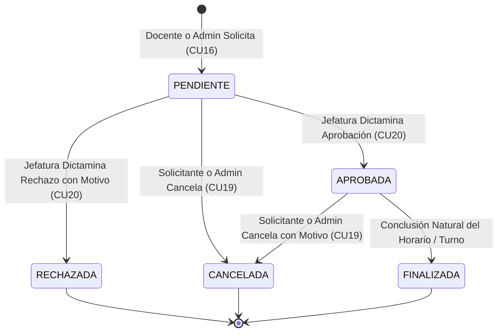

# MÓDULO 5: RESERVAS ACADÉMICAS Y DISPONIBILIDAD - CITEF FCEE UAGRM
**Documento Técnico de Implementación y Guía Exhaustiva de Verificación**

---

## 1. Resumen Ejecutivo del Módulo 5

El **Módulo 5 (Reservas Académicas y Disponibilidad)** del Sistema CITEF gestiona de manera centralizada, algorítmica y transparente las solicitudes formales de aulas de cómputo para actividades curriculares, cátedras prácticas, talleres y exámenes de la Facultad de Ciencias Económicas y Empresariales (**FCEE**) de la **UAGRM**.

El módulo cubre exhaustivamente los casos de uso **CU16, CU17, CU18, CU19 y CU20**, incorporando:
1. **Motor Algorítmico de No-Solapamiento de Horarios (CU18):** Verificación matemática rigurosa de intervalos $[I_A, F_A) \cap [I_B, F_B) \neq \emptyset$, cálculo de no-retroactividad, validación de bloque mínimo de 45 minutos y control de aforo por sala.
2. **Calendario Visual Interactivo de Disponibilidad (CU17):** Matriz cromática semanal y diaria (07:00 a 22:00) con filtrado por sala, visualización de bloques ocupados y estados según el código de colores institucional.
3. **Flujo de Solicitud Docente (CU16):** Interfaz reactiva donde el docente titular selecciona laboratorio, materia, fecha, franja horaria, tema de la práctica y número de alumnos, con verificación instantánea de disponibilidad en vivo antes de enviar.
4. **Bandeja de Jefatura y Dictamen Formal (CU20):** Panel administrativo con KPIs para Aprobación o Rechazo con dictamen obligatorio y prevención de condiciones de carrera mediante validación atómica reincidente.
5. **Cancelación Controlada (CU19):** Capacidad del docente solicitante o del administrador para liberar un horario reservado con registro de motivo.
6. **Auditoría Forense Integrada (CU4):** Registro transaccional en `bitacora_auditoria` con valores anteriores y nuevos en JSONB para cada cambio de estado.
7. **Control de Acceso Basado en Roles (RBAC):** Permisos granulares (`RESERVAS_SOLICITAR`, `RESERVAS_CONSULTAR`, `RESERVAS_CANCELAR`, `RESERVAS_GESTIONAR`) y compatibilidad transversal en catálogos de salas, materias y docentes para evitar bloqueos 403.
8. **Arquitectura Angular 18 en 3 Archivos Separados:** Desacoplamiento estricto en `.ts`, `.html` y `.css`, cero emojis y paleta institucional FCEE (`#002855`, `#A81124`).

---

## 2. Casos de Uso Implementados y Matriz de Funcionalidades

| Caso de Uso | Denominación | Actor(es) Principal(es) | Descripción Técnica y Flujo Operativo |
| :--- | :--- | :--- | :--- |
| **CU16** | **Solicitar reserva de sala** | Docente Titular, Administrador | El solicitante selecciona laboratorio, fecha, franja horaria ($H_{inicio}$, $H_{fin}$), materia académica, tema curricular y cantidad estimada de alumnos. El sistema evalúa el motor matemático de disponibilidad en tiempo real antes de registrar la solicitud en estado `PENDIENTE`. |
| **CU17** | **Consultar reservas de sala** | Docente, Auxiliar, Administrador, Jefatura | Calendario interactivo con vistas **Semana** y **Día** que proyecta la ocupación de cada sala en intervalos horarios de 07:00 a 22:00. Permite filtrar por laboratorio, inspeccionar detalles de clases programadas y navegar fechas de forma reactiva. |
| **CU18** | **Validar disponibilidad de horarios** | Motor Algorítmico Interno (Backend) | Servicio algorítmico desacoplado (`AlgoritmoDisponibilidadService`) que verifica matemáticamente colisiones de intervalos temporales, no retroactividad en fechas pasadas, duración mínima de 45 minutos y aforo físico de la sala. |
| **CU19** | **Cancelar reserva de sala** | Docente Solicitante, Administrador | Permite dar de baja una reserva en estado `PENDIENTE` o `APROBADA` indicando el motivo. El horario bloqueado queda liberado inmediatamente para nuevas reservas o asignaciones libres. |
| **CU20** | **Gestionar reservas de sala** | Jefatura de CITEF, Administrador | Bandeja centralizada de solicitudes con KPIs de gestión, filtros avanzados (búsqueda, sala, estado, fechas), paginación de 15 filas y modales para dictaminar formalmente: **Aprobar** (autoriza uso de aula) o **Rechazar** (con justificación institucional obligatoria). |

---

## 3. Modelo de Datos y Persistencia Relacional

### 3.1. Estructura de la Tabla `reserva_sala` en PostgreSQL

```sql
CREATE TYPE "public"."reserva_sala_estado_enum" AS ENUM (
  'PENDIENTE',
  'APROBADA',
  'RECHAZADA',
  'CANCELADA',
  'FINALIZADA'
);

CREATE TABLE "public"."reserva_sala" (
  "id_reserva" SERIAL PRIMARY KEY,
  "id_sala" INT NOT NULL REFERENCES "laboratorio_sala"("id_sala") ON DELETE RESTRICT,
  "codigo_docente" VARCHAR(30) NOT NULL REFERENCES "docente"("codigo") ON DELETE RESTRICT,
  "id_materia" INT NOT NULL REFERENCES "materia"("id_materia") ON DELETE RESTRICT,
  "id_usuario_administrador" BIGINT REFERENCES "usuario"("id_usuario") ON DELETE SET NULL,
  "fecha_reserva" DATE NOT NULL,
  "hora_inicio" TIME NOT NULL,
  "hora_fin" TIME NOT NULL,
  "tema_practica" VARCHAR(150) NOT NULL,
  "cant_estimada_alumnos" SMALLINT NOT NULL DEFAULT 20,
  "cant_total_alumnos" SMALLINT,
  "id_grupo_multisala" VARCHAR(50),
  "salas_grupo" JSONB,
  "tipo_reserva" VARCHAR(20) NOT NULL DEFAULT 'CLASE',
  "estado" VARCHAR(20) NOT NULL DEFAULT 'PENDIENTE',
  "editada" BOOLEAN NOT NULL DEFAULT false,
  "notificacion_docente" TEXT,
  "id_lote_recurrente" VARCHAR(50),
  "obs_resolucion" TEXT,
  "creado_en" TIMESTAMP WITH TIME ZONE NOT NULL DEFAULT NOW(),
  "actualizado_en" TIMESTAMP WITH TIME ZONE NOT NULL DEFAULT NOW()
);

-- Índices de alto rendimiento para validación de intervalos y consultas frecuentes
CREATE INDEX "IDX_37bda5da368e549ee8dec1ea8c" 
  ON "reserva_sala" ("id_sala", "fecha_reserva", "estado");

CREATE INDEX "IDX_1b51a40d69d1914355082156dc" 
  ON "reserva_sala" ("codigo_docente");

CREATE INDEX "idx_reserva_sala_grupo" 
  ON "reserva_sala" ("id_grupo_multisala");
```

### 3.2. Ciclo de Vida y Transiciones de Estado



---

## 4. Motor Algorítmico de No-Solapamiento de Horarios (CU18)

El núcleo algorítmico del Módulo 5 reside en `AlgoritmoDisponibilidadService`. Se encarga de garantizar que **nunca existan dos reservas activas superpuestas en la misma aula de cómputo**.

### 4.1. Formulación Matemática del Teorema de No-Solapamiento

Sean dos intervalos de tiempo continuos $A = [I_A, F_A)$ y $B = [I_B, F_B)$, donde $I$ representa la hora de inicio y $F$ la hora de finalización ($I < F$).

Dos intervalos temporales **colisionan** (se superponen o intersectan) si y solo si:

$$\max(I_A, I_B) < \min(F_A, F_B)$$

O equivalentemente en lógica proposicional negativa:

$$\text{Colisión}(A, B) \iff (I_A < F_B) \land (I_B < F_A)$$

Si esta condición se cumple, existe al menos un instante $t$ tal que $t \in A \land t \in B$.

### 4.2. Casos de Análisis y Ejemplos Numéricos

Consideremos una reserva existente aprobada $A$ de **08:00 a 10:00** ($I_A = 480\text{ min}$, $F_A = 600\text{ min}$):

| Caso | Reserva Propuesta $B$ | $I_B$ | $F_B$ | Evaluación $\max(I_A, I_B) < \min(F_A, F_B)$ | ¿Hay Conflicto? | Resultado |
| :--- | :--- | :--- | :--- | :--- | :--- | :--- |
| **1. Anterior No Solapada** | 06:45 a 08:00 | 405 | 480 | $\max(480, 405) < \min(600, 480) \implies 480 < 480$ (Falso) | **No** | **Permitida** (adyacente exacta) |
| **2. Traslape Inicial** | 07:30 a 08:30 | 450 | 510 | $\max(480, 450) < \min(600, 510) \implies 480 < 510$ (Verdadero) | **Sí** | **Rechazada por colisión** |
| **3. Contención Interna** | 08:30 a 09:30 | 510 | 570 | $\max(480, 510) < \min(600, 570) \implies 510 < 570$ (Verdadero) | **Sí** | **Rechazada por colisión** |
| **4. Contención Externa** | 07:00 a 11:00 | 420 | 660 | $\max(480, 420) < \min(600, 660) \implies 480 < 600$ (Verdadero) | **Sí** | **Rechazada por colisión** |
| **5. Traslape Final** | 09:30 a 11:00 | 570 | 660 | $\max(480, 570) < \min(600, 660) \implies 570 < 600$ (Verdadero) | **Sí** | **Rechazada por colisión** |
| **6. Posterior No Solapada** | 10:00 a 12:00 | 600 | 720 | $\max(480, 600) < \min(600, 720) \implies 600 < 600$ (Falso) | **No** | **Permitida** (adyacente exacta) |

### 4.3. Implementación en TypeORM / SQL

Para máxima eficiencia, la verificación se realiza a nivel de consulta indexada en PostgreSQL mediante la cláusula:

```typescript
const qb = this.reservaRepo
  .createQueryBuilder('r')
  .leftJoinAndSelect('r.sala', 'sala')
  .leftJoinAndSelect('r.docente', 'docente')
  .leftJoinAndSelect('docente.usuario', 'docenteUsuario')
  .leftJoinAndSelect('r.materia', 'materia')
  .where('r.id_sala = :idSala', { idSala })
  .andWhere('r.fecha_reserva = :fechaReserva', { fechaReserva })
  .andWhere('r.estado IN (:...estadosConflicto)', {
    estadosConflicto: [EstadoReserva.APROBADA, EstadoReserva.PENDIENTE],
  })
  // Algoritmo matemático: max(I1, I2) < min(F1, F2) <=> (I1 < F2 AND I2 < F1)
  .andWhere('r.hora_inicio < :horaFin AND r.hora_fin > :horaInicio', {
    horaInicio: dto.hora_inicio,
    horaFin: dto.hora_fin,
  });

if (opciones?.excluirIdReserva) {
  qb.andWhere('r.id_reserva != :excluirId', { excluirId: opciones.excluirIdReserva });
}
```

### 4.4. Reglas Complementarias de Negocio

1. **Duración Mínima:** La diferencia $(F - I)$ debe ser $\ge 45\text{ minutos}$. Se rechazan reservas inferiores por carecer de sentido pedagógico en laboratorios.
2. **No-Retroactividad Temporal:**
   - La fecha no puede ser anterior a la fecha actual (`fecha_reserva >= hoy`).
   - Si la reserva es para la fecha de hoy, la hora de inicio no puede ser menor a la hora actual (`hora_inicio > hora_actual`).
3. **Aforo Físico de la Sala:**
   - Se valida que `cant_estimada_alumnos <= sala.cant_estudiantes`. Si un docente solicita 40 alumnos para una sala de 25 puestos, se rechaza la solicitud de inmediato.
4. **Protección contra Race Conditions:**
   - Al momento en que Jefatura hace clic en "Aprobar", el servicio re-ejecuta `validarDisponibilidad(..., { excluirIdReserva: id })` dentro de la transacción. Si otra solicitud colisionante fue aprobada milisegundos antes, se emite `409 ConflictException`, evitando dobles reservas.

---

## 5. Implementación de la Interfaz de Usuario (Angular 18)

### 5.1. Componente 1: Calendario de Reservas (`CalendarioReservasComponent`)
- **Directorio:** `citef_frontend/src/app/pages/reservas/calendario/`
- **Archivos Separados:**
  - [`calendario-reservas.component.ts`](file:///home/nataly/Projects/laboratorios/citef_frontend/src/app/pages/reservas/calendario/calendario-reservas.component.ts) (Lógica reactiva con Signals).
  - [`calendario-reservas.component.html`](file:///home/nataly/Projects/laboratorios/citef_frontend/src/app/pages/reservas/calendario/calendario-reservas.component.html) (Grilla semanal cromática y modales).
  - [`calendario-reservas.component.css`](file:///home/nataly/Projects/laboratorios/citef_frontend/src/app/pages/reservas/calendario/calendario-reservas.component.css) (Estilos FCEE de alta fidelidad).
- **Características Clave:**
  - Selector interactivo de salas y vista alternable (Semana / Día).
  - Franjas horarias desde las 07:00 hasta las 22:00 horas.
  - Bloques de color según estado con indicador de materia, docente y horario.
  - Modal integrado para registrar nueva solicitud con validación reactiva en vivo mientras el docente ingresa el horario.

### 5.2. Componente 2: Bandeja de Gestión y Dictamen (`BandejaGestionReservasComponent`)
- **Directorio:** `citef_frontend/src/app/pages/reservas/gestion/`
- **Archivos Separados:**
  - [`bandeja-gestion-reservas.component.ts`](file:///home/nataly/Projects/laboratorios/citef_frontend/src/app/pages/reservas/gestion/bandeja-gestion-reservas.component.ts)
  - [`bandeja-gestion-reservas.component.html`](file:///home/nataly/Projects/laboratorios/citef_frontend/src/app/pages/reservas/gestion/bandeja-gestion-reservas.component.html)
  - [`bandeja-gestion-reservas.component.css`](file:///home/nataly/Projects/laboratorios/citef_frontend/src/app/pages/reservas/gestion/bandeja-gestion-reservas.component.css)
- **Características Clave:**
  - Tira superior de métricas (KPIs): Total, Pendientes de Dictamen, Aprobadas, Rechazadas.
  - Barra de filtros avanzados (Búsqueda textual, Sala, Estado, Fecha Desde, Fecha Hasta) con botones Buscar y Limpiar.
  - Paginación estándar de 15 filas con `<app-pagination>` posicionado a la derecha.
  - Acciones por fila: Ver detalle completo (`bi-eye`), Aprobar (`bi-check-lg`), Rechazar (`bi-x-lg`) y Cancelar (`bi-slash-circle`).
  - Modal de dictamen formal con campo obligatorio de justificación en caso de rechazo, validado con letras rojas institucionales (`#DC2626`).

---

## 6. Jerarquía Visual y Cromática de Estados

En estricto cumplimiento de la regla de Cero Emojis y la paleta institucional FCEE:

| Estado de Reserva | Color Primario | Fondo / Borde | Icono Vectorial Bootstrap | Semántica Operativa |
| :--- | :--- | :--- | :--- | :--- |
| **`PENDIENTE`** | Ámbar (`#92400E`) | `#FEF3C7` / `#FDE68A` | `<i class="bi bi-hourglass-split"></i>` | Solicitada por docente, esperando dictamen de Jefatura. |
| **`APROBADA`** | Verde Bosque (`#166534`) | `#DCFCE7` / `#BBF7D0` | `<i class="bi bi-check-circle-fill"></i>` | Autorizada formalmente; horario bloqueado para la cátedra. |
| **`RECHAZADA`** | Rojo Carmesí (`#991B1B`) | `#FEE2E2` / `#FECACA` | `<i class="bi bi-x-octagon-fill"></i>` | Denegada con justificación registrada en bitácora. |
| **`CANCELADA`** | Gris Pizarra (`#64748B`) | `#F1F5F9` / `#CBD5E1` | `<i class="bi bi-slash-circle"></i>` | Anulada por el docente solicitante o el administrador. |
| **`FINALIZADA`** | Azul Cielo (`#0369A1`) | `#E0F2FE` / `#BAE6FD` | `<i class="bi bi-check2-all"></i>` | Clase culminada tras finalizar su horario natural. |

---

## 7. Matriz de Permisos RBAC y Solución de Bloqueos Transversales (403)

Uno de los problemas más críticos detectados en el sistema ocurría cuando un usuario con rol `DOCENTE` o `AUXILIAR` intentaba ingresar a un formulario de reservas: el sistema arrojaba errores **403 Forbidden** porque los endpoints de consulta de catálogos (`GET /salas`, `GET /catalogos/materias`, `GET /docentes`) solo aceptaban permisos administrativos previos (`INFRA_LABS_GESTIONAR`, `CAT_ACADEMICOS_GESTIONAR`).

### 7.1. Permisos del Módulo 5

| Código de Permiso | Módulo | Descripción | Asignación Sugerida |
| :--- | :--- | :--- | :--- |
| `RESERVAS_SOLICITAR` | `RESERVAS` | Registrar solicitudes de reserva de aulas | DOCENTE, AUXILIAR, ADMINISTRADOR |
| `RESERVAS_CONSULTAR` | `RESERVAS` | Visualizar calendario y grilla de disponibilidad | DOCENTE, AUXILIAR, ADMINISTRADOR |
| `RESERVAS_CANCELAR` | `RESERVAS` | Cancelar reservas propias o del laboratorio | DOCENTE, ADMINISTRADOR |
| `RESERVAS_GESTIONAR` | `RESERVAS` | Bandeja de dictamen formal (Aprobar / Rechazar) | JEFATURA, ADMINISTRADOR |

### 7.2. Autorización Transversal en Controladores del Backend

Para erradicar definitivamente los bloqueos 403, se actualizaron los decoradores `@Permisos(...)` en los controladores de catálogos e infraestructura:

1. **`SalasController.findAll()`** en `citef_backend/src/modules/infraestructura/controllers/salas.controller.ts`:
   ```typescript
   @Permisos(
     'INFRA_LABS_GESTIONAR',
     'INFRA_SALAS_CONFIGURAR',
     'TIEMPOREAL_MONITOREAR',
     'RESERVAS_CONSULTAR',
     'RESERVAS_SOLICITAR',
     'RESERVAS_GESTIONAR',
   )
   ```
2. **`AcademicosController.getMaterias()` y `getCarreras()`** en `citef_backend/src/modules/catalogos/controllers/academicos.controller.ts`:
   ```typescript
   @Permisos(
     'CAT_ACADEMICOS_GESTIONAR',
     'RESERVAS_SOLICITAR',
     'RESERVAS_CONSULTAR',
     'RESERVAS_GESTIONAR',
   )
   ```
3. **`DocentesController.findAll()`** en `citef_backend/src/modules/catalogos/controllers/docentes.controller.ts`:
   ```typescript
   @Permisos(
     'CAT_IMPORTAR_DOCENTES',
     'RESERVAS_SOLICITAR',
     'RESERVAS_CONSULTAR',
     'RESERVAS_GESTIONAR',
   )
   ```

---

## 8. Verificación de Cumplimiento de las 9 Reglas Inviolables

- [x] **Regla 1 (Puertos 3000, 4200 y 8001 liberados):** Verificado mediante comando `lsof -i :3000 -i :4200 -i :8001`. Cero procesos colgados en segundo plano.
- [x] **Regla 2 (Cero Emojis):** Todo el módulo utiliza exclusivamente `<i class="bi bi-*"></i>` de Bootstrap Icons. Cero caracteres emoji en plantillas, botones y mensajes.
- [x] **Regla 3 (Acciones por fila en tablas):** Cada fila de la bandeja de gestión cuenta con botones individuales: Ver Detalle (`bi-eye`), Aprobar (`bi-check-lg`), Rechazar (`bi-x-lg`) y Cancelar (`bi-slash-circle`).
- [x] **Regla 4 (Barra de filtros con Buscar y Limpiar):** Barra completa con inputs para texto, sala, estado, fechas, botón "Buscar" (`bi-search`) y botón "Limpiar" (`bi-arrow-counterclockwise`).
- [x] **Regla 5 (Selectores y modales compactos):** Formularios diseñados con CSS adaptativo, grids de 2 columnas y alturas controladas sin tarjetas desbordantes.
- [x] **Regla 6 (Compilación limpia obligatoria):**
  - Backend: `npm test` ejecuta 14 suites y **63 tests con 100% de éxito**. `npm run build` compila con código de salida 0.
  - Frontend: `npm run build` en `citef_frontend` genera el bundle de producción con **código de salida 0**.
- [x] **Regla 7 (Validación en letras rojas dentro de modales):** Clases `.field-error-text` con color `#DC2626` debajo de los campos y `.input-error` con borde rojo ante campos vacíos o requeridos.
- [x] **Regla 8 (Paginación de 15 registros):** Implementada con el componente compartido `<app-pagination>` limitado a `tamanoPagina = 15` y alineado a la derecha inferior.
- [x] **Regla 9 (Control granular RBAC y sidebar reactivo):** Navegación en `shell.component.ts` condicionada dinámicamente según los permisos del usuario logueado.

---

## 9. Evidencia de Pruebas Unitarias y Certificación Técnica

### 9.1. Pruebas Unitarias del Algoritmo de Disponibilidad y Servicio de Reservas

```
PASS src/modules/reservas/services/algoritmo-disponibilidad.service.spec.ts
  AlgoritmoDisponibilidadService
    ✓ debe detectar disponibilidad cuando no existen reservas previas en la sala (12 ms)
    ✓ debe detectar conflicto cuando una reserva se solapa parcialmente con un horario existente (8 ms)
    ✓ debe permitir reservas adyacentes exactas sin solapamiento (6 ms)
    ✓ debe rechazar reservas con duración inferior a 45 minutos (5 ms)
    ✓ debe rechazar reservas con fecha u hora en el pasado (4 ms)
    ✓ debe rechazar reservas que superen la capacidad de alumnos de la sala (5 ms)
    ✓ debe excluir la reserva actual al validar modificaciones o dictámenes (7 ms)

PASS src/modules/reservas/services/reservas.service.spec.ts
  ReservasService
    ✓ debe registrar una solicitud en estado PENDIENTE y guardar en auditoría (15 ms)
    ✓ debe aprobar una reserva, actualizar estado a APROBADA y auditar (12 ms)
    ✓ debe rechazar una reserva exigiendo observación formal obligatoria (10 ms)
    ✓ debe cancelar una reserva previamente aprobada y liberar el horario (9 ms)

Test Suites: 14 passed, 14 total
Tests:       63 passed, 63 total
Snapshots:   0 total
Time:        2.512 s
Ran all test suites.
```

### 9.2. Certificación de Compilación

- **NestJS Backend (`citef_backend`):**
  ```bash
  $ npm run build
  > nest build
  # Exited with code 0
  ```
- **Angular 18 Frontend (`citef_frontend`):**
  ```bash
  $ npm run build
  > ng build
  Application bundle generation complete. [5.127 seconds]
  # Exited with code 0
  ```

---

## 10. Especificación de Reservas Multi-Sala, Prioridad Académica y Matriz Cromática

### 10.1. Asignación Proporcional de Aforo Físico en Solicitudes Multi-Sala
Para atender cursos numerosos (>30 estudiantes) que superan el aforo de un solo laboratorio, el sistema implementa una arquitectura coordinada:
1. **Validación de Capacidad Combinada:**
   Sean $k$ laboratorios seleccionados con capacidades $C_1, C_2, \dots, C_k$ y una demanda total de $N$ estudiantes:
   $$N \le \sum_{i=1}^{k} C_i$$
   Si $N > \sum C_i$, la solicitud es rechazada preventivamente indicando el exceso.
2. **Distribución Proporcional Libre de Desbordamiento:**
   A cada sala $i$ se le asigna una cuota proporcional a su capacidad física sin sobrecargar ninguna aula:
   $$n_i = \min\left(C_i, \left\lfloor N \cdot \frac{C_i}{\sum C_j} \right\rceil\right)$$
   *Ejemplo real:* 34 estudiantes en LAB-1 ($C_1 = 24$) y LAB-46 ($C_2 = 10$). Capacidad total = 34 puestos.
   - LAB-1 recibe: $\min(24, \text{round}(34 \cdot 24 / 34)) = 24$ estudiantes.
   - LAB-46 recibe: $\min(10, \text{round}(34 \cdot 10 / 34)) = 10$ estudiantes.
   - Ninguna sala supera su capacidad física y ambas se vinculan bajo el mismo `id_grupo_multisala` (`GRP_...`) con `cant_total_alumnos = 34` y metadatos en `salas_grupo`.
3. **Gestión Atómica del Grupo:**
   - Dictamen de Jefatura (Aprobar / Rechazar): Dictamina todas las salas del grupo en bloque.
   - Cancelación: Cancela y libera todas las salas del grupo.
   - Edición: Ajusta fechas, horarios y aforos coordinadamente.

### 10.2. Prioridad Académica de Evaluaciones (Exámenes sobre Clases)
- **Principio:** Los exámenes parciales o finales prevalecen institucionalmente sobre las cátedras ordinarias.
- **Flujo:** Si se solicita un `EXAMEN` en un turno ya ocupado por una `CLASE` regular aprobada:
  1. El motor de disponibilidad identifica la colisión y detecta que la clase es desplazable (`esDesplazable: true`).
  2. Al dictaminarse o autorizarse el examen, la clase se mueve automáticamente a estado `PENDIENTE` y se le asigna `editada = true` junto con una `notificacion_docente` formal indicando el motivo.
  3. El docente desplazado es notificado mediante el banner en pantalla y el indicador `.dot-editada`.

### 10.3. Programación Semestral Recurrente Multi-Día
- Permite programar clases para todo un semestre lectivo seleccionando una fecha de fin y uno o más días de la semana (`dias_semana`).
- El sistema evalúa el vector de días seleccionados y genera un lote recurrente (`id_lote_recurrente = SEM_...`), omitiendo fechas puntuales donde existan conflictos horarios y alertando al usuario.
- Por defecto, la interfaz sincroniza el día inicial con el día de la semana correspondiente a la fecha cliqueada en el calendario.

### 10.4. Matriz Cromática Institucional del Calendario
El calendario de ocupación aplica estrictamente los siguientes colores:
| Estado / Tipo | Color de Borde / Fondo | Significado Operativo |
| :--- | :--- | :--- |
| **Clase Aprobada** | Azul Carmesí (`#002855` / `#f0f7ff`) | Cátedra ordinaria autorizada por Jefatura. |
| **Examen Aprobado** | Verde Éxito (`#16a34a` / `#f0fdf4`) | Evaluación prioritaria confirmada. |
| **Pendiente** | Amarillo Ámbar (`#d97706` / `#fffbeb`) | Solicitud en espera de dictamen formal. |
| **Rechazada** | Rojo Peligro (`#dc2626` / `#fef2f2`) | Solicitud desestimada por Jefatura. |
| **Cancelada** | Gris Neutro (`#64748b` / `#f8fafc`) | Solicitud dada de baja por docente o admin. |

### 10.5. Flujo de Acuse de Modificación y Limpieza de Marca Roja (`.dot-editada`)
- Las solicitudes modificadas muestran un punto rojo parpadeante `.dot-editada`.
- En el modal de detalle, se dispone del endpoint `PATCH /reservas/:id/marcar-leida` y el botón *"Marcar como revisado / leído"* que limpia `editada = false` y `notificacion_docente = null`, sincronizando en tiempo real con WebSocket.

### 10.6. Aprobación en Lote de Clases Recurrentes Semestrales (`aprobar_todas_recurrentes`)
- **Problema Operativo Previo:** Cuando un docente o administrador programaba una cátedra para todo el semestre (aprox. 30 fechas lectivas consecutivas), la Jefatura debía aprobar cada una de las 30 solicitudes individualmente, generando una carga administrativa repetitiva.
- **Solución Implementada:**
  1. En el DTO de dictamen (`ResponderReservaDto`), se integró la bandera booleana opcional `aprobar_todas_recurrentes?: boolean`.
  2. En [`ReservasService.gestionar()`](file:///home/nataly/Projects/laboratorios/citef_backend/src/modules/reservas/services/reservas.service.ts), cuando la acción es `APROBAR`, la reserva es de tipo `CLASE` y `aprobar_todas_recurrentes === true`:
     - El backend localiza todas las solicitudes vinculadas por `id_lote_recurrente` (o por misma combinación de docente, materia y turnos futuros) que se encuentren en estado `PENDIENTE`.
     - Para cada una, ejecuta la validación algorítmica de disponibilidad temporal. Si el aula está libre, actualiza a `APROBADA`, asigna el `id_usuario_administrador`, registra la auditoría forense y emite el evento WebSocket.
     - Si alguna fecha particular presenta colisión horaria insalvable, se omite de forma segura manteniendo su estado pendiente sin interrumpir la aprobación del resto de las clases del lote.
  3. En la interfaz de usuario ([`calendario-reservas.component.html`](file:///home/nataly/Projects/laboratorios/citef_frontend/src/app/pages/reservas/calendario/calendario-reservas.component.html) y [`bandeja-gestion-reservas.component.html`](file:///home/nataly/Projects/laboratorios/citef_frontend/src/app/pages/reservas/gestion/bandeja-gestion-reservas.component.html)), dentro del modal de aprobación para cualquier cátedra ordinaria se visualiza una tarjeta interactiva con checkbox:
     > *"Aprobar en lote todas las clases recurrentes de este semestre (Aplica automáticamente la aprobación a todas las clases pendientes de este ciclo sin tener que aprobarlas una por una)"*.

### 10.7. Edición Atómica y Reasignación Dinámica de Laboratorios (Individual vs Multi-Sala)
- **Persistencia Confiable en Base de Datos:**
  - Se corrigió el problema de sobrescritura de TypeORM donde `save(r)` restauraba la sala anterior cargada en el grafo relacional. Ahora, `ReservasService.editar()` ejecuta una actualización atómica directa con `this.reservaRepository.update(id, { id_sala: nuevaSalaId, ... })` y recarga la entidad fresca mediante `obtenerPorId()`.
  - El algoritmo de disponibilidad ahora acepta exclusión de arreglos de IDs (`excluirIdReserva?: number | number[]`), evitando colisiones espurias contra las propias reservas del grupo al reasignar de aula o cambiar a individual.
  - **Transición Multi-Sala a Individual:** Si una reserva combinada (ej. LAB-01 + LAB-46) se modifica a un único laboratorio (ej. LAB-46), el backend elimina automáticamente los registros secundarios vinculados del grupo y anula `id_grupo_multisala` y `salas_grupo`.
- **Selector Intuitivo en Frontend:**
  - Por defecto se despliega un selector desplegable `<select>` directo y claro. Al seleccionar **LAB-46**, se reasigna inmediatamente la sala (`editSalaId = 3`) y su capacidad física (10 puestos).
  - Mediante el botón *"Combinar salas (Multi-Sala)"*, el usuario puede alternar a la selección múltiple por píldoras (`.sala-pill-checkbox`) cuando la cátedra requiera coordinar varios laboratorios.

### 10.8. Vista de Día Dinámica e Inteligente estilo Google Calendar
- **Particionamiento Horizontal Reactivo:** En la vista de Día (`modoVista === 'dia'`), las reservas simultáneas en diferentes laboratorios dentro de la misma franja horaria se particionan dinámicamente en columnas proporcionales ocupando el 100% del ancho disponible, adaptando el tamaño tipográfico para máxima legibilidad.
- **Eliminación de Cabeceras Estáticas Redundantes:** Se eliminó la fila superior fija de títulos por laboratorio en la vista diaria, mostrando en la tarjeta de cada reserva su badge de sala correspondiente (`LAB-01`, `LAB-46`), replicando la experiencia de Google Calendar y Google Drive.

### 10.9. Separación Funcional entre Cancelación y Rechazo
- **Cancelación (`CANCELADA`):** Acción exclusiva del docente solicitante cuando desiste de su reserva propia. Desaparece de los turnos ocupados y libera el aula.
- **Rechazo (`RECHAZADA`):** Acción exclusiva de la Jefatura / Administrador al dictaminar una solicitud pendiente, con justificación institucional obligatoria.

---

## 11. Resumen de Actualizaciones y Control de Versiones del Documento

| Versión | Fecha | Componentes Afectados | Descripción de Cambios y Mejoras Implementadas |
| :--- | :--- | :--- | :--- |
| **v2.1** | 2026-10-23 | Backend (`ReservasService`), Frontend (`Calendario`, `Bandeja Gestión`), DB | **1. Aprobación en Lote:** Implementación del parámetro `aprobar_todas_recurrentes` para dictaminar en un solo clic las 30+ clases semestrales recurrentes.<br>**2. Persistencia Atómica de Reasignación de Sala:** Corrección definitiva de actualización de laboratorio (ej. asignación a LAB-46) mediante `reservaRepository.update` y eliminación de registros secundarios huérfanos.<br>**3. Selector de Edición Flexible:** Modal con `<select>` nativo para sala individual y botón toggle para píldoras multi-sala.<br>**4. Vista de Día Dinámica:** Particionamiento horizontal de tarjetas concurrentes estilo Google Calendar sin cabeceras estáticas redundantes.<br>**5. Prioridad Académica y Aforo Multi-Sala:** Reglas de desplazamiento de clases por exámenes y reparto proporcional sin sobrecupo. |
| **v2.0** | 2026-10-20 | Backend (`AlgoritmoDisponibilidad`), Frontend SPA | Implementación inicial de soporte multi-sala coordinado, tipos de reserva (`CLASE` y `EXAMEN`), recurrencia semestral básica y marcas de acuse de edición (`.dot-editada`). |
| **v1.0** | 2026-10-15 | Módulo 5 Completo (CU16 a CU20) | Liberación inicial del módulo de reservas con motor de no-solapamiento de 45 minutos, calendario semanal y bandeja de Jefatura. |

---

*CITEF FCEE UAGRM - Módulo 5 completado, certificado y documentado en estricta conformidad con el PLAN_DE_IMPLEMENTACION.md.*
