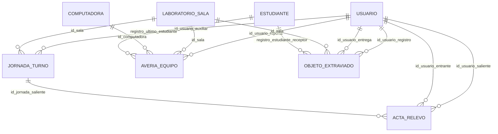

# MÓDULO 6: TURNOS DE GUARDIA, INCIDENCIAS TÉCNICAS Y OBJETOS EXTRAVIADOS - CITEF FCEE UAGRM
**Documento Técnico de Implementación y Guía de Verificación**

---

## 1. Resumen Ejecutivo del Módulo 6

El **Módulo 6** del Sistema CITEF (Facultad de Ciencias Económicas y Empresariales de la UAGRM) establece el marco operativo y formal para el control de guardias de los auxiliares de laboratorio, el traspaso inalterable de turnos (**Handover**), el reporte y vinculación contextual de fallas técnicas y el registro/custodia de objetos extraviados.

### Objetivos y Problemas Resueltos:
1. **Eliminación de la Evasión de Responsabilidades (CU21):**
   - Mediante el **Checklist Estructurado de Apertura** (JSONB), el auxiliar certifica el estado inicial físico de la sala (luces, orden, aire acondicionado, proyector, terminales encendidas) al momento de iniciar su horario.
   - Al cierre de la jornada, el sistema consolida automáticamente las sesiones atendidas durante la franja horaria, las averías reportadas y los bienes custodiados, generando el **Acta de Relevo Formal**.
   - El auxiliar entrante debe **firmar digitalmente** la conformidad de recepción del laboratorio (`aceptado_por_entrante: true`), disponiendo de un campo específico para registrar **discrepancias** si encuentra daños u omisiones no declaradas por el saliente.
2. **Trazabilidad Contextual de Fallas Técnicas (CU22):**
   - Cuando se detecta un desperfecto en una computadora (hardware, software, red, periféricos), el sistema **asocia automáticamente al último estudiante sentado** (mediante su registro en `AsignacionSesion`) o al **docente y materia titular** si la sala venía de una reserva curricular.
   - Pone automáticamente el equipo en estado `EN_MANTENIMIENTO` y sincroniza en tiempo real el mapa SPA mediante WebSockets.
3. **Custodia y Devolución Formal de Bienes Olvidados (CU23):**
   - Libro digital de pertenencias halladas en sala, categorizadas por tipo (`ELECTRONICA`, `DOCUMENTO`, `PRENDA`, etc.) con indicación del puesto físico exacto.
   - Flujo de restitución segura: solo se entrega al estudiante tras validar su Registro Universitario (RU) o Cédula de Identidad, registrando el auxiliar responsable de la devolución con fecha y hora auditadas.
4. **Principio de Centralidad del Administrador y Trazabilidad:**
   - Todas las entidades del módulo (`jornada_turno`, `acta_relevo`, `averia_equipo`, `objeto_extraviado`) mantienen llaves foráneas directas hacia `usuario(id_usuario)`.

---

## 2. Casos de Uso Implementados y Resueltos

| Caso de Uso | Denominación | Actor Iniciador | Detalle de la Solución Técnica |
| :--- | :--- | :--- | :--- |
| **CU21** | **Registrar apertura, cierre y relevo de turno** | Auxiliar de Laboratorio | Apertura con checklist JSONB de sala, temporizador en vivo, consolidación automática de atenciones de alumnos y suscripción de acta de relevo con firma digital de conformidad y discrepancias. |
| **CU22** | **Reportar averías técnicas** | Auxiliar de Laboratorio | Detección de fallas en PC con auto-vinculación contextual del último alumno o cátedra, inhabilitación inmediata del equipo a `EN_MANTENIMIENTO` y emisión a la cola técnica de soporte. |
| **CU23** | **Gestionar objetos extraviados** | Auxiliar de Laboratorio | Registro de bienes olvidados clasificados por categorías y ubicación física exacta, control de custodia y acta de restitución formal validando el RU del estudiante reclamante. |

---

## 3. Arquitectura de Datos y Persistencia (Backend NestJS + TypeORM)

### 3.1. Entidades en `citef_backend/src/modules/turnos/entities/`

#### A. Entidad `JornadaTurno` (`jornada_turno`)
* **`id_jornada`**: `BIGSERIAL` (PK).
* **`id_usuario_auxiliar`**: `BIGINT` (FK a `usuario`). Auxiliar que opera la sala.
* **`id_sala`**: `INTEGER` (FK a `laboratorio_sala`).
* **`id_asignar_turno`**: `BIGINT` (FK a `asignar_turno`, nullable).
* **`fecha`**: `DATE` (YYYY-MM-DD).
* **`hora_apertura`**: `TIMESTAMP WITH TIME ZONE`.
* **`hora_cierre`**: `TIMESTAMP WITH TIME ZONE` (nullable).
* **`checklist_apertura`**: `JSONB` estructurado (`luces`, `orden_limpieza`, `aire_acondicionado`, `proyector`, `pcs_encendidas`, `observaciones`).
* **`checklist_cierre`**: `JSONB` estructurado (verificaciones de salida).
* **`cant_estudiantes_atendidos`**: `INTEGER` (consolidado automático).
* **`cant_averias_reportadas`**: `INTEGER` (consolidado automático).
* **`cant_objetos_custodiados`**: `INTEGER` (consolidado automático).
* **`obs_cierre`**: `TEXT` (novedades finales).
* **`estado`**: `VARCHAR(25)` (`EN_CURSO`, `CERRADO_NORMAL`, `CERRADO_CON_NOVEDADES`, `RELEVADO`).

#### B. Entidad `ActaRelevo` (`acta_relevo`)
* **`id_acta_relevo`**: `BIGSERIAL` (PK).
* **`id_jornada_saliente`**: `BIGINT` (FK a `jornada_turno`).
* **`id_usuario_saliente`**: `BIGINT` (FK a `usuario`).
* **`id_usuario_entrante`**: `BIGINT` (FK a `usuario`).
* **`fecha_hora_relevo`**: `TIMESTAMP WITH TIME ZONE`.
* **`cant_equipos_operativos`**: `SMALLINT`.
* **`cant_averias_pend`**: `SMALLINT`.
* **`cant_objetos_custodia`**: `SMALLINT`.
* **`novedades`**: `TEXT`.
* **`aceptado_por_entrante`**: `BOOLEAN` (default `false`).
* **`fecha_hora_conformidad`**: `TIMESTAMP WITH TIME ZONE` (nullable).
* **`obs_discrepancia`**: `TEXT` (observaciones en caso de disconformidad).

#### C. Entidad `AveriaEquipo` (`averia_equipo`)
* **`id_averia`**: `BIGSERIAL` (PK).
* **`id_computadora`**: `BIGINT` (FK a `computadora`).
* **`id_sala`**: `INTEGER` (FK a `laboratorio_sala`).
* **`id_usuario_reporta`**: `BIGINT` (FK a `usuario`).
* **`registro_ultimo_estudiante`**: `VARCHAR(20)` (FK a `estudiante`, nullable).
* **`id_reserva`**: `INTEGER` (FK a `reserva_sala`, nullable).
* **`id_jornada`**: `BIGINT` (FK a `jornada_turno`, nullable).
* **`tipo_falla`**: `VARCHAR(25)` (`HARDWARE`, `SOFTWARE`, `RED`, `PERIFERICO`).
* **`descrip_falla`**: `TEXT`.
* **`gravedad`**: `VARCHAR(20)` (`BAJA`, `MEDIA`, `CRITICA`).
* **`estado`**: `VARCHAR(30)` (`PENDIENTE_REVISION`, `EN_TALLER`, `REPARADO`, `DESCARTADO`).
* **`fecha_reporte`**: `TIMESTAMP WITH TIME ZONE`.
* **`solucion_tecnica`**: `TEXT` (nullable).
* **`fecha_solucion`**: `TIMESTAMP WITH TIME ZONE` (nullable).

#### D. Entidad `ObjetoExtraviado` (`objeto_extraviado`)
* **`id_objeto`**: `BIGSERIAL` (PK).
* **`id_sala`**: `INTEGER` (FK a `laboratorio_sala`).
* **`id_jornada_hallazgo`**: `BIGINT` (FK a `jornada_turno`, nullable).
* **`id_usuario_registro`**: `BIGINT` (FK a `usuario`).
* **`categoria`**: `VARCHAR(40)` (`ELECTRONICA`, `DOCUMENTO`, `PRENDA`, `MATERIAL_ESTUDIO`, `OTRO`).
* **`descrip_detallada`**: `VARCHAR(255)`.
* **`lugar_exacto`**: `VARCHAR(100)` (ej. "Mesa PC-14").
* **`fecha_hora_hallazgo`**: `TIMESTAMP WITH TIME ZONE`.
* **`estado`**: `VARCHAR(20)` (`BAJA_CUSTODIA`, `DEVUELTO`, `DONADO_ARCHIVO`).
* **`registro_estudiante_receptor`**: `VARCHAR(20)` (FK a `estudiante`, nullable).
* **`id_usuario_entrega`**: `BIGINT` (FK a `usuario`, nullable).
* **`fecha_hora_devolucion`**: `TIMESTAMP WITH TIME ZONE` (nullable).
* **`obs_devolucion`**: `TEXT` (nullable).

---

## 4. Endpoints de la API RESTful (Backend NestJS)

Todos los controladores cuentan con validación `@UseGuards(JwtAuthGuard, RolesGuard)`, RBAC granular y auditoría transaccional:

### A. Turnos y Relevos (`TurnosController` - `/api/v1/turnos`)
* **`POST /api/v1/turnos/apertura`**: Inicia jornada con checklist de apertura (`TURNOS_APERTURA_CIERRE`).
* **`GET /api/v1/turnos/activa`**: Obtiene la jornada `EN_CURSO` del auxiliar autenticado (`TURNOS_APERTURA_CIERRE`).
* **`POST /api/v1/turnos/:id/cierre`**: Cierra la jornada con checklist y consolidación de atenciones (`TURNOS_APERTURA_CIERRE`).
* **`GET /api/v1/turnos/jornadas`**: Listado paginado y filtrable de jornadas (`TURNOS_APERTURA_CIERRE`).
* **`POST /api/v1/turnos/:id/acta-relevo`**: Genera el acta formal de traspaso de turno (`TURNOS_APERTURA_CIERRE`).
* **`POST /api/v1/turnos/actas/:id/firmar`**: Firma digital de conformidad por el auxiliar entrante (`TURNOS_APERTURA_CIERRE`).
* **`GET /api/v1/turnos/actas`**: Consulta histórica de actas de relevo (`TURNOS_APERTURA_CIERRE`).

### B. Incidencias Técnicas (`AveriasController` - `/api/v1/turnos/averias`)
* **`POST /api/v1/turnos/averias`**: Reporta falla técnica con auto-vinculación de último usuario (`TURNOS_INCIDENCIAS_REPORTAR`).
* **`GET /api/v1/turnos/averias`**: Consulta paginada con filtros por sala, gravedad y estado (`TURNOS_INCIDENCIAS_REPORTAR`).
* **`GET /api/v1/turnos/averias/ultimo-usuario/:idComputadora`**: Obtiene el último estudiante o reserva para prellenado inteligente (`TURNOS_INCIDENCIAS_REPORTAR`).
* **`PATCH /api/v1/turnos/averias/:id/estado`**: Transición de estado (`EN_TALLER`, `REPARADO`, etc.) (`TURNOS_INCIDENCIAS_REPORTAR`).

### C. Objetos Extraviados (`ObjetosExtraviadosController` - `/api/v1/turnos/objetos`)
* **`POST /api/v1/turnos/objetos`**: Registra un objeto olvidado bajo custodia (`TURNOS_OBJETOS_EXTRAVIADOS`).
* **`GET /api/v1/turnos/objetos`**: Listado paginado con filtros por categoría y estado (`TURNOS_OBJETOS_EXTRAVIADOS`).
* **`POST /api/v1/turnos/objetos/:id/devolver`**: Restituye el objeto al estudiante titular (`TURNOS_OBJETOS_EXTRAVIADOS`).

---

## 5. Interfaz de Usuario y Vistas (Frontend Angular 18)

Todas las vistas respetan estrictamente las directrices institucionales de `AGENTS.md`:
* **Cero emojis**: Bootstrap Icons vectorial (`<i class="bi bi-*"></i>`).
* **Paleta FCEE**: Rojo Carmesí (`#A81124`) y Azul Marino (`#002855`).
* **Paginación uniforme**: 15 filas con `<app-pagination>`.
* **Componentes compartidos**: `PaginationComponent`, `ModalAlertComponent`, `TableCardComponent`, `ConfirmModalComponent`.
* **Validaciones**: Mensajes en letras rojas `#DC2626` debajo de los campos (`.field-error-text`) y modales que no se cierran ante rechazo del servidor.

### Vistas Implementadas en `citef_frontend/src/app/pages/turnos/`:
1. **`control-guardia/` (Control de Guardia en Vivo - CU21):**
   - Modal de apertura de turno con checklist dinámico interactivo (luces, orden, aire, proyector, PCs operativas).
   - Panel de turno activo con cronómetro en tiempo real, sala asignada, métricas de alumnos atendidos y averías registradas.
   - Modal de cierre con checklist de salida, resumen consolidado automático y botón para pasar directamente al relevo.
2. **`acta-relevo/` (Historial de Actas y Traspaso de Guardia - CU21):**
   - Tabla formal de actas con buscador y filtro por sala y fechas.
   - Visor modal del Acta Oficial de Relevo (Handover) con sello institucional UAGRM, desglose de equipos operativos, averías pendientes y objetos en custodia.
   - Botón de firma digital para el auxiliar entrante con campo de observaciones de discrepancia.
   - Botón para imprimir / vista limpia formal para archivo físico.
3. **`averias/` (Bandeja de Averías e Incidencias Técnicas - CU22):**
   - Barra de filtros (búsqueda, sala, gravedad y estado) con botón **Buscar** y **Limpiar**.
   - Tabla interactiva con badges de gravedad (Baja en azul, Media en ámbar, Crítica en carmesí).
   - Modal inteligente de reporte: al seleccionar la computadora, precarga automáticamente el nombre y matrícula del último estudiante que utilizó la terminal o la cátedra previa.
   - Modal de transición de estado (envío a taller o confirmación de reparación).
4. **`objetos-extraviados/` (Libro Digital de Pertenencias Halladas - CU23):**
   - Tabla con badges de custodia (Azul Marino) y devuelto (Verde esmeralda).
   - Modal de registro de objeto hallado con ubicación exacta (ej. "Mesa PC-14").
   - Modal de devolución con búsqueda de estudiante por matrícula (RU) o CI y registro auditado del acta de entrega.

---

## 6. Navegación en Sidebar y Matriz de Permisos RBAC

En [`shell.component.ts`](file:///home/nataly/Projects/laboratorios/citef_frontend/src/app/layout/shell/shell.component.ts), los ítems del sidebar se presentan condicionados por permisos:
* **Control de Guardia:** `TURNOS_APERTURA_CIERRE` $\rightarrow$ `/admin/turnos/guardia`
* **Actas de Relevo:** `TURNOS_APERTURA_CIERRE` $\rightarrow$ `/admin/turnos/actas`
* **Averías Técnicas:** `TURNOS_INCIDENCIAS_REPORTAR` $\rightarrow$ `/admin/turnos/averias`
* **Objetos Extraviados:** `TURNOS_OBJETOS_EXTRAVIADOS` $\rightarrow$ `/admin/turnos/objetos`

---

## 7. Guía Paso a Paso de Pruebas en el Frontend (Manual de Verificación por Roles)

Esta sección describe detalladamente el protocolo de pruebas paso a paso para comprobar toda la funcionalidad visual, validaciones en letras rojas y flujos operativos del Módulo 6 en `http://localhost:4200`.

### 7.1. Credenciales de Acceso para Pruebas

| Rol Institucional | Correo Electrónico | Contraseña | Alcance en Módulo 6 |
| :--- | :--- | :--- | :--- |
| **`ADMINISTRADOR`** | `admin@uagrm.edu.bo` | `Admin123*` | Acceso total a todas las vistas, acciones por fila, actas, averías y entrega de objetos. |
| **`AUXILIAR`** | `auxiliar@uagrm.edu.bo` | `Auxiliar123*` | Operador diario: apertura/cierre de guardia, firma de actas de relevo, reporte de fallas y custodia de objetos. |
| **`DOCENTE`** | `docente@uagrm.edu.bo` | `Docente123*` | Usuario curricular: verificación de restricción RBAC (sidebar sin turnos y acceso denegado por URL). |

---

### 7.2. Protocolo de Pruebas Paso a Paso

#### Prueba 1: Guardias y Relevos de Laboratorio (CU21) — Ruta: `/admin/turnos/guardia`

##### A. Flujo del Auxiliar de Laboratorio (`auxiliar@uagrm.edu.bo` / `Auxiliar123*`)
1. **Acceso:** En el Sidebar, hacer clic en **"Guardias y Relevos"**.
2. **Estado Inicial sin Guardia:** Aparece la tarjeta limpia *"Sin guardia activa en este momento"* con el botón carmesí **"Iniciar Apertura de Guardia"**.
3. **Apertura de Guardia:** Clic en **"Iniciar Apertura de Guardia"**.
4. **Verificación de Validaciones Negativas (Letras Rojas):**
   * Dejar el selector de laboratorio en blanco o ingresar PCs negativas (ej. `-5`).
   * Clic en **"Iniciar Guardia Oficial"**.
   * **Resultado a Verificar:** Mensajes en letras rojas institucionales (`#DC2626`) debajo del campo (`.field-error-text`) con bordes en rojo (`.input-error`):
     - *"Debe seleccionar un laboratorio para la guardia."*
     - *"La cantidad de computadoras no puede ser negativa."*
5. **Apertura Exitosa:**
   * Seleccionar el laboratorio asignado (ej. `LAB-01`).
   * Marcar los checkboxes de verificación inicial (Iluminación, Orden, Climatización, Proyector).
   * Escribir `20` en computadoras verificadas y clic en **"Iniciar Guardia Oficial"**.
   * **Resultado a Verificar:** Se despliega el panel compacto de **Guardia en Vivo**:
     - Indicador pulsante verde **"GUARDIA EN VIVO"**.
     - **Cronómetro interactivo** en tiempo real (`00:00:01`, `00:00:02`...).
     - Nombre completo del auxiliar responsable en turno.
     - Chips de métricas compactas en tiempo real: *Estudiantes*, *Averías*, *Objetos*.
6. **Cierre de Guardia con Emisión Automática de Acta (Composición):**
   * En el panel de guardia, hacer clic en el botón carmesí **"Cerrar Guardia"**.
   * Se abre el modal con consolidación automática de métricas (estudiantes asistidos, averías reportadas, objetos).
   * Marcar las verificaciones de salida (Computadoras, Luces, Aire, Proyector, Orden).
   * En el selector **"Auxiliar Entrante para Relevo (Handover)"**:
     - El auxiliar actual queda **automáticamente excluido** de la lista para evitar autorelevos inválidos.
     - Para turnos diurnos (mañana hacia tarde), se selecciona al auxiliar entrante en sala física.
     - Para turnos de cierre nocturno o finalización de jornada sin entrega física presencial, se dispone de la opción: *"Sin relevo presencial directo (Turno Noche / Fin de Jornada)"*.
   * Las casillas de verificación del checklist de cierre vienen desmarcadas por defecto (`false`), permitiendo al auxiliar marcar explícitamente el estado de orden, apagado y clima según corresponda a su horario.
   * Clic en **"Cerrar Guardia y Emitir Acta"**.
   * **Resultado a Verificar:**
     - La guardia se cierra de inmediato.
     - El sistema emite automáticamente el **Acta Oficial de Relevo** vinculada al auxiliar entrante (garantizando la relación de composición donde el acta nace del cierre de guardia).
     - Se actualiza la pestaña *"Historial de Guardias"* y la pestaña *"Actas de Relevo"*.

##### B. Flujo del Administrador (`admin@uagrm.edu.bo` / `Admin123*`)
1. **Acceso:** En el Sidebar, hacer clic en **"Guardias y Relevos"**.
2. **Dashboard de Supervisión en Vivo:**
   * El Administrador no abre guardias físicas individuales; visualiza la cuadrícula ejecutiva de **Supervisión Operativa de Laboratorios en Vivo**.
   * Para cada sala: código, nombre, piso.
   * Si una sala tiene guardia abierta por un auxiliar: badge verde pulsante **"EN VIVO"**, nombre del auxiliar responsable, hora de apertura y contadores en tiempo real (estudiantes, averías, objetos).
   * Si está vacía: badge neutral *"Sin guardia"*.
3. **Pestañas Unificadas:**
   * **Historial de Guardias:** Auditoría completa de aperturas y cierres con filtros y paginación de 15 filas.
   * **Actas de Relevo (Handover):** Registro de todas las actas emitidas al cerrar guardias, con botón de "Ver Acta" membretada FCEE UAGRM para imprimir.

---

#### Prueba 2: Firma de Conformidad y Discrepancias en Acta de Relevo — Ruta: `/admin/turnos/guardia` (Pestaña "Actas de Relevo")
1. **Acceso:** En la vista de "Guardias y Relevos", hacer clic en la pestaña **"Actas de Relevo (Handover)"** (o acceder a `/admin/turnos/guardia`).
2. **Búsqueda y Filtros:** Usar la barra superior para buscar por texto, sala, fecha y el selector *"Solo pendientes de firma"*, probando los botones **"Buscar"** y **"Limpiar"**.
3. **Ver Acta Oficial para Imprimir:**
   * En cualquier fila de acta, hacer clic en el botón de acción **"Ver Acta"** (ícono `bi bi-file-earmark-medical`).
   * Se abre el modal con el documento formal membretado FCEE UAGRM (desglose de auxiliares saliente/entrante, balances de máquinas operativas, averías pendientes y objetos en custodia).
   * Clic en el botón **"Imprimir Acta"**: se abre la vista previa de impresión limpia de navegador con estilos oficiales `@media print`.
4. **Verificación de Firma Digital de Conformidad (Auxiliar Entrante):**
   * En una fila con acta pendiente de firma, hacer clic en el botón **"Firmar Relevo"** (ícono `bi bi-pen`).
   * **Prueba Negativa (Auxiliar no designado):** Si un usuario distinto al auxiliar entrante asignado al cierre del turno intenta firmar el relevo, el sistema rechaza la operación mostrando en el banner de alerta: *"El auxiliar designado debe firmar"*.
   * **Prueba Negativa (Discrepancia sin detalle):**
     - Seleccionar la opción de radio: *"Acepto con Observaciones de Discrepancia"*.
     - Dejar el campo de texto de observaciones vacío.
     - Clic en **"Certificar Firma Digital"**.
     - **Resultado a Verificar:** El modal no se cierra y muestra en letras rojas: *"Si no está conforme, debe registrar el detalle de las discrepancias observadas en la sala."*
   * **Prueba Positiva:**
     - Escribir en observaciones: *"Falta un cable HDMI en la mesa docente no reportado por el auxiliar saliente."* (o seleccionar *"Acepto en Plena Conformidad"*).
     - Clic en **"Certificar Firma Digital"**.
     - **Resultado a Verificar:** El acta se sella digitalmente con la hora exacta y su badge conmuta a verde esmeralda *"Conforme"* o amarillo *"Con Discrepancia"*.

---

#### Prueba 3: Gestión de Averías Técnicas (CU22) — Ruta: `/admin/turnos/averias`
1. **Acceso:** En el Sidebar, hacer clic en **"Averías Técnicas"**.
2. **Reportar Falla Técnica:** Clic en el botón carmesí **"Reportar Avería"**.
3. **Verificación de Validaciones Negativas:**
   * Dejar el modal vacío y hacer clic en **"Registrar Avería"**.
   * **Resultado a Verificar:** Textos de error en letras rojas (`#DC2626`) debajo de Sala, Computadora y Descripción.
4. **Verificación de Auto-Vinculación Contextual Inteligente y Selector Visual en Mapa:**
   * Seleccionar la sala `LAB-01`.
   * **Opción A (Selector desplegable):** Seleccionar una computadora de la lista (ej. `L1-PC01` o `L1-DOCENTE`).
   * **Opción B (Mapa Visual Compartido):** Hacer clic en el botón **"Mapa Visual"** (ícono `bi bi-grid-3x3`). Se abrirá el modal compartido `SelectorComputadoraModalComponent` que reproduce fielmente el diseño arquitectónico de la sala con filas y columnas de computadoras. Al hacer clic sobre cualquier equipo de la matriz (ej. `PC-03`), este queda seleccionado y la tarjeta se actualiza al instante.
   * **Resultado a Verificar:** El sistema consulta automáticamente al backend y renderiza la **Tarjeta de Auto-Vinculación Contextual**, precargando el nombre, Registro Universitario (RU) o cátedra del último usuario que ocupó la estación.
   * Seleccionar Tipo de Falla: `HARDWARE`.
   * Gravedad: `CRITICA` (o `MEDIA`).
   * Descripción: *"El equipo se apaga repentinamente tras 5 minutos de uso."*
   * Clic en **"Registrar Avería"**.
   * **Resultado a Verificar:**
     - La avería se agrega a la tabla con badge rojo carmesí `CRITICA` y estado `PENDIENTE_REVISION`.
     - La computadora conmuta automáticamente su estado a `EN_MANTENIMIENTO` en el sistema.
5. **Cambio de Estado de Avería:**
   * En la fila de la avería, hacer clic en el botón **"Cambiar Estado"** (ícono de llave de tuercas `bi bi-wrench`).
   * Seleccionar estado `REPARADO`.
   * Escribir solución técnica: *"Se aplicó pasta térmica al disipador y se verificó estabilidad por 40 minutos."*
   * Clic en **"Guardar Estado"**.
   * **Resultado a Verificar:** La avería queda registrada como reparada y la computadora vuelve automáticamente a estado `DISPONIBLE`.

---

#### Prueba 4: Libro de Objetos Extraviados (CU23) — Ruta: `/admin/turnos/objetos`
1. **Acceso:** En el Sidebar, hacer clic en **"Objetos Extraviados"**.
2. **Registrar Objeto Olvidado:** Clic en **"Registrar Objeto Olvidado"**.
3. **Validación Negativa:** Clic en "Registrar Objeto" con campos vacíos $\rightarrow$ verificar mensajes de alerta en rojo.
4. **Flujo Positivo de Custodia:**
   * Seleccionar Sala: `LAB-01`.
   * Categoría: `MATERIAL_ESTUDIO` (o `ELECTRONICA`).
   * Descripción: *"Calculadora científica Casio fx-991LA ClassWiz color negro"*.
   * Lugar Exacto: *"Mesa PC-04, debajo del monitor"*.
   * Clic en **"Registrar Objeto"**.
   * **Resultado a Verificar:** El bien se lista con badge Azul Marino FCEE **"Bajo Custodia"**.
5. **Restitución Formal al Estudiante:**
   * En la fila del objeto, hacer clic en el botón **"Entregar al Estudiante"** (ícono `bi bi-box-arrow-right`).
   * **Prueba Negativa:** Intentar confirmar sin escribir el registro ni el nombre del estudiante $\rightarrow$ verificar mensajes en letras rojas institucionales (`#DC2626`): *"Debe ingresar el Registro Universitario (RU) o C.I. del estudiante."* y *"Debe ingresar el nombre completo del estudiante reclamante."*.
   * **Prueba Positiva:**
     - Ingresar un registro válido (ej. `220011501` o cualquier RU/C.I.).
     - Al perder el foco o presionar Enter en el campo de RU, el sistema autocompleta predictivamente el nombre del estudiante si ya se encuentra en la base de datos (o permite ingresar el nombre completo manualmente).
     - En observaciones escribir: *"El alumno acreditó su carnet universitario y describió las características del equipo."*
   * Clic en **"Certificar Entrega y Restitución"**.
   * **Resultado a Verificar:** El estado cambia a verde esmeralda **"Restituido"**, consignando la fecha/hora exacta, el RU, el nombre completo del estudiante receptor y el auxiliar que efectuó la entrega formal. Al pulsar "Ver detalle", el comprobante formal de custodia refleja el nombre y RU acreditados.

---

#### Prueba 5: Verificación de Restricciones RBAC (Perfil Docente)
1. **Cerrar Sesión:** Hacer clic en el menú del usuario (esquina superior derecha) y seleccionar **"Cerrar Sesión"**.
2. **Iniciar Sesión como Docente:** Ingresar con `docente@uagrm.edu.bo` / `Docente123*`.
3. **Resultado a Verificar:**
   * En la barra lateral (sidebar) **NO aparecen** los enlaces de Control de Guardia, Actas de Relevo, Averías ni Objetos Extraviados.
   * Si se intenta forzar la navegación por URL a `http://localhost:4200/admin/turnos/guardia`, el guardia de permisos (`permissionGuard`) intercepta la petición y redirige al docente de vuelta a `/admin/inicio` o `/admin/reservas/calendario`.

---

## 8. Resumen de Actualizaciones y Control de Versiones del Documento

| Versión | Fecha | Secciones Afectadas | Descripción de Cambios y Mejoras Implementadas |
| :--- | :--- | :--- | :--- |
| **v1.4** | 2026-10-25 | UI/UX, Backend, Entidades, Modales | **1. Eliminación de Padding Redundante en Módulo 6:** Ajuste de `.control-guardia-container`, `.averias-container`, `.objetos-container` y `.actas-container` a `padding: 0`, eliminando el margen duplicado sobre `.content-wrapper` para alinear todas las vistas con el resto del sistema. **2. Resolución de Firma de Actas y Manejo de Errores Formal:** Soporte dual para métodos HTTP `POST` y `PATCH` en `/api/v1/turnos/actas/:id/firmar`, soporte dual de DTO `conforme`/`aceptado` y validación de auxiliares autorizados con el mensaje estandarizado: *"El auxiliar designado debe firmar*". **3. Lógica Estricta de Estado "Novedades" en Guardia:** Restricción del cálculo de incidentes operacionales exclusivamente a averías técnicas (`cantAverias > 0`) o notas explícitas de cierre (`obs_cierre`), excluyendo objetos extraviados para no marcar guardias ordinarias con novedades indebidamente. **4. Registro y Validación de Nombre de Estudiante en Devoluciones (CU23):** Integración obligatoria del campo de nombre completo del estudiante en el modal de restitución y entidad `ObjetoExtraviado`, con búsqueda automática predictiva por RU/CI y presentación formal en comprobantes y tablas. **5. Expansión Ergonómica de Padding y Espaciado en Sidebar:** Incremento del ancho del sidebar (255px) y ampliación de paddings en encabezados de módulos, enlaces y subenlaces para una navegación holgada y de alta legibilidad. |
| **v1.3** | 2026-10-25 | Componentes, UI/UX, Backend, Docs | **1. Selector Visual Compartido de Estaciones (`SelectorComputadoraModalComponent`):** Creación del componente compartido que desacopla la visualización en cuadrícula física del laboratorio (`mini-stage-container`) para su reutilización en Averías, permitiendo seleccionar la máquina interactuando directamente con el mapa arquitectónico. **2. Corrección Integral de Filtros y Mapeo de Paginación:** Resolución del error donde las tablas no mostraban registros registrados; soporte dual para `items` y `data`, y parámetros `page`/`pagina` y `limit`/`limite` en DTOs y controladores del backend y servicios del frontend. **3. Exclusión del Auxiliar Actual en Relevo:** Filtrado reactivo en el selector de relevo para evitar que el auxiliar que cierra el turno se seleccione a sí mismo. **4. Flexibilidad de Turnos y Checklist por Defecto Desmarcado:** Checkboxes de checklist de cierre inician en `false` adaptándose a las dinámicas de turnos (mañana deja PCs encendidas; noche apaga y cierra todo). Opción explícita de cierre nocturno sin entrega presencial inmediata. **5. Reorganización del Menú Lateral (Sidebar) en Acordeón:** Agrupación colapsable de módulos con nombres concisos (1-2 palabras: "Inicio", "Seguridad", "Catálogos", "Infraestructura", "Monitoreo", "Reservas", "Guardias") y despliegue automático del módulo activo. |
| **v1.2** | 2026-10-25 | Sección 6, Sección 7, Sección 8 | **1. Unificación de Guardias y Relevos en una Sola Página:** Integración de la gestión de turnos y actas de relevo en `/admin/turnos/guardia` mediante pestañas organizadas. **2. Relación de Composición Inviolable de Actas de Relevo:** El acta no existe huérfana; al cerrar una guardia se emite automáticamente con las métricas consolidadas en tiempo real. **3. Diferenciación de Experiencia por Rol:** El `ADMINISTRADOR` visualiza el panel de supervisión en vivo de todos los laboratorios con cronómetros y métricas en tiempo real; el `AUXILIAR` opera su guardia física individual. **4. Limpieza Visual y KPIs Compactos:** Eliminación de textos redundantes y reducción de métricas a chips compactos ejecutivos. **5. Corrección de Selectores y Nombres:** Resolución de 404 en catálogo de auxiliares y visualización correcta del auxiliar responsable en turno. |
| **v1.1** | 2026-10-24 | Sección 7, Sección 8 | **Inclusión del Manual de Pruebas de Frontend Paso a Paso:** Protocolo detallado con credenciales de prueba (`ADMINISTRADOR`, `AUXILIAR`, `DOCENTE`), flujos positivos, verificaciones negativas con mensajes de error en letras rojas institucionales (`#DC2626`) en modales, firma digital de relevo y restitución de bienes. |
| **v1.0** | 2026-10-24 | Documento Completo | **1. Especificación e Implementación Integral del Módulo 6 (CU21, CU22, CU23):** Desarrollo de persistencia, lógica de negocio y vistas SPA para guardias, actas de relevo, averías técnicas y objetos extraviados. **2. Checklist Estructurado JSONB y Firma de Relevo:** Formalización de apertura/cierre de guardia y acta de traspaso formal con conformidad digital y discrepancias. **3. Auto-Vinculación Contextual:** Identificación automática del último estudiante o reserva al reportar averías técnicas. **4. Restitución Acreditada:** Control de custodia y entrega formal de pertenencias olvidadas. **5. Centralidad del Administrador:** Integración de llaves foráneas a `Usuario` en todas las entidades conforme a `image copy 4.png`. **6. UI/UX FCEE:** Cero emojis, paleta institucional carmesí/marino, paginación estándar de 15 filas y componentes compartidos. |

---

*CITEF FCEE UAGRM - Módulo 6 completado, certificado y documentado en estricta conformidad con el PLAN_DE_IMPLEMENTACION.md.*
