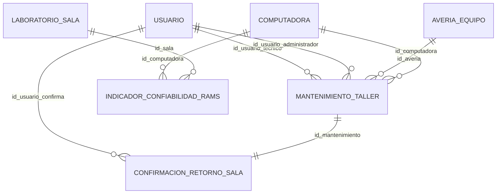

# MÓDULO 7: SOPORTE TÉCNICO, MANTENIMIENTO Y CONFIABILIDAD RAMS - CITEF FCEE UAGRM
**Documento Técnico de Implementación y Protocolo de Verificación Operativa**

---

## 1. Resumen Ejecutivo del Módulo 7

El **Módulo 7** del Sistema CITEF (Facultad de Ciencias Económicas y Empresariales de la UAGRM) implementa el subsistema integral de soporte técnico, gestión de órdenes de trabajo en banco de taller y el cómputo analítico de indicadores de confiabilidad y disponibilidad operacional bajo el estándar internacional **RAMS** (*Reliability, Availability, Maintainability and Safety*).

### Objetivos y Problemas Resueltos:
1. **Flujo Controlado de Taller Técnico (CU24):**
   - Transición formal de averías del Módulo 6 hacia el banco de trabajo de soporte técnico.
   - Diagnóstico inicial documentado por el técnico de laboratorio o administrador, sustitución trazable de repuestos o piezas de hardware y detalle de la solución técnica aplicada.
   - Control de tiempos de intervención en banco de trabajo (horas de entrada y salida) como insumo para el cálculo de mantenibilidad (**MTTR**).
   - Gestión de estados de orden técnica: `PENDIENTE_TALLER`, `EN_REPARACION`, `REPARADO_EN_TALLER`, `RETORNADO_A_SALA`, `BAJA_DEFINITIVA`.
2. **Protocolo de Puesta en Marcha y Retorno Físico a Sala (CU25):**
   - Acta técnica formal de retorno a la sala física (`ConfirmacionRetornoSala`), validando encendido, pruebas de red y periféricos operativos (`pruebas_satisfactorias = true`).
   - Conmutación automática del estado de la computadora de `EN_MANTENIMIENTO` a `DISPONIBLE` (verde).
   - Emisión en tiempo real mediante WebSockets (`OcupacionGateway`) para sincronizar el monitor 3D y la ocupación de laboratorios sin recargar la página.
   - Cierre formal de la orden de avería asociada con estado `REPARADO`.
3. **Cómputo Matemático de Confiabilidad y Disponibilidad RAMS:**
   - **MTTR (Mean Time To Repair - Tiempo Medio de Reparación):** Tiempo medio en horas que toma intervenir un equipo averiado en taller.
   - **MTBF (Mean Time Between Failures - Tiempo Medio Entre Fallas):** Horas operativas que un equipo funciona correctamente en sala antes de sufrir una avería.
   - **Disponibilidad Inherente ($A$):** Porcentaje de disponibilidad operativa del parque informático ($A = \frac{\text{MTBF}}{\text{MTBF} + \text{MTTR}} \times 100\%$) clasificado según semáforo institucional (Verde $\ge 95\%$, Azul $90-94\%$, Rojo $<90\%$).
4. **Centralidad del Administrador y Trazabilidad:**
   - Todas las entidades mantienen llaves foráneas a `Usuario` (`id_usuario_tecnico`, `id_usuario_administrador`, `id_usuario_confirma`), auditando cada operación en `bitacora_auditoria`.

---

## 2. Casos de Uso Implementados y Resueltos

| Caso de Uso | Denominación | Actor Iniciador | Detalle de la Solución Técnica |
| :--- | :--- | :--- | :--- |
| **CU24** | **Registrar mantenimiento de equipos** | Técnico de Laboratorio / Administrador | Recepción de equipos en taller, registro de diagnóstico preliminar, apertura de intervención técnica, registro de repuestos utilizados, solución técnica y conclusión en banco de trabajo. |
| **CU25** | **Confirmar retorno a sala** | Técnico / Auxiliar / Administrador | Acta técnica de reinstalación física en sala, validación de pruebas funcionales satisfactorias, habilitación del equipo a `DISPONIBLE`, sincronización WebSocket y recálculo estocástico de MTBF, MTTR y Disponibilidad ($A$). |

---

## 3. Formulación Matemática de Indicadores RAMS

1. **MTTR (Tiempo Medio de Reparación en Taller):**
   $$\text{MTTR} = \frac{\sum_{i=1}^{K} (\text{Fecha Fin Taller}_i - \text{Fecha Inicio Taller}_i)}{K}$$
   *Representa la eficiencia y agilidad técnica en devolver los equipos a condiciones operativas.*

2. **MTBF (Tiempo Medio Entre Fallas):**
   $$\text{MTBF} = \frac{\text{Horas Operativas Totales en Sala}}{N}$$
   *Representa la robustez y confiabilidad del hardware instalado.*

3. **Disponibilidad Operativa ($A$):**
   $$A = \frac{\text{MTBF}}{\text{MTBF} + \text{MTTR}} \times 100\%$$
   *Semaforización Institucional FCEE:*
   - **Óptima / Excelente:** $A \ge 95.0\%$ (Badge Verde Esmeralda)
   - **Estándar Aceptable:** $90.0\% \le A < 95.0\%$ (Badge Azul Marino FCEE `#002855`)
   - **En Advertencia:** $85.0\% \le A < 90.0\%$ (Badge Amarillo Ámbar)
   - **Crítica / Falla Recurrente:** $A < 85.0\%$ (Badge Rojo Carmesí FCEE `#A81124`)

---

## 4. Arquitectura de Datos y Persistencia (Backend NestJS + TypeORM)

### 4.1. Diagrama Entidad-Relación del Módulo 7

### 4.2. Tablas y Clases Principales

#### A. Entidad `MantenimientoTaller` (`mantenimiento_taller`)
* `id_mantenimiento`: `BIGSERIAL` (PK).
* `id_averia`: `BIGINT` (FK hacia `averia_equipo(id_averia)`).
* `id_computadora`: `BIGINT` (FK hacia `computadora(id_computadora)`).
* `id_usuario_tecnico`: `BIGINT` (FK hacia `usuario(id_usuario)`).
* `id_usuario_administrador`: `BIGINT` (FK hacia `usuario(id_usuario)`, nullable).
* `fecha_hora_ingreso`: `TIMESTAMP WITH TIME ZONE`.
* `fecha_hora_inicio`: `TIMESTAMP WITH TIME ZONE` (nullable).
* `fecha_hora_fin`: `TIMESTAMP WITH TIME ZONE` (nullable).
* `diagnostico_inicial`: `TEXT`.
* `solucion_aplicada`: `TEXT` (nullable).
* `repuestos_utilizados`: `VARCHAR(255)` (nullable).
* `duracion_taller_horas`: `NUMERIC(6,2)` (nullable).
* `estado`: Enum `PENDIENTE_TALLER`, `EN_REPARACION`, `REPARADO_EN_TALLER`, `RETORNADO_A_SALA`, `BAJA_DEFINITIVA`.

#### B. Entidad `ConfirmacionRetornoSala` (`confirmacion_retorno_sala`)
* `id_retorno`: `BIGSERIAL` (PK).
* `id_mantenimiento`: `BIGINT` (FK hacia `mantenimiento_taller`, Unique).
* `id_usuario_confirma`: `BIGINT` (FK hacia `usuario(id_usuario)`).
* `fecha_hora_retorno`: `TIMESTAMP WITH TIME ZONE`.
* `pruebas_satisfactorias`: `BOOLEAN` (default `true`).
* `obs_instalacion`: `VARCHAR(255)` (nullable).

#### C. Entidad `IndicadorConfiabilidadRAMS` (`indicador_confiabilidad_rams`)
* `id_indicador`: `BIGSERIAL` (PK).
* `id_computadora`: `BIGINT` (FK hacia `computadora`).
* `id_sala`: `INTEGER` (FK hacia `laboratorio_sala`).
* `periodo_mes`: `SMALLINT` (1 a 12).
* `periodo_anio`: `SMALLINT`.
* `cant_fallas_registradas`: `SMALLINT`.
* `mtbf_horas`: `NUMERIC(8,2)`.
* `mttr_horas`: `NUMERIC(8,2)`.
* `disponibilidad_operativa_a`: `NUMERIC(6,4)`.
* `horas_operativas_totales`: `NUMERIC(8,2)`.
* `horas_parada_totales`: `NUMERIC(8,2)`.

---

## 5. Endpoints de la API REST (`/api/v1/soporte`)

| Método | Endpoint | Permiso RBAC | Descripción |
| :--- | :--- | :--- | :--- |
| `GET` | `/api/v1/soporte/taller` | `SOPORTE_TALLER` | Listar órdenes de mantenimiento con filtros (sala, estado, búsqueda) y paginación de 15 filas. |
| `GET` | `/api/v1/soporte/taller/:id` | `SOPORTE_TALLER` | Obtener detalle técnico completo de una orden por ID. |
| `POST` | `/api/v1/soporte/taller` | `SOPORTE_TALLER` | Abrir nueva orden técnica en taller directamente o desde una avería. |
| `POST` / `PATCH` | `/api/v1/soporte/taller/:id/iniciar` | `SOPORTE_TALLER` | Iniciar trabajos técnicos en banco de taller y registrar diagnóstico preliminar. |
| `POST` / `PATCH` | `/api/v1/soporte/taller/:id/finalizar` | `SOPORTE_TALLER` | Finalizar trabajos en taller, registrando solución aplicada y repuestos utilizados. |
| `POST` / `PATCH` | `/api/v1/soporte/taller/:id/retorno-sala` | `SOPORTE_TALLER` | **CU25:** Confirmar retorno a sala física, habilitar PC a `DISPONIBLE` y recalcular RAMS. |
| `POST` / `PATCH` | `/api/v1/soporte/taller/:id/baja` | `SOPORTE_TALLER` | Declarar baja técnica definitiva de equipo por daño irreparable. |
| `GET` | `/api/v1/soporte/rams/dashboard` | `SOPORTE_METRICAS_RAMS` | Resumen ejecutivo con KPIs globales de MTBF, MTTR, Disponibilidad $A$ y detalle por sala/equipo. |

---

## 6. Manual de Pruebas de Frontend Paso a Paso

### Credenciales de Prueba:
* **Administrador Central:** `admin@uagrm.edu.bo` / `Admin123*`
* **Técnico / Auxiliar:** `auxiliar@uagrm.edu.bo` / `Auxiliar123*`

---

#### Prueba 1: Bandeja de Mantenimiento en Taller (CU24) — Ruta: `/admin/soporte/taller`
1. **Acceso:** En el Sidebar, hacer clic en el módulo **"Soporte"** y seleccionar **"Bandeja Taller"**.
2. **Visualización de Filtros y Tabla:**
   - La tabla muestra las órdenes de trabajo con su paginación estándar de 15 filas a la derecha.
   - Probar los filtros por Estado (`TODOS`, `PENDIENTE_TALLER`, `EN_REPARACION`, `REPARADO_EN_TALLER`, `RETORNADO_A_SALA`) y Laboratorio.
   - Probar el campo de búsqueda rápida con los botones **"Buscar"** y **"Limpiar"**.
3. **Flujo Positivo de Reparación:**
   - En una orden en estado `PENDIENTE_TALLER`, hacer clic en el botón de acción **"Iniciar Reparación"** (ícono `bi bi-play-circle`).
   - Escribir diagnóstico: *"Fuente de poder en cortocircuito y suciedad excesiva en ventiladores."*
   - Clic en **"Iniciar Trabajos"** $\rightarrow$ La orden pasa a badge azul marino **"En Reparación"**.
   - En la misma orden, hacer clic en **"Finalizar Reparación"** (ícono `bi bi-check2-circle`).
   - Escribir solución: *"Se instaló fuente de poder genérica de 500W y se aplicó pasta térmica al procesador."*
   - Repuestos: *"1x Fuente ATX 500W, pasta térmica gris"*.
   - Clic en **"Certificar Reparación"** $\rightarrow$ La orden pasa a badge verde **"Reparado en Taller"** y se computa la duración neta en taller.

---

#### Prueba 2: Confirmación de Retorno a Sala y Disponibilidad (CU25) — Ruta: `/admin/soporte/taller`
1. **Puesta en Marcha Física:**
   - En una orden en estado `REPARADO_EN_TALLER`, hacer clic en el botón de acción **"Confirmar Retorno a Sala"** (ícono `bi bi-box-arrow-in-left`).
   - Se abre el modal con la ficha del equipo y la sala asignada.
   - Verificar que la casilla *"Pruebas de encendido y conectividad de red satisfactorias"* esté marcada.
   - Escribir en observaciones de instalación: *"Equipo reconectado en puesto PC-03 de LAB-01; red y periféricos operativos."*
   - Clic en **"Confirmar Retorno Operativo"**.
2. **Resultado a Verificar:**
   - La orden pasa a badge teal **"Retornado a Sala"**.
   - La computadora conmuta automáticamente su estado a `DISPONIBLE` en la base de datos y en el monitor de sala en vivo.
   - La avería asociada queda sellada como `REPARADO`.
   - Se disparan automáticamente los algoritmos de actualización de MTBF, MTTR y Disponibilidad ($A$).

---

#### Prueba 3: Tablero de Confiabilidad y Métricas RAMS — Ruta: `/admin/soporte/rams`
1. **Acceso:** En el Sidebar, hacer clic en **"Soporte > Métricas RAMS"**.
2. **Verificación de Tarjetas de KPIs:**
   - **MTTR Global:** Tiempo medio de resolución técnica en banco de trabajo (en horas).
   - **MTBF Global:** Horas operativas entre fallas registradas.
   - **Disponibilidad Inherente Global ($A$):** Porcentaje visible con barra de progreso y badge semaforizado FCEE.
   - **Balance Operativo:** Conteo de equipos reparados vs equipos en taller técnico.
3. **Desglose Analítico por Computadora:**
   - Explorar la tabla de confiabilidad por estación de trabajo.
   - Cada fila detalla la sala, código de PC, averías acumuladas, MTBF, MTTR y la barra de porcentaje de disponibilidad individual.
   - Probar el filtrado por sala para evaluar qué laboratorio presenta mayor confiabilidad.

---

## 7. Resumen de Actualizaciones y Control de Versiones

| Versión | Fecha | Secciones Afectadas | Descripción de Cambios y Mejoras Implementadas |
| :--- | :--- | :--- | :--- |
| **v1.1** | 2026-10-25 | Flujo de Taller, Filtros, Impresión y Pruebas | **1. Transición Automática Averías $\rightarrow$ Taller (CU22 $\rightarrow$ CU24):** Al cambiar una avería a `EN_TALLER`, el sistema genera automáticamente la orden en `mantenimiento_taller` e inhabilita la PC a `EN_MANTENIMIENTO`. Se suprime la creación manual redundante de órdenes. **2. Restricción Granular del Rol Técnico:** Los usuarios con rol `TECNICO` únicamente visualizan en la bandeja de taller las órdenes que tienen asignadas expresamente. **3. Selector de Técnicos Calificados:** Nuevo endpoint `GET /api/v1/soporte/tecnicos` que lista exclusivamente usuarios con rol `TECNICO` activos. **4. Estandarización Visual Institucional:** Botones de acción primaria ("Buscar", "Iniciar Reparación", "Guardar") en Azul Marino FCEE (`#002855`). Supresión de etiquetas `<label>` redundantes encima de los inputs en filtros. **5. Regla Inviolable 10 de Impresión Oficial:** Motor CSS `@media print` universal que genera comprobantes y reportes en tablas limpias y estructuradas con membrete FCEE UAGRM, suprimiendo menús, barras de filtros y botones interactivos. |
| **v1.0** | 2026-10-25 | Documento Completo | **1. Especificación e Implementación Integral del Módulo 7 (CU24 y CU25):** Persistencia, lógica de negocio y vistas SPA para taller de hardware y métricas de confiabilidad RAMS. **2. Cómputo de Indicadores de Mantenimiento:** Fórmulas de MTTR, MTBF y Disponibilidad Operativa ($A$) con semaforización formal FCEE. **3. Retorno Físico a Sala y WebSockets:** Reincorporación validada con conmutación de estado a `DISPONIBLE` y sincronización en tiempo real. **4. Centralidad del Administrador:** Integración de llaves foráneas hacia `Usuario` en todas las entidades del módulo. **5. UI/UX FCEE:** Cero emojis, paleta carmesí/marino, paginación de 15 filas y componentes compartidos. |
